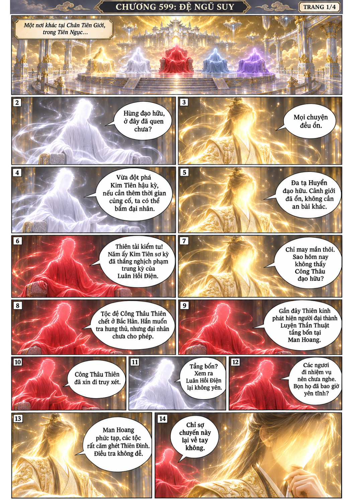
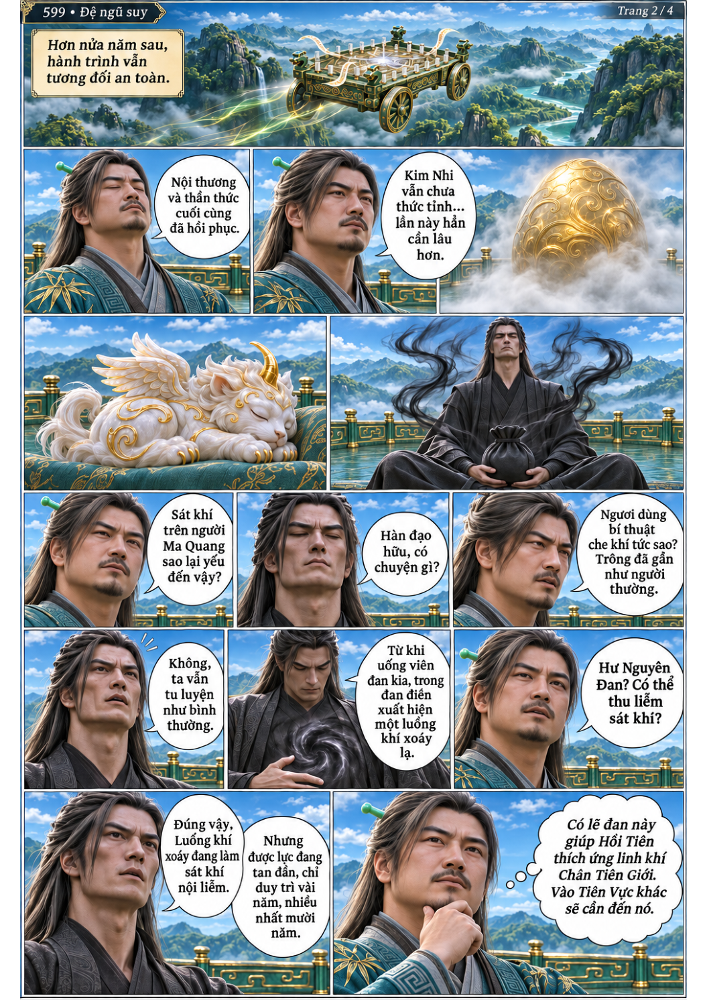
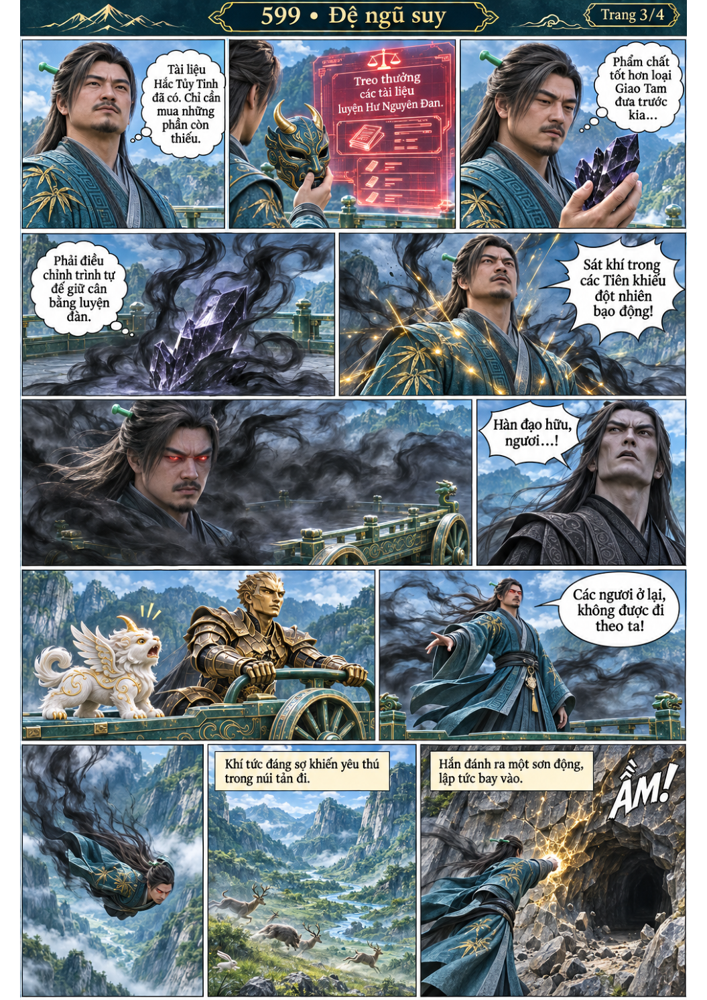
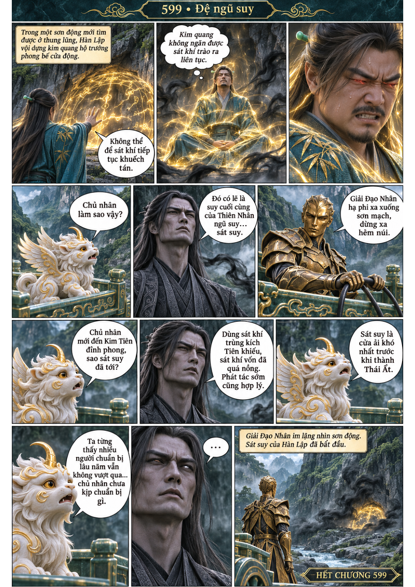

# Chương 599: Đệ ngũ suy

4 trang PNG riêng, tỉ lệ A4 dọc; chuyển thể từ văn bản người dùng đính kèm, có thoại, suy nghĩ và lời dẫn. Dùng model tham chiếu trong bộ nhớ dự án.

[PDF A4](chuong-599.pdf) · [Văn bản nguồn](SOURCE.txt)

Tiên Ngục cử Công Thâu Thiên truy xét Luyện Thần Thuật. Hơn nửa năm sau, nhóm phát hiện tác dụng thu liễm sát khí của Hư Nguyên Đan, rồi Hàn Lập đột ngột gặp sát suy.

