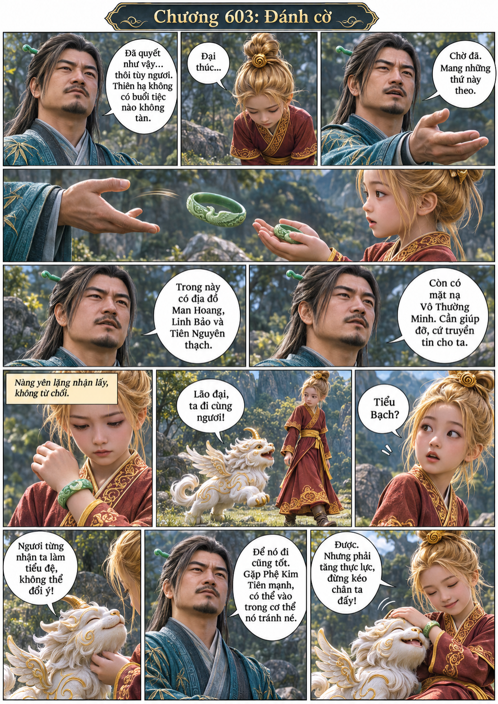
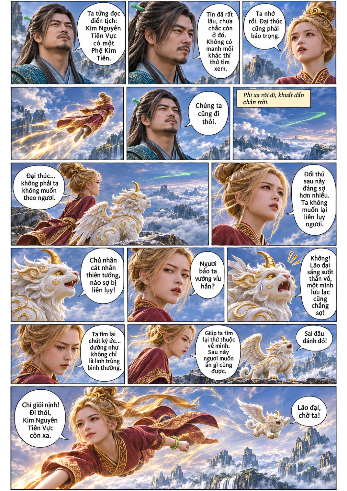
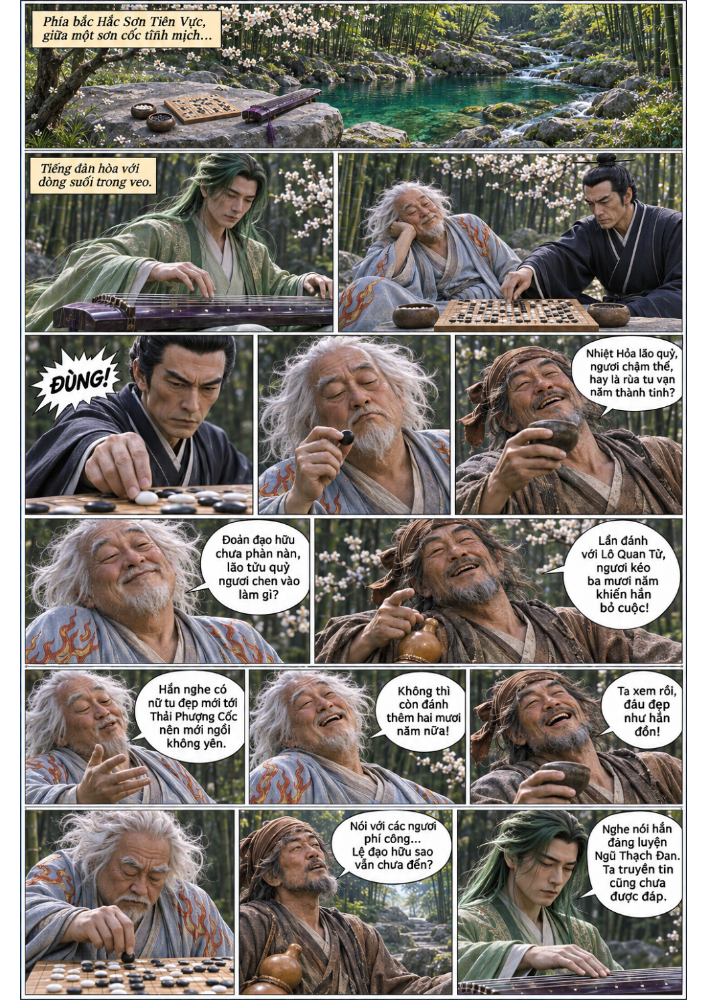
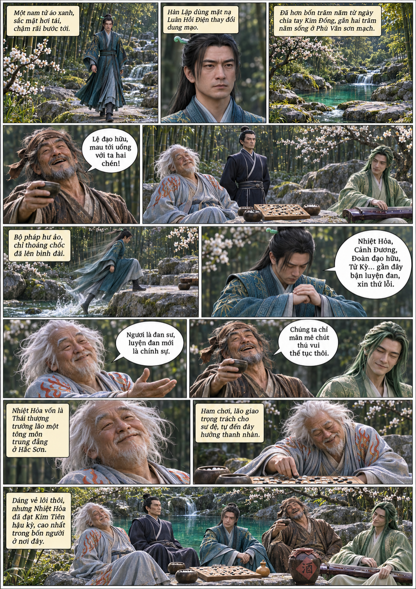

# Chương 603: Đánh cờ

4 trang PNG riêng, tỉ lệ A4 dọc; chuyển thể từ văn bản người dùng đính kèm, có thoại, suy nghĩ và lời dẫn. Dùng model tham chiếu trong bộ nhớ dự án.

[PDF A4](chuong-603.pdf) · [Văn bản nguồn](SOURCE.txt)

Kim Đồng cùng Tiểu Bạch rời Hàn Lập tìm Kim Nguyên Tiên Vực. Hơn bốn trăm năm sau, Hàn Lập dùng dung mạo mới gặp bốn người bạn đánh cờ tại Dã Hạc cốc.

