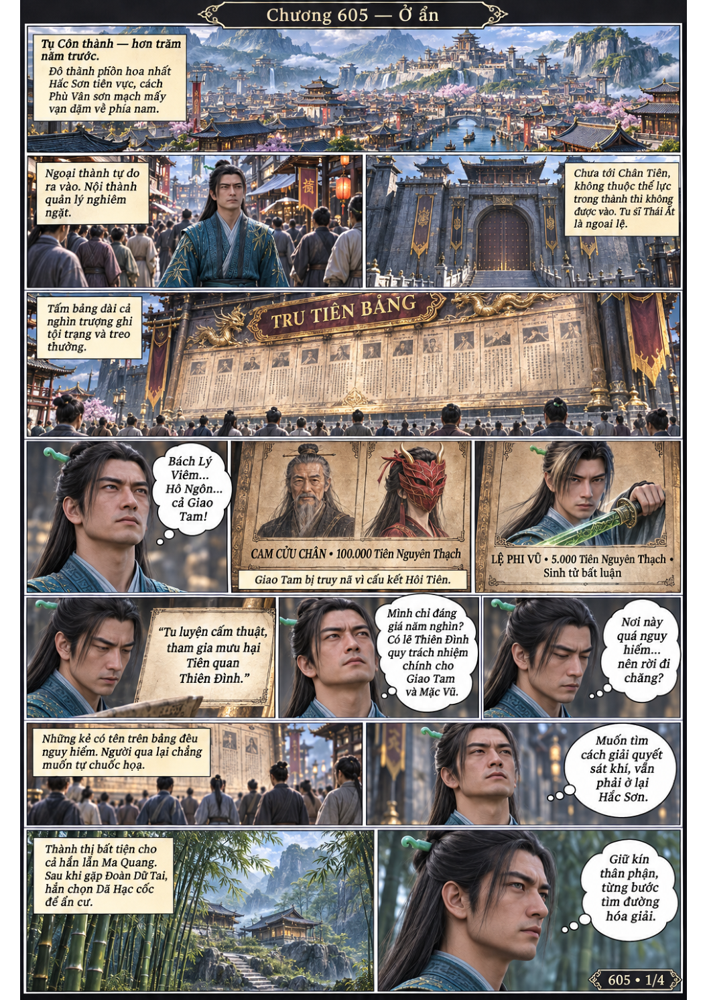
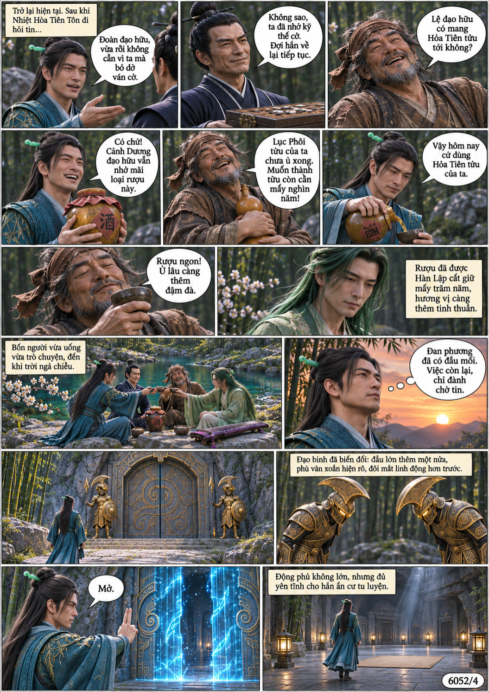
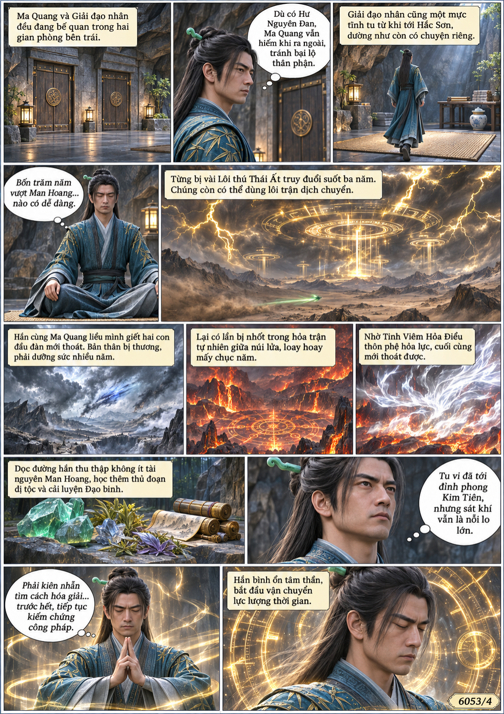
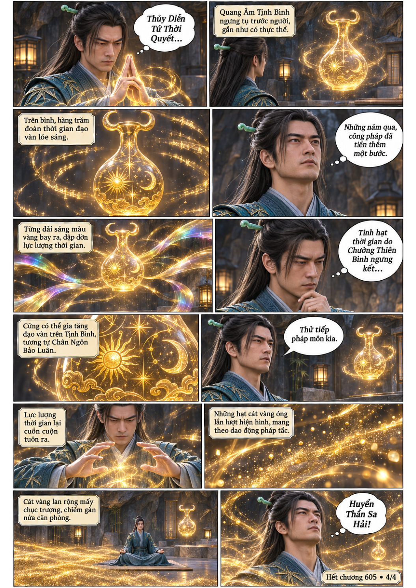

# Chương 605: Ở ẩn

4 trang PNG riêng, tỉ lệ A4 dọc; chuyển thể từ văn bản người dùng đính kèm, có thoại, suy nghĩ và lời dẫn. Dùng model tham chiếu trong bộ nhớ dự án.

[PDF A4](chuong-605.pdf) · [Văn bản nguồn](SOURCE.txt)

Hàn Lập hồi tưởng lệnh truy nã ở Tụ Côn, trở về động phủ sau cuộc tụ họp và thử Quang Âm Tịnh Bình, Huyễn Thần Sa Hải.

