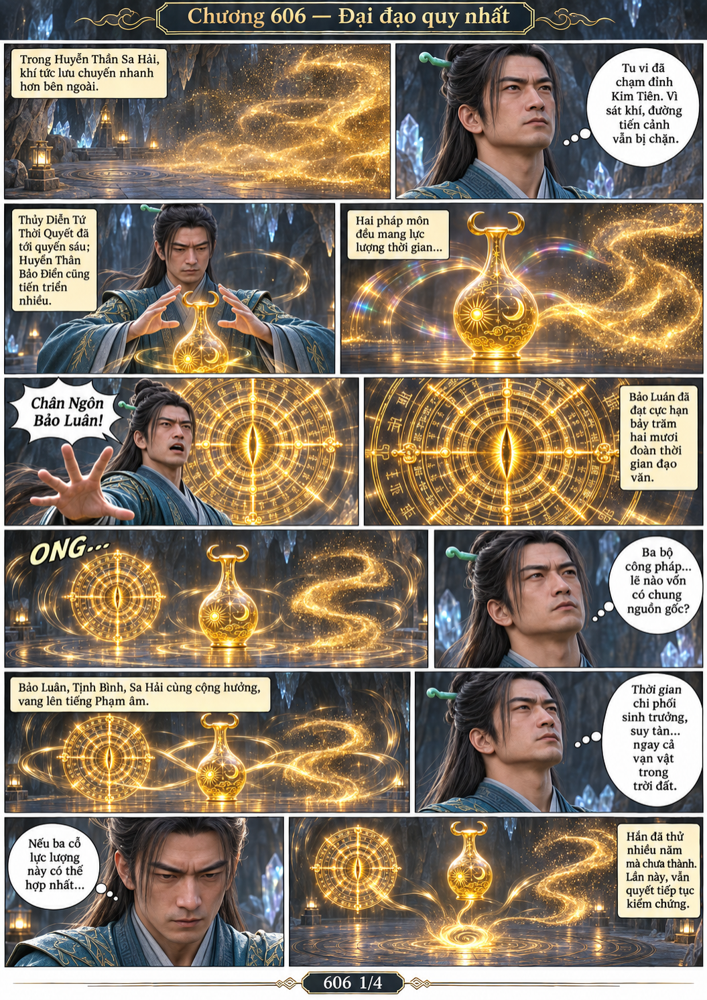
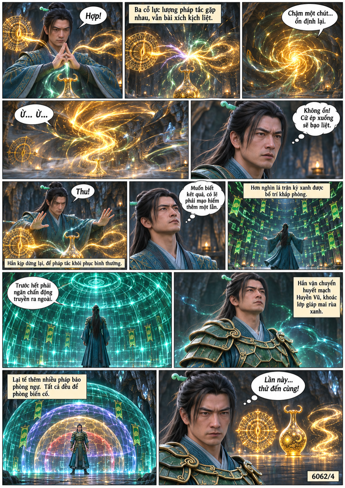
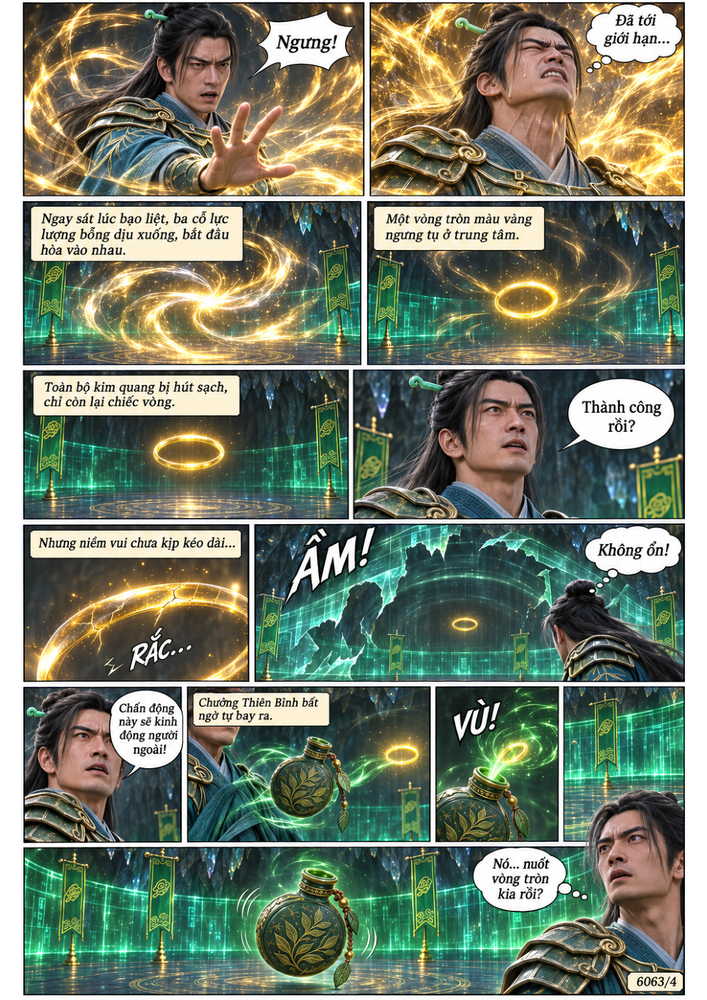
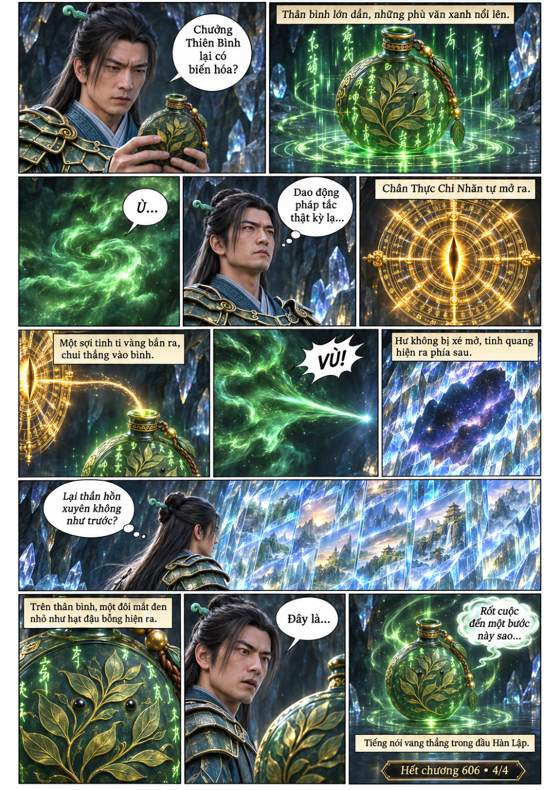

# Chương 606: Đại đạo quy nhất

4 trang PNG riêng, tỉ lệ A4 dọc; chuyển thể từ văn bản người dùng đính kèm, có thoại, suy nghĩ và lời dẫn. Dùng model tham chiếu trong bộ nhớ dự án.

[PDF A4](chuong-606.pdf) · [Văn bản nguồn](SOURCE.txt)

Hàn Lập thử hợp nhất ba biểu hiện thời gian. Vòng vàng bất ổn được Chưởng Thiên Bình hút vào, mở ra tinh bích và tiếng nói của bình linh.

