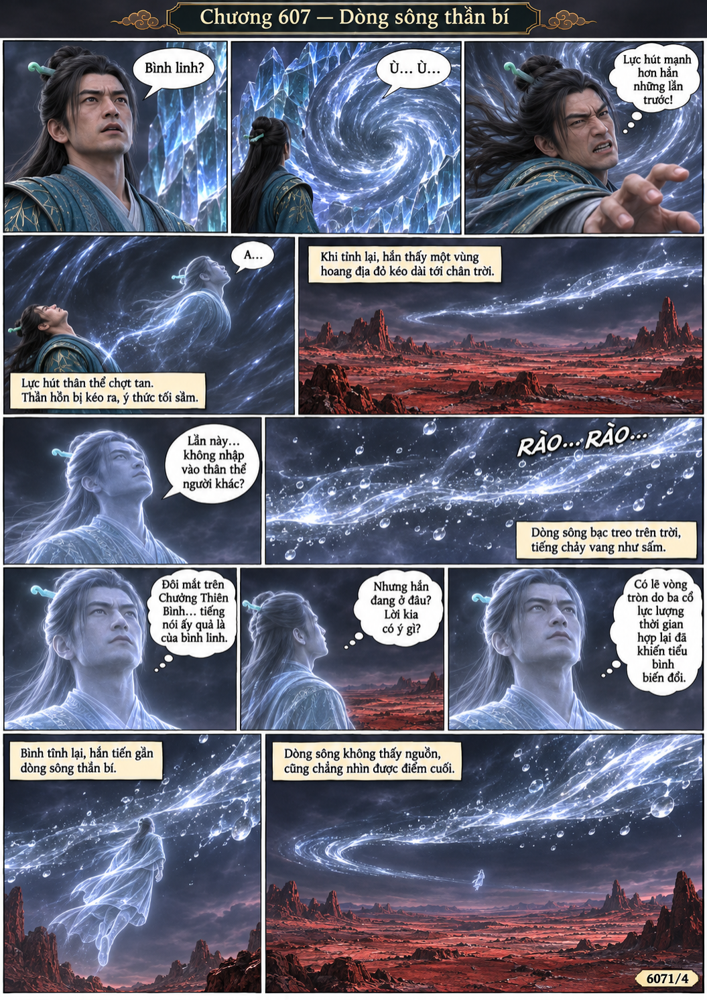
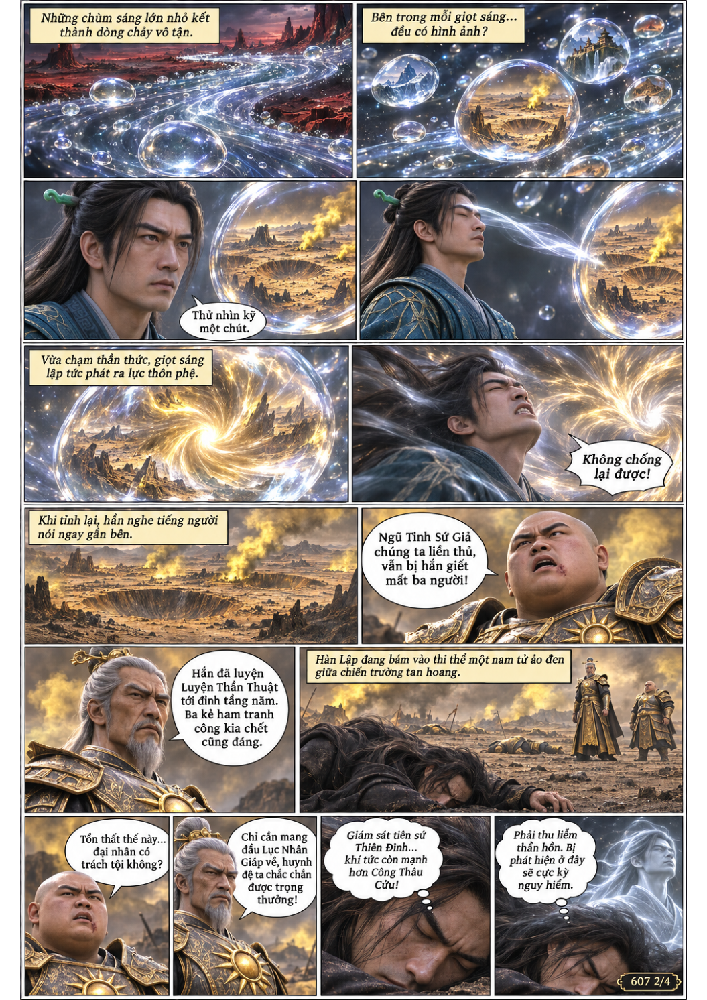
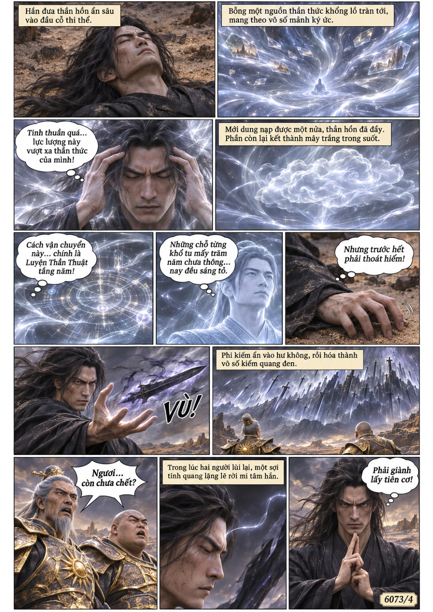
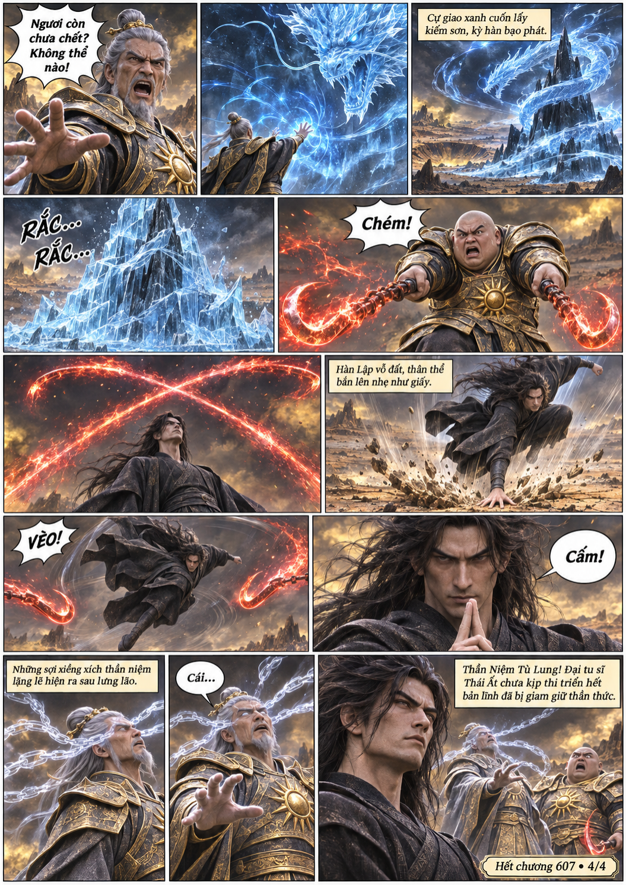

# Chương 607: Dòng sông thần bí

4 trang PNG riêng, tỉ lệ A4 dọc; chuyển thể từ văn bản người dùng đính kèm, có thoại, suy nghĩ và lời dẫn. Dùng model tham chiếu trong bộ nhớ dự án.

[PDF A4](chuong-607.pdf) · [Văn bản nguồn](SOURCE.txt)

Thần hồn Hàn Lập vào dòng sông bạc, bị một giọt sáng kéo tới chiến trường và nhập thi thể Lục Nhân Giáp. Nhờ thần thức lưu lại, hắn khống chế một Giám sát tiên sứ.

