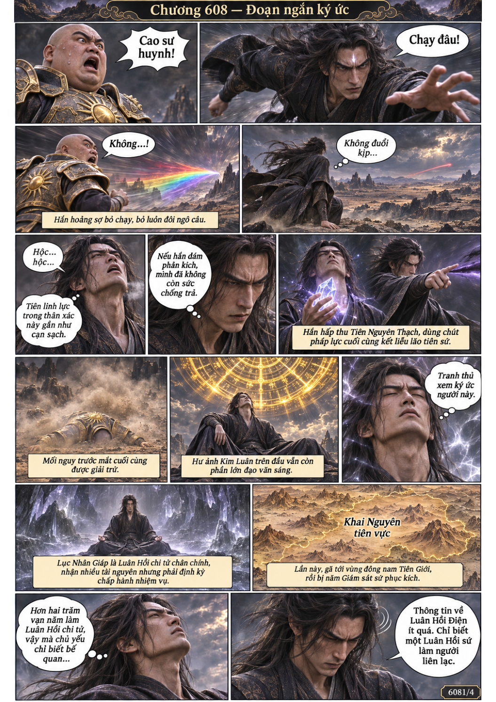
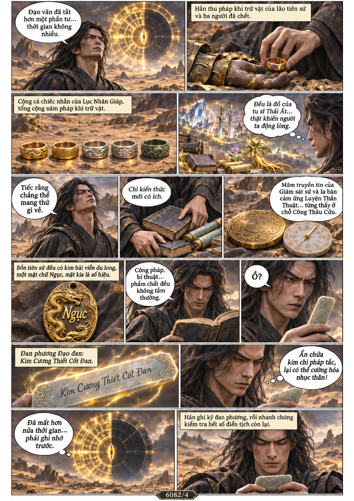
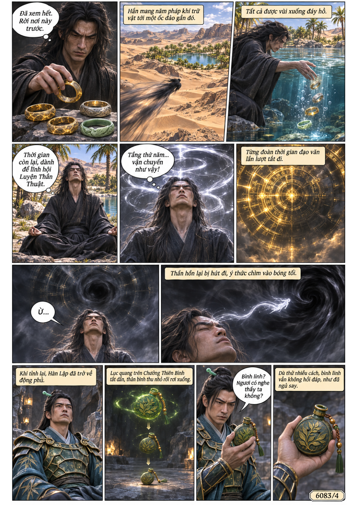
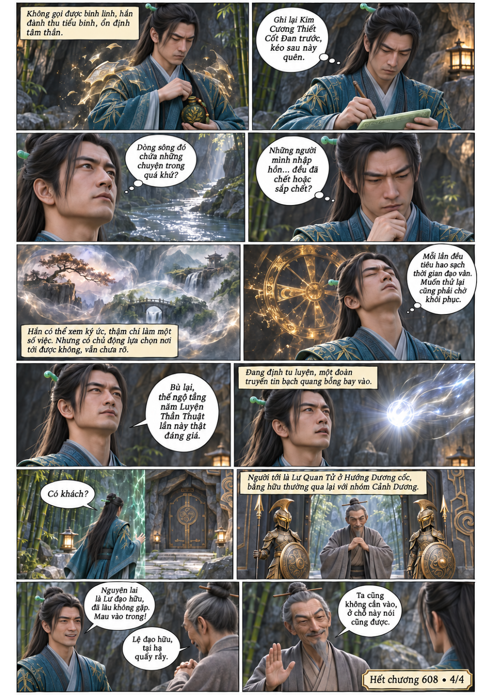

# Chương 608: Đoạn ngắn ký ức

4 trang PNG riêng, tỉ lệ A4 dọc; chuyển thể từ văn bản người dùng đính kèm, có thoại, suy nghĩ và lời dẫn. Dùng model tham chiếu trong bộ nhớ dự án.

[PDF A4](chuong-608.pdf) · [Văn bản nguồn](SOURCE.txt)

Hàn Lập dọa lui tiên sứ, thu được ký ức Luyện Thần Thuật và đan phương Kim Cương Thiết Cốt Đan. Trở về động phủ, hắn gặp Lư Quan Tử.

