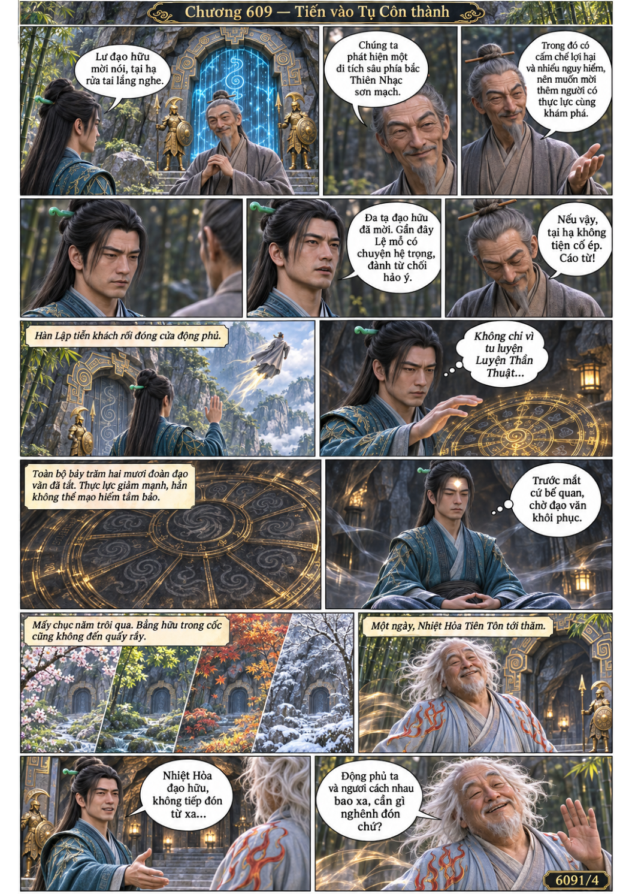
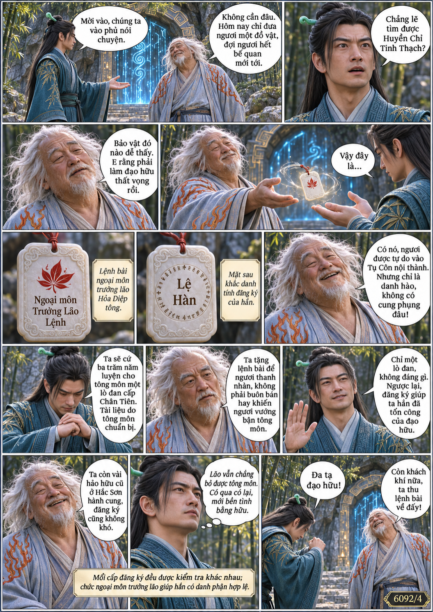
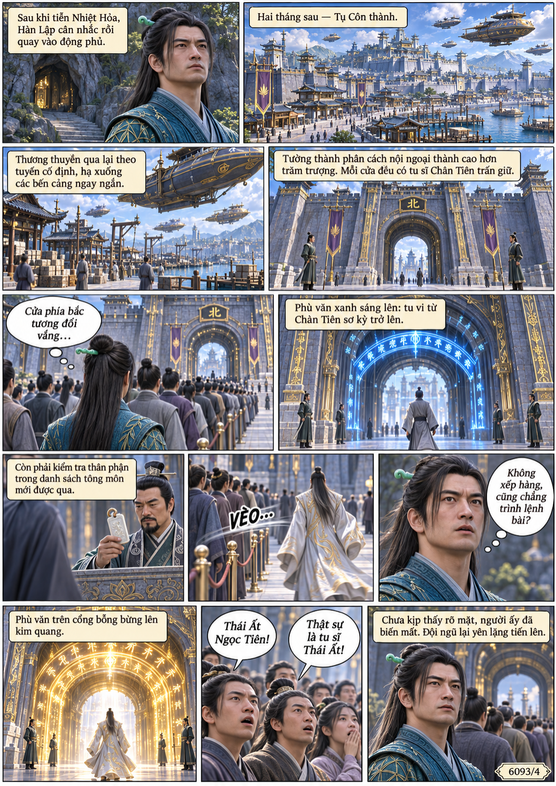
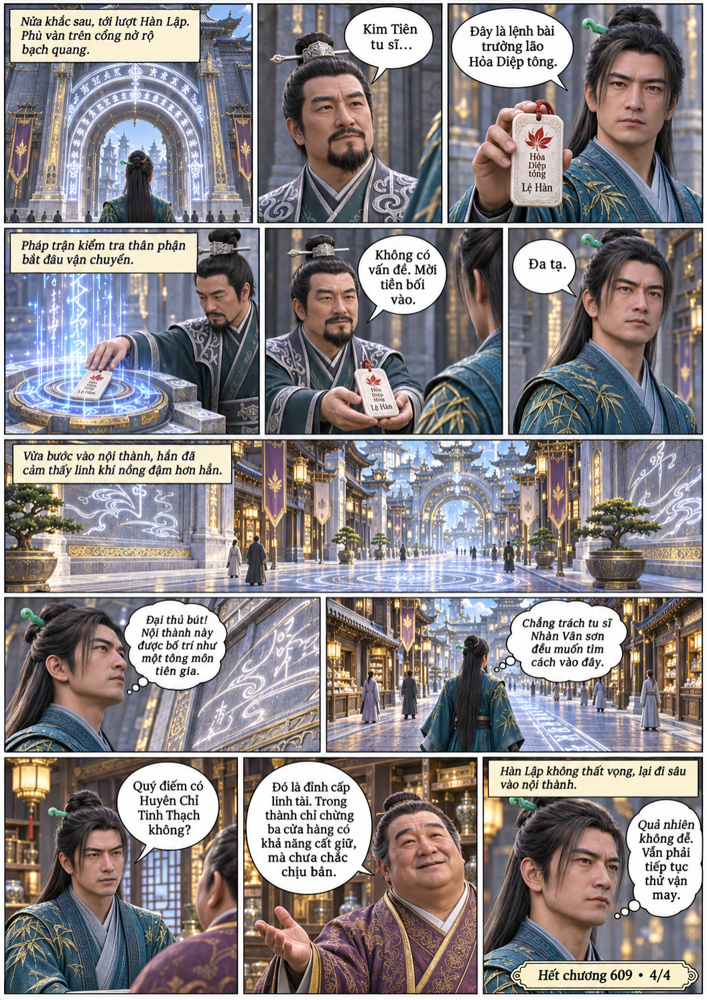

# Chương 609: Tiến vào Tụ Côn thành

4 trang PNG riêng, tỉ lệ A4 dọc; chuyển thể từ văn bản người dùng đính kèm, có thoại, suy nghĩ và lời dẫn. Dùng model tham chiếu trong bộ nhớ dự án.

[PDF A4](chuong-609.pdf) · [Văn bản nguồn](SOURCE.txt)

Hàn Lập từ chối thám hiểm khi đạo văn chưa hồi phục. Nhờ lệnh trưởng lão Hỏa Diệp tông, hắn vào Tụ Côn nội thành tìm Huyền Chỉ Tinh Thạch.

