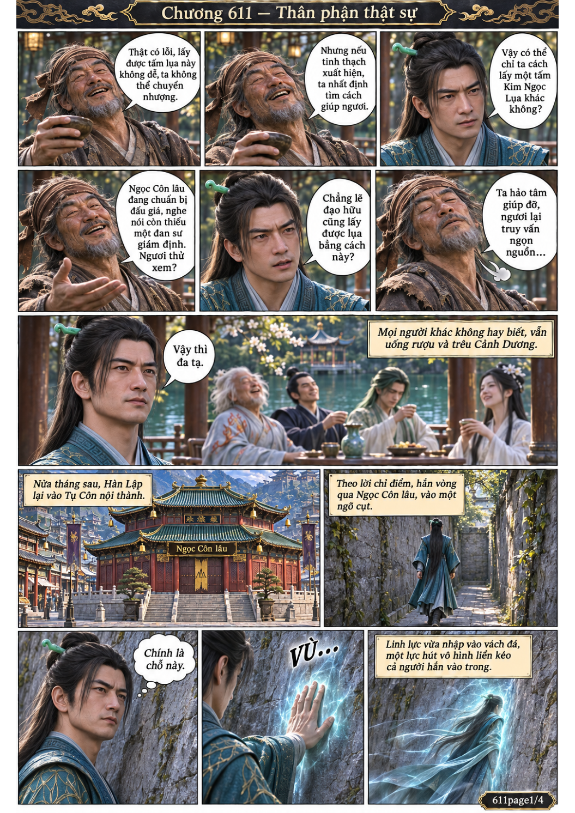
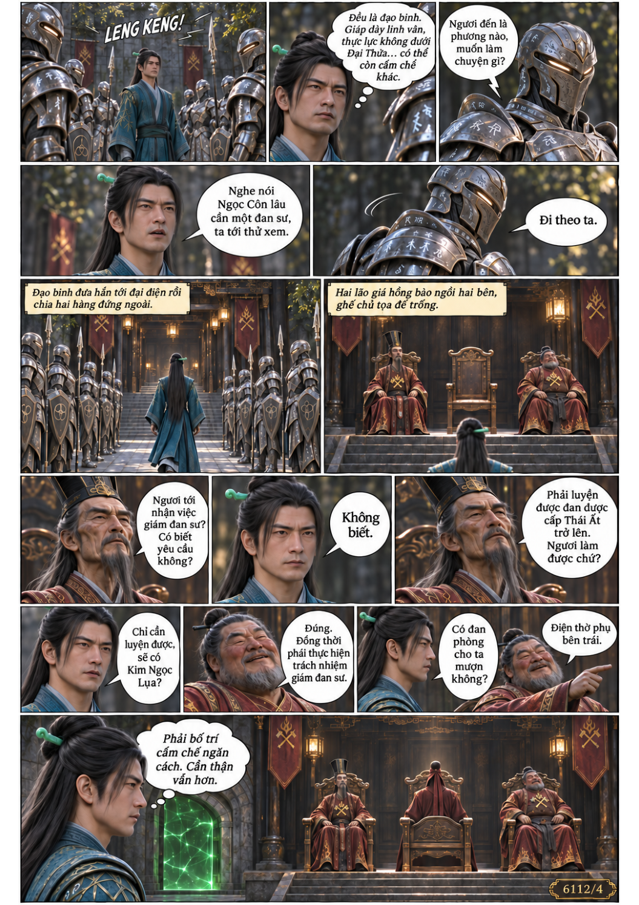
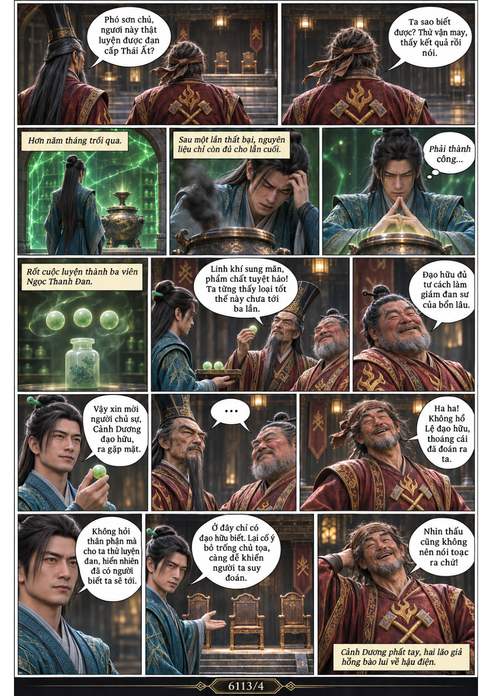
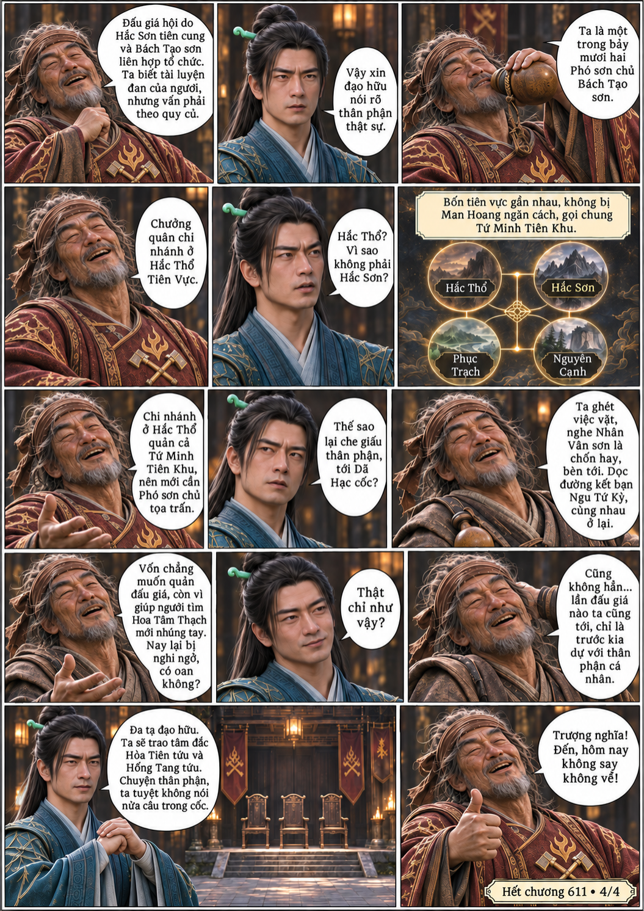

# Chương 611: Thân phận thật sự

4 trang PNG riêng, tỉ lệ A4 dọc; chuyển thể từ văn bản người dùng đính kèm, có thoại, suy nghĩ và lời dẫn. Dùng model tham chiếu trong bộ nhớ dự án.

[PDF A4](chuong-611.pdf) · [Văn bản nguồn](SOURCE.txt)

Hàn Lập luyện thành Ngọc Thanh Đan để nhận việc giám đan sư, rồi nhận ra Cảnh Dương là người chủ sự và Phó sơn chủ Bách Tạo sơn.

