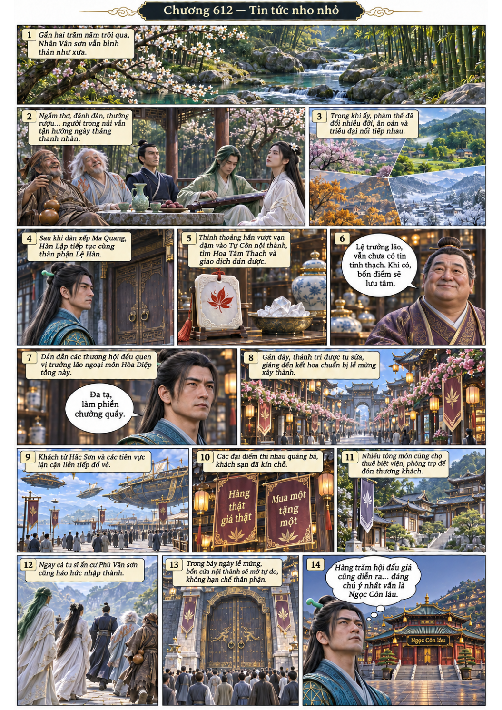
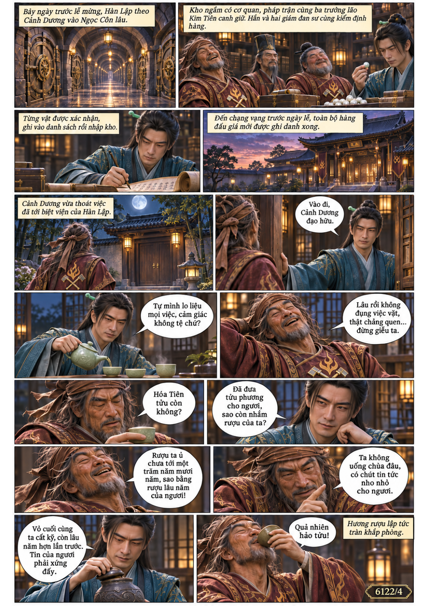
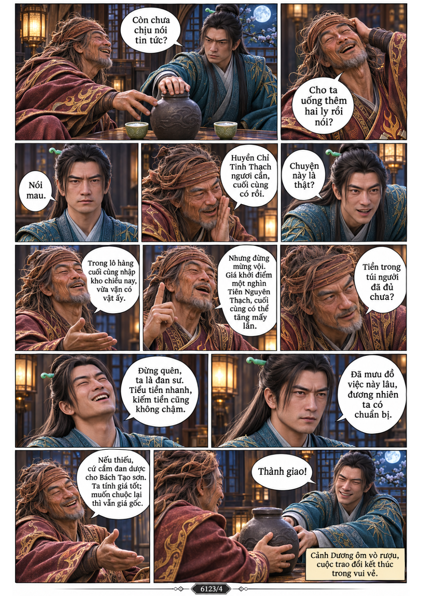
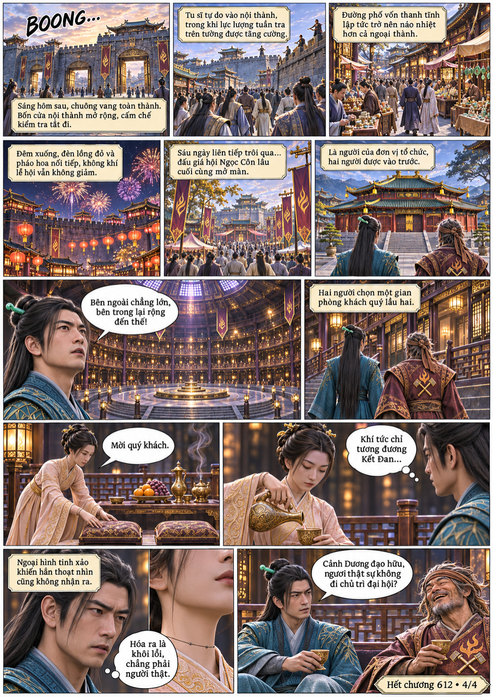

# Chương 612: Tin tức nho nhỏ

4 trang PNG riêng, tỉ lệ A4 dọc; chuyển thể từ văn bản người dùng đính kèm, có thoại, suy nghĩ và lời dẫn. Dùng model tham chiếu trong bộ nhớ dự án.

[PDF A4](chuong-612.pdf) · [Văn bản nguồn](SOURCE.txt)

Gần hai trăm năm sau, Hàn Lập tham gia giám định hàng ở Ngọc Côn lâu. Cảnh Dương báo Hoa Tâm Thạch đã tới; hai người vào phòng khách quý chờ đấu giá.

