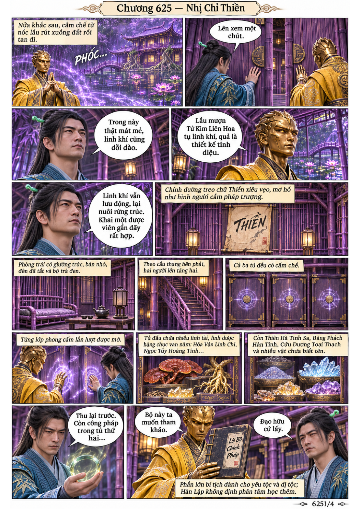
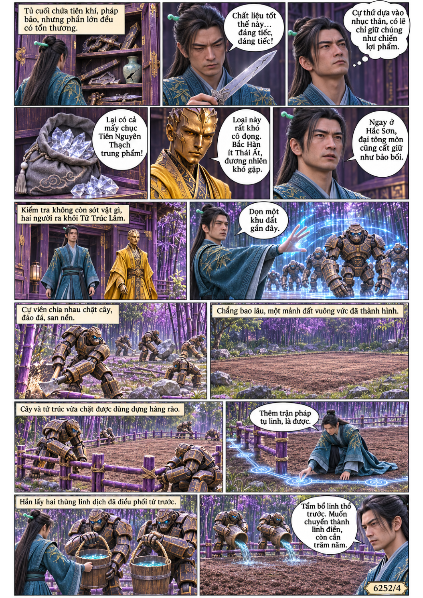
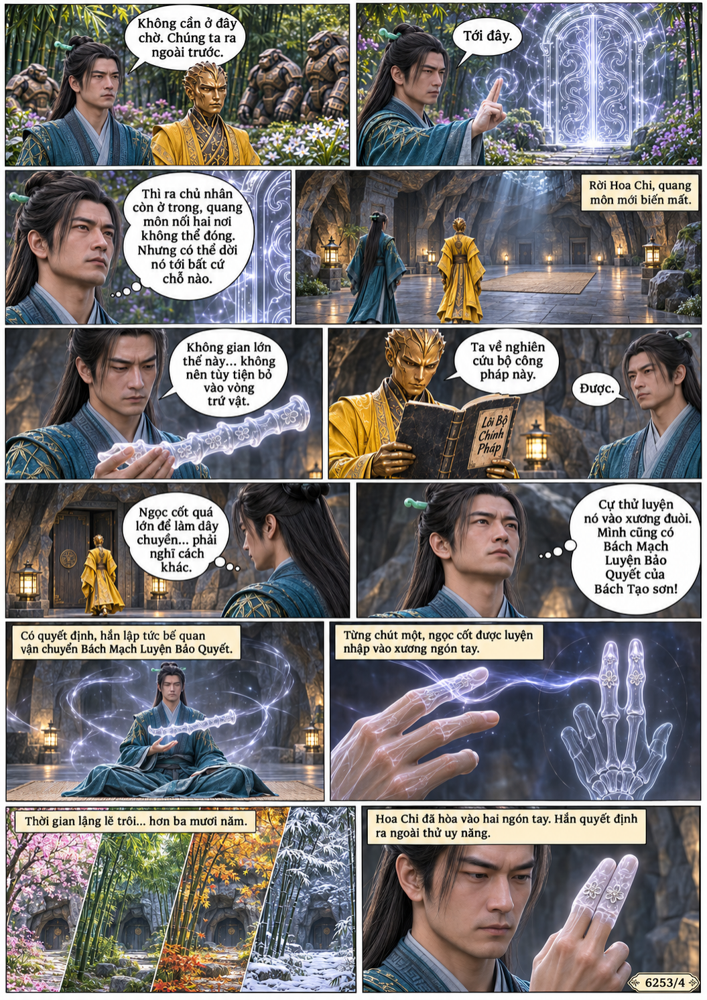
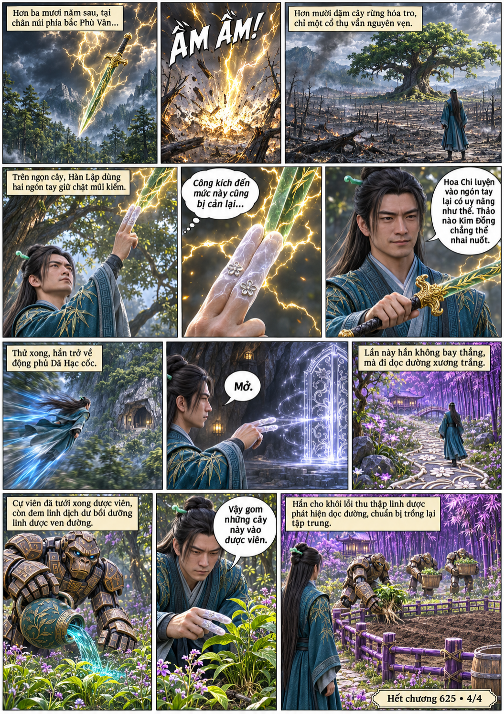

# Chương 625: Nhị Chỉ Thiền

4 trang PNG riêng, tỉ lệ A4 dọc; chuyển thể từ văn bản người dùng đính kèm, có thoại, suy nghĩ và lời dẫn. Dùng model tham chiếu trong bộ nhớ dự án.

[PDF A4](chuong-625.pdf) · [Văn bản nguồn](SOURCE.txt)

Hai người thu tài vật trong lầu tử trúc và dựng dược viên. Sau hơn ba mươi năm, Hàn Lập luyện Hoa Chi vào hai ngón tay, thử sức phòng ngự rồi quay lại chăm linh dược.

