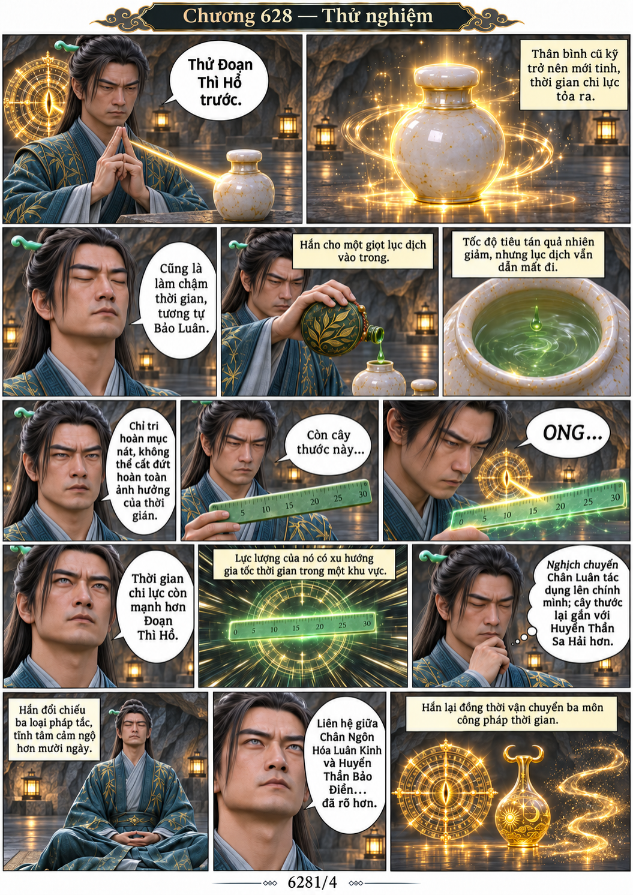
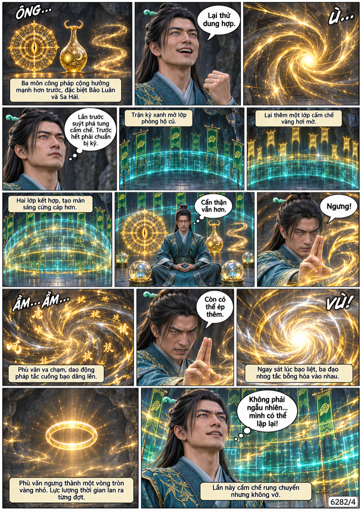
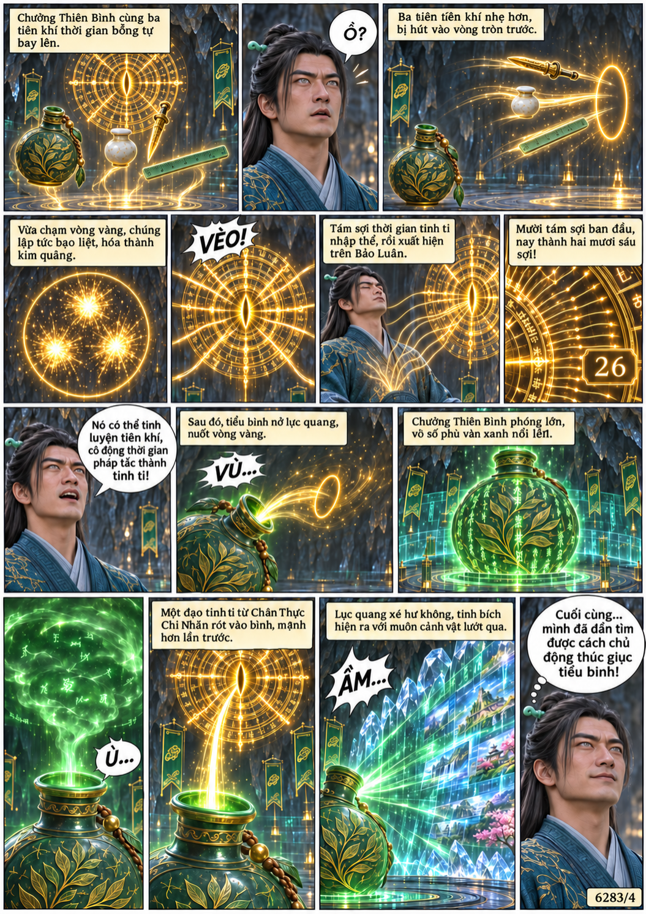
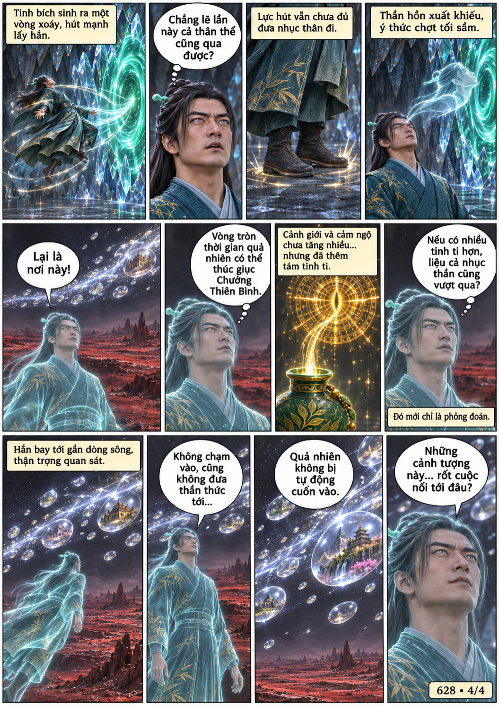

# Chương 628: Thử nghiệm

4 trang PNG riêng, tỉ lệ A4 dọc; chuyển thể từ văn bản người dùng đính kèm, có thoại, suy nghĩ và lời dẫn. Dùng model tham chiếu trong bộ nhớ dự án.

[PDF A4](chuong-628.pdf) · [Văn bản nguồn](SOURCE.txt)

Hàn Lập thử ba pháp khí thời gian, tái tạo vòng vàng và chủ động thúc giục Chưởng Thiên Bình. Tám tinh ti mới xuất hiện; thần hồn lại tới dòng sông vạn cảnh.

