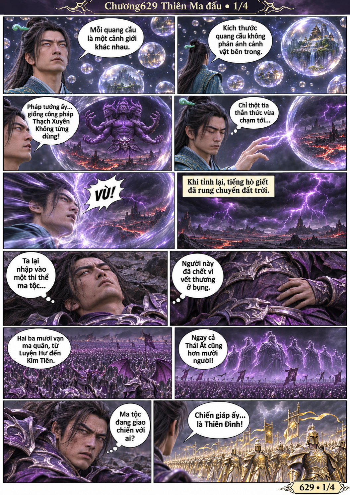
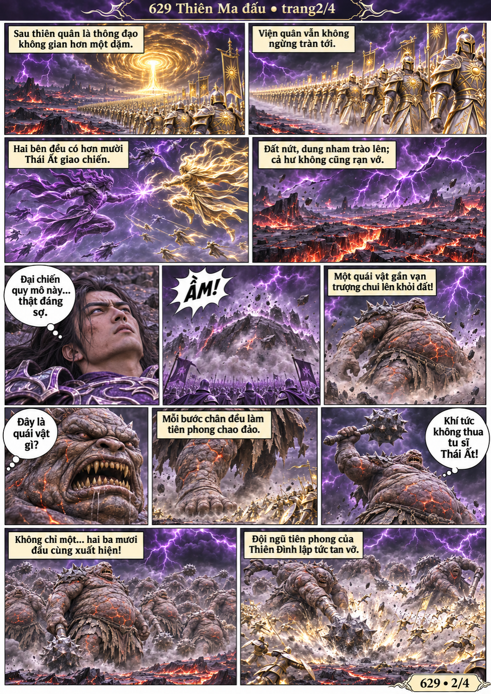
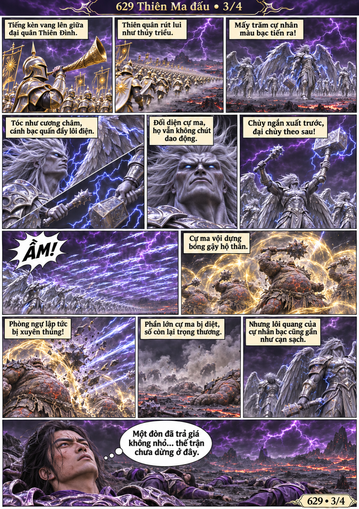
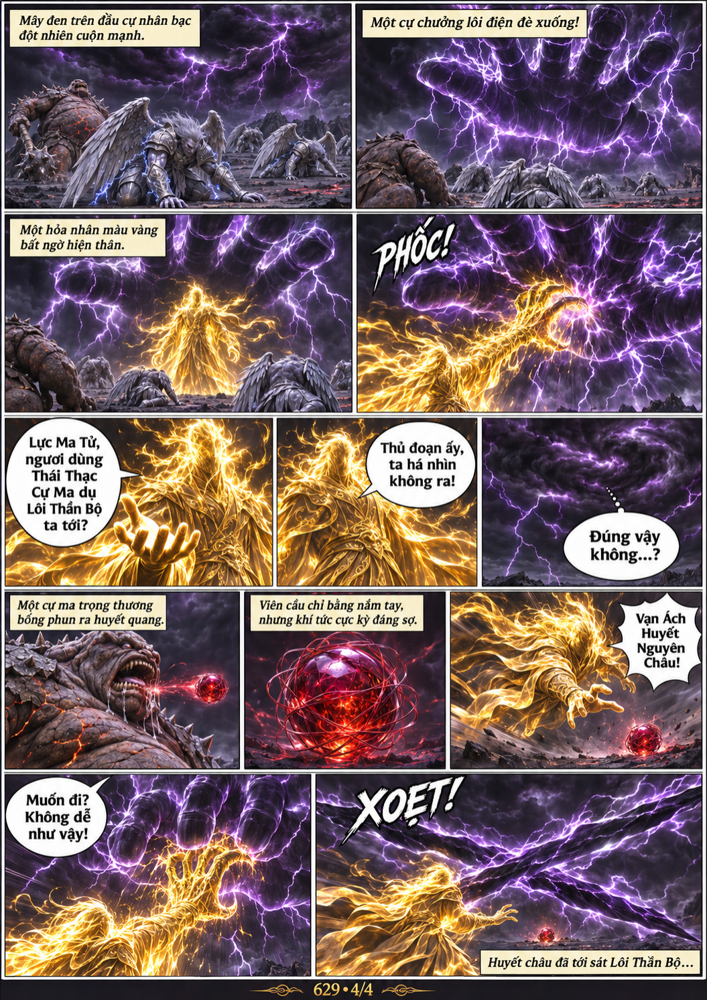

# Chương 629: Thiên Ma đấu

4 trang PNG riêng, tỉ lệ A4 dọc; chuyển thể từ văn bản người dùng đính kèm, có thoại, suy nghĩ và lời dẫn. Dùng model tham chiếu trong bộ nhớ dự án.

[PDF A4](chuong-629.pdf) · [Văn bản nguồn](SOURCE.txt)

Thần hồn Hàn Lập nhập vào thi thể ma tộc giữa đại chiến với Thiên Đình, chứng kiến Thái Thạc Cự Ma và Lôi Thần Bộ giao chiến cùng một cạm bẫy huyết châu.

