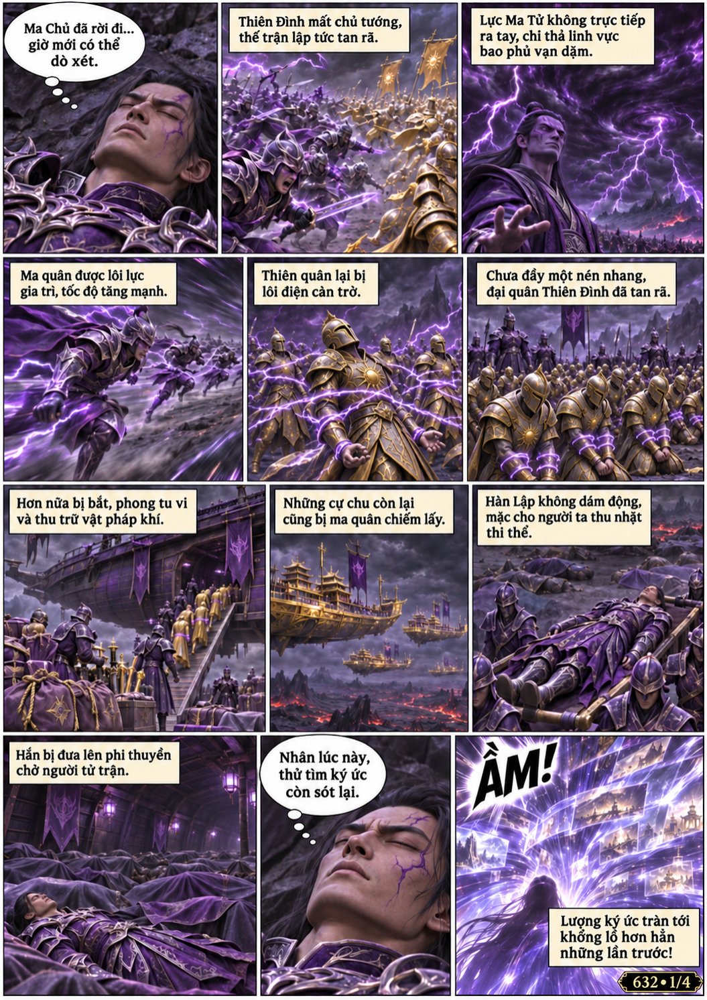
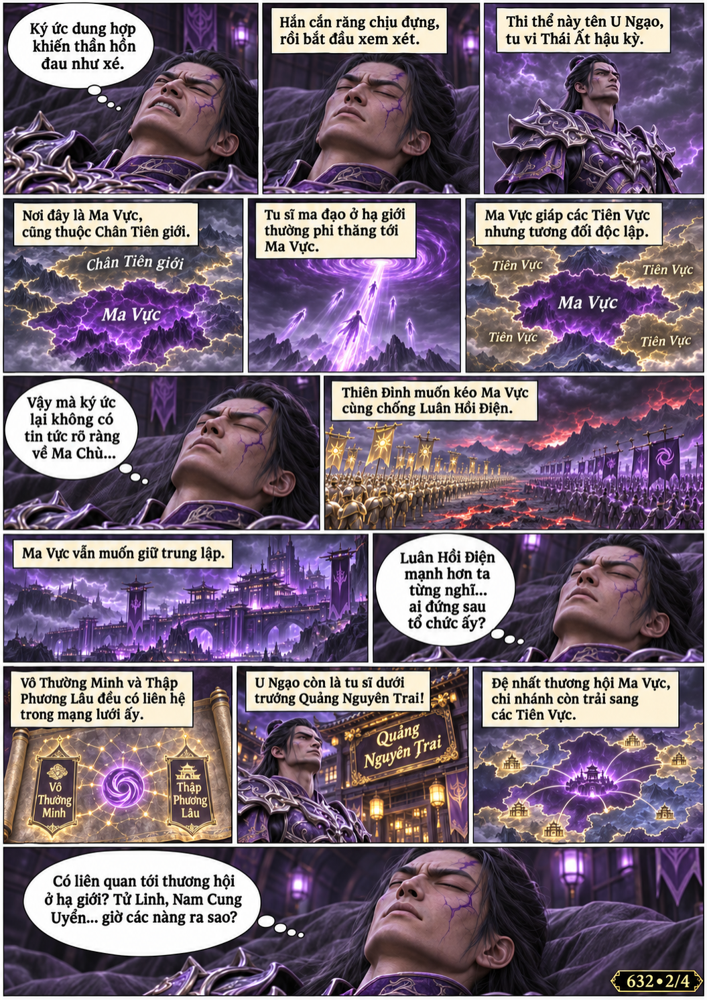
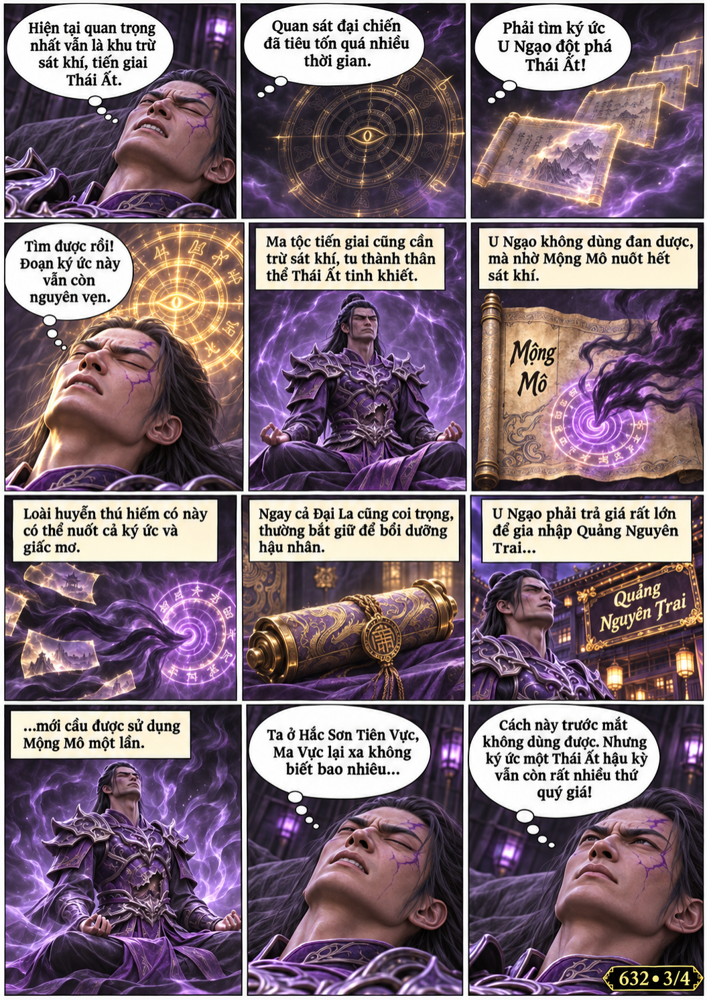
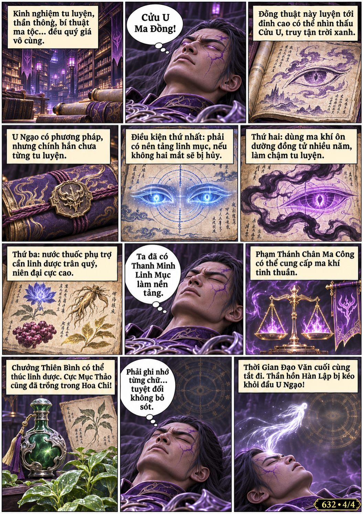

# Chương 632: Ma vực

4 trang PNG riêng, tỉ lệ A4 dọc; chuyển thể từ văn bản người dùng đính kèm, có thoại, suy nghĩ và lời dẫn. Dùng model tham chiếu trong bộ nhớ dự án.

[PDF A4](chuong-632.pdf) · [Văn bản nguồn](SOURCE.txt)

Ký ức thi thể hé lộ thân phận U Ngạo, tình thế Ma Vực, Quảng Nguyên Trai và phương pháp nhờ Mộng Mô trừ sát khí. Hàn Lập ghi nhớ Cửu U Ma Đồng trước khi thần hồn bị kéo về.

