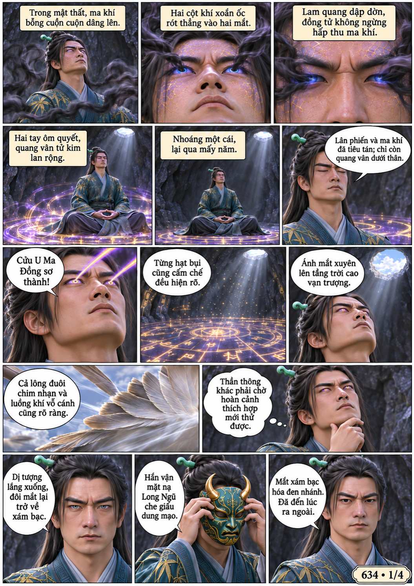
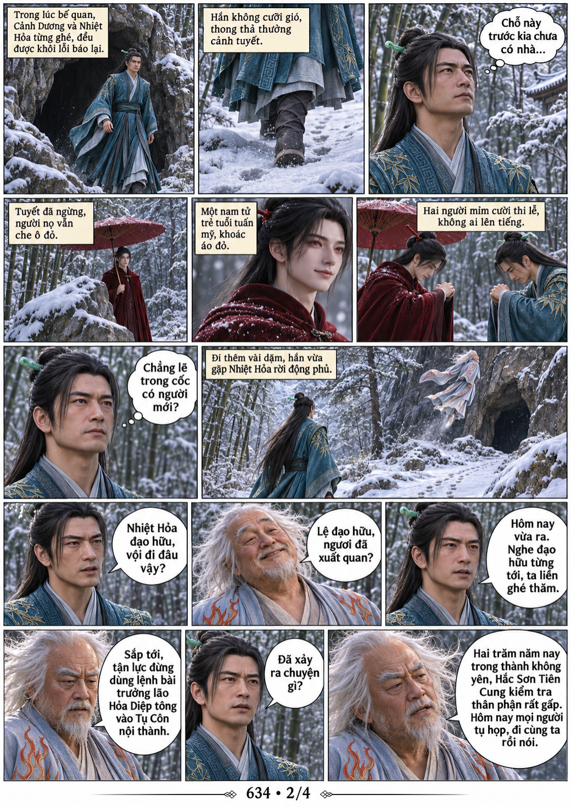
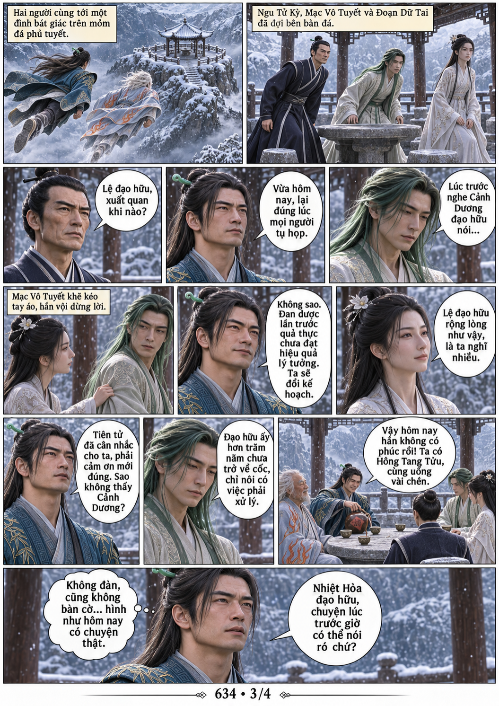
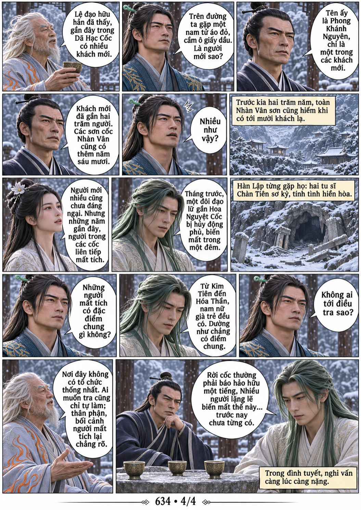

# Chương 634: Sự tình kỳ lạ

4 trang PNG riêng, tỉ lệ A4 dọc; chuyển thể từ văn bản người dùng đính kèm, có thoại, suy nghĩ và lời dẫn. Dùng model tham chiếu trong bộ nhớ dự án.

[PDF A4](chuong-634.pdf) · [Văn bản nguồn](SOURCE.txt)

Cửu U Ma Đồng sơ thành, Hàn Lập che giấu đôi mắt xám bạc rồi xuất quan. Trong mùa tuyết Dã Hạc Cốc, hắn gặp Phong Khánh Nguyên và nghe bằng hữu kể về người mới cùng những vụ mất tích kỳ lạ.

