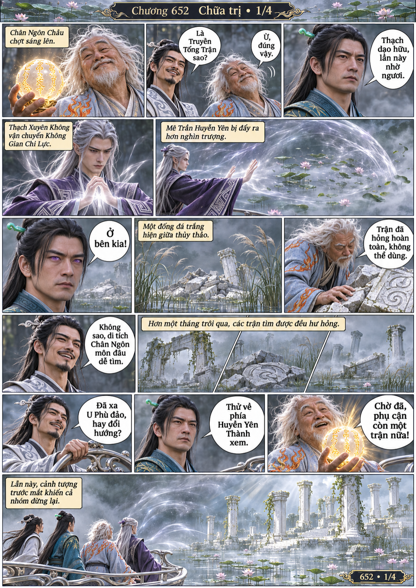
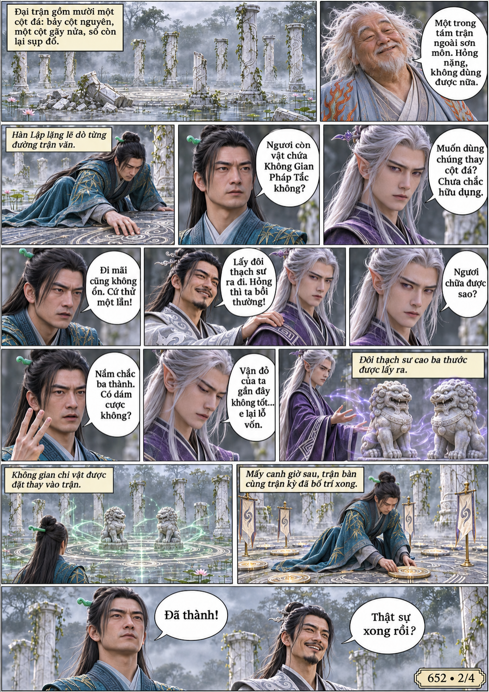
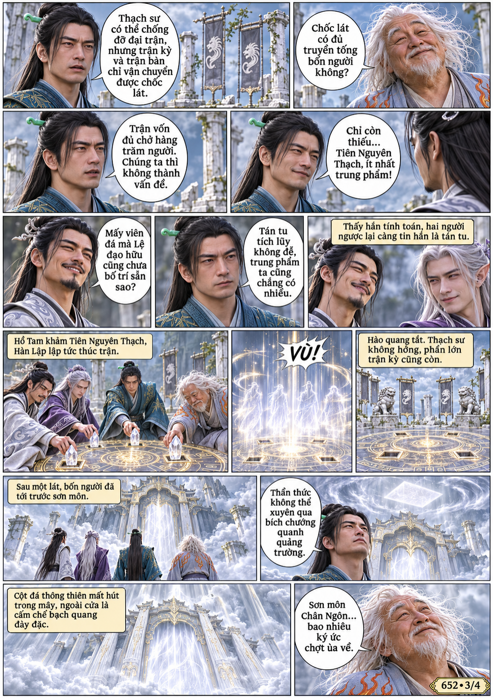
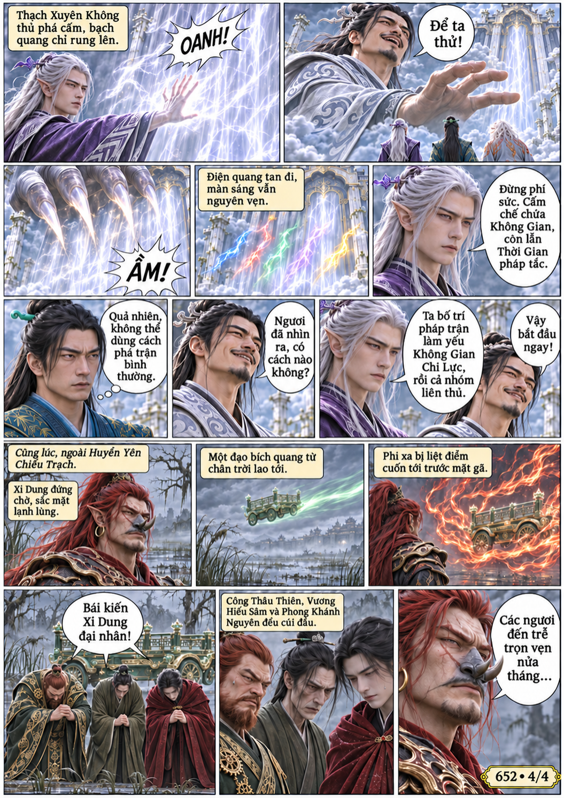

# Chương 652: Chữa trị

4 trang PNG riêng, tỉ lệ A4 dọc; chuyển thể từ văn bản người dùng đính kèm, có thoại, suy nghĩ và lời dẫn. Dùng model tham chiếu trong bộ nhớ dự án.

[PDF A4](chuong-652.pdf) · [Văn bản nguồn](SOURCE.txt)

Nhóm Hàn Lập sửa truyền tống trận bằng đôi thạch sư, tới sơn môn Chân Ngôn nhưng gặp cấm chế thời gian và không gian. Ngoài đầm lầy, Xi Dung đang chờ Công Thâu Thiên cùng đồng bọn.

