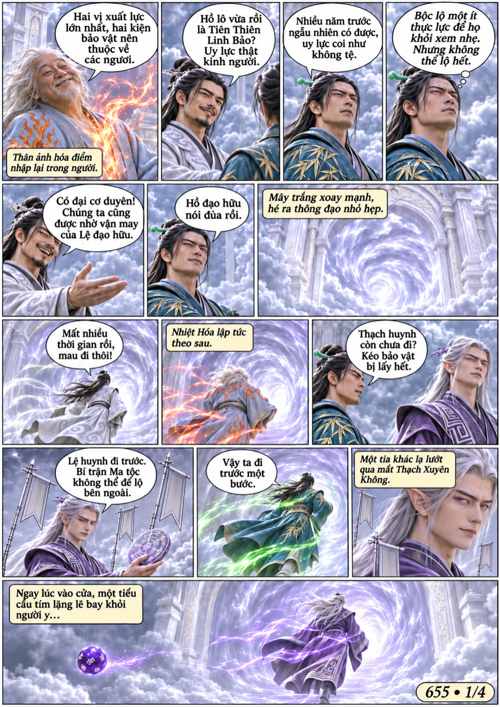
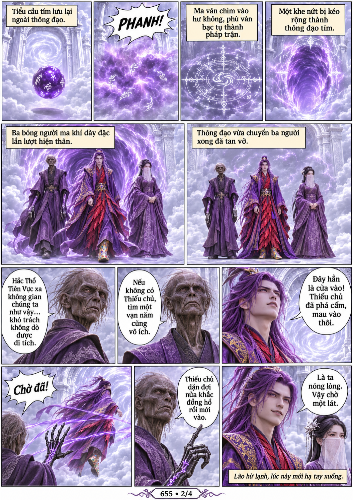
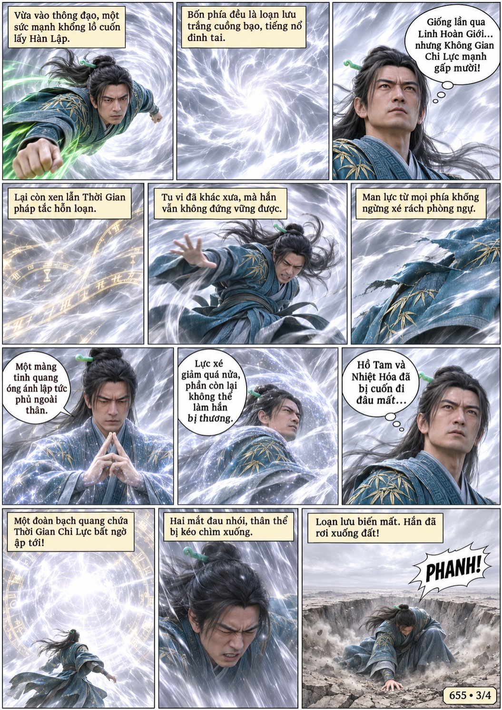
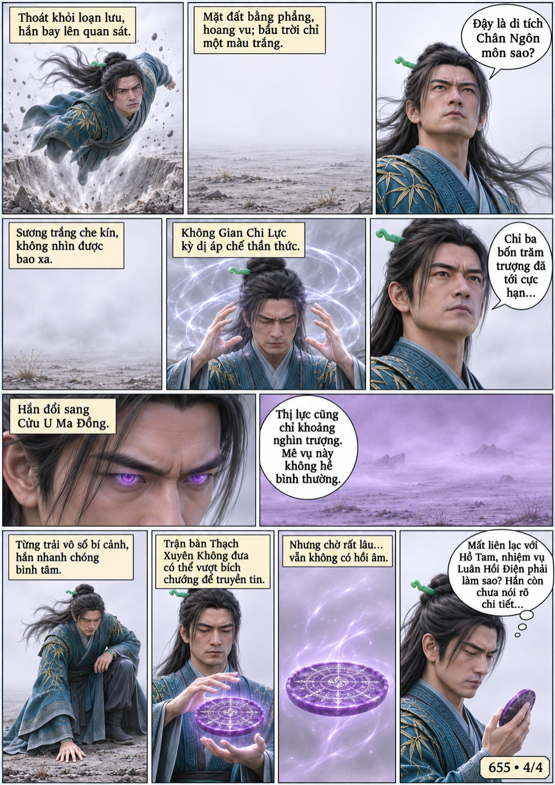

# Chương 655: Loạn lưu

4 trang PNG riêng, tỉ lệ A4 dọc; chuyển thể từ văn bản người dùng đính kèm, có thoại, suy nghĩ và lời dẫn. Dùng model tham chiếu trong bộ nhớ dự án.

[PDF A4](chuong-655.pdf) · [Văn bản nguồn](SOURCE.txt)

Nhóm đi vào di tích; Thạch Xuyên Không để lại tiểu cầu mở đường cho ba người Ma tộc. Hàn Lập bị loạn lưu chia cắt, đến bình nguyên mù trắng và không thể liên lạc đồng hành.

