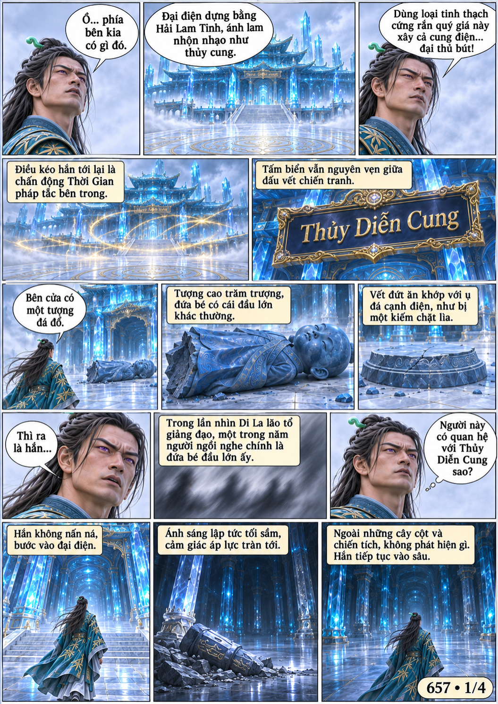
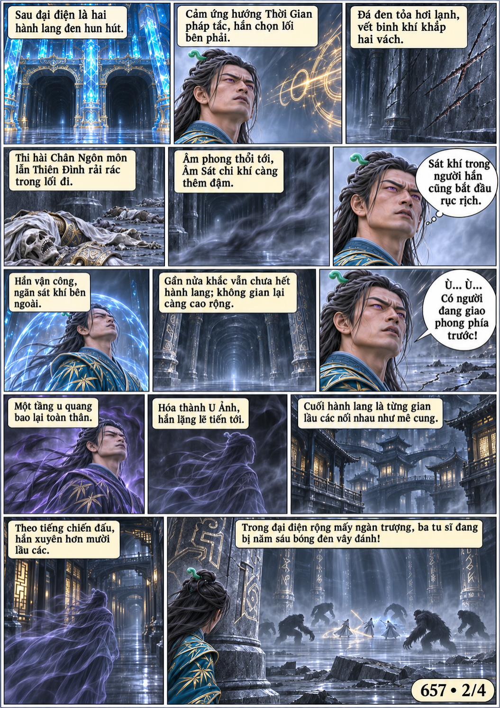
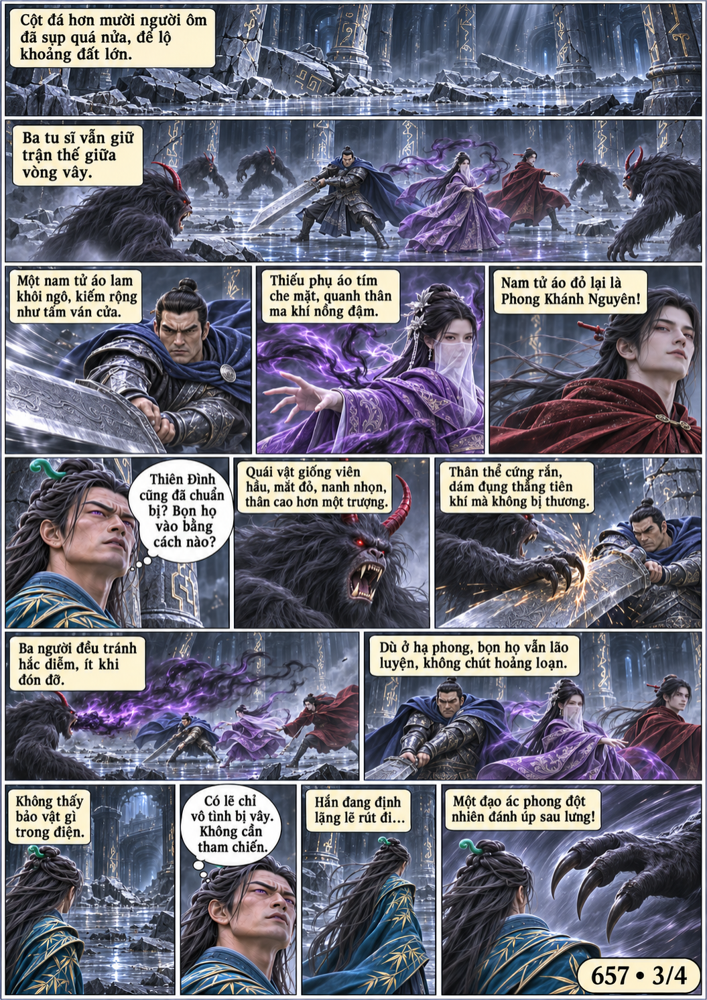
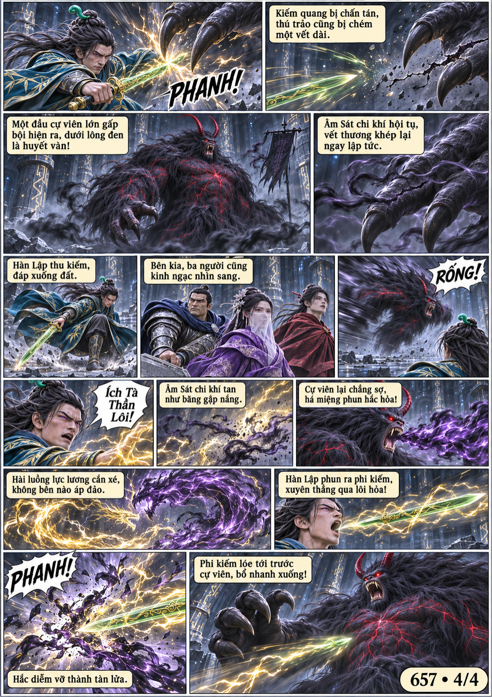

# Chương 657: Kịch đấu Thủy Diễn Cung

4 trang PNG riêng, tỉ lệ A4 dọc; chuyển thể từ văn bản người dùng đính kèm, có thoại, suy nghĩ và lời dẫn. Dùng model tham chiếu trong bộ nhớ dự án.

[PDF A4](chuong-657.pdf) · [Văn bản nguồn](SOURCE.txt)

Hàn Lập tìm tới Thủy Diễn Cung theo chấn động thời gian. Trong điện sâu, hắn gặp ba tu sĩ bị quỷ viên vây đánh, rồi bất ngờ bị cự viên huyết văn tập kích.

