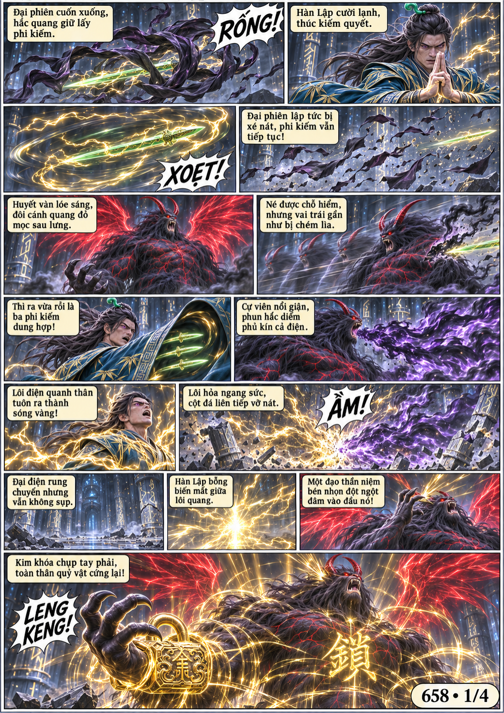
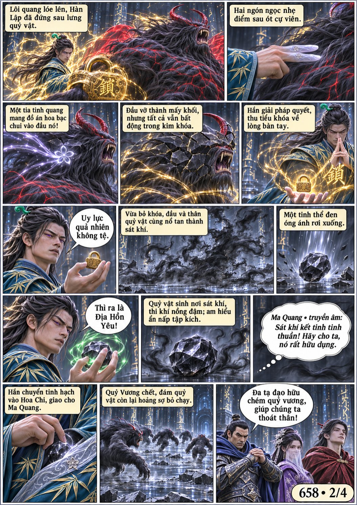
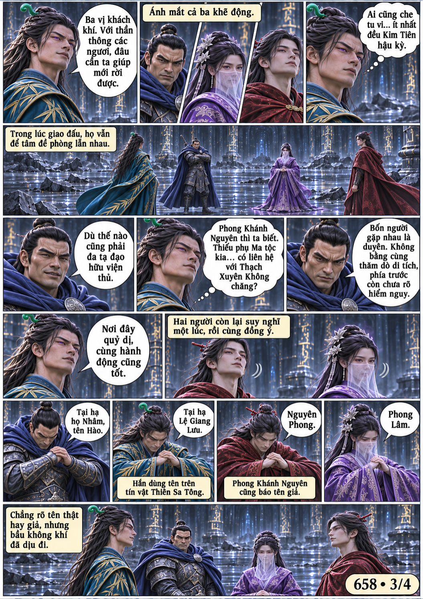
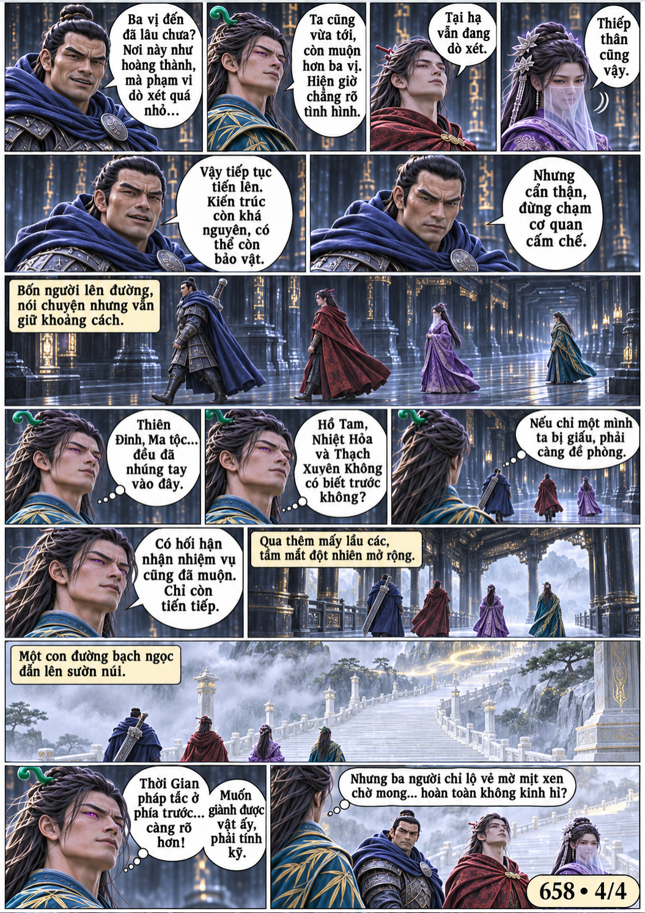

# Chương 658: Bốn người đi

4 trang PNG riêng, tỉ lệ A4 dọc; chuyển thể từ văn bản người dùng đính kèm, có thoại, suy nghĩ và lời dẫn. Dùng model tham chiếu trong bộ nhớ dự án.

[PDF A4](chuong-658.pdf) · [Văn bản nguồn](SOURCE.txt)

Hàn Lập diệt Địa Hồn Quỷ Vương bằng kim khóa và Nhị Chỉ, giao tinh hạch cho Ma Quang. Hắn cùng ba tu sĩ kết bạn, tự xưng Lệ Giang Lưu, rồi đi về phía có chấn động thời gian.

