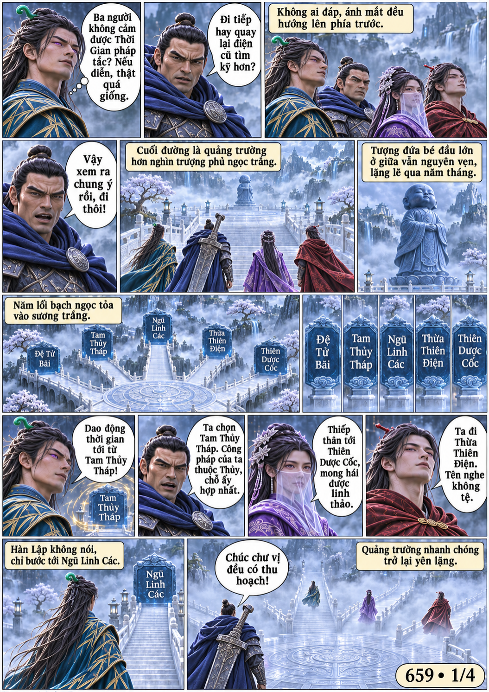
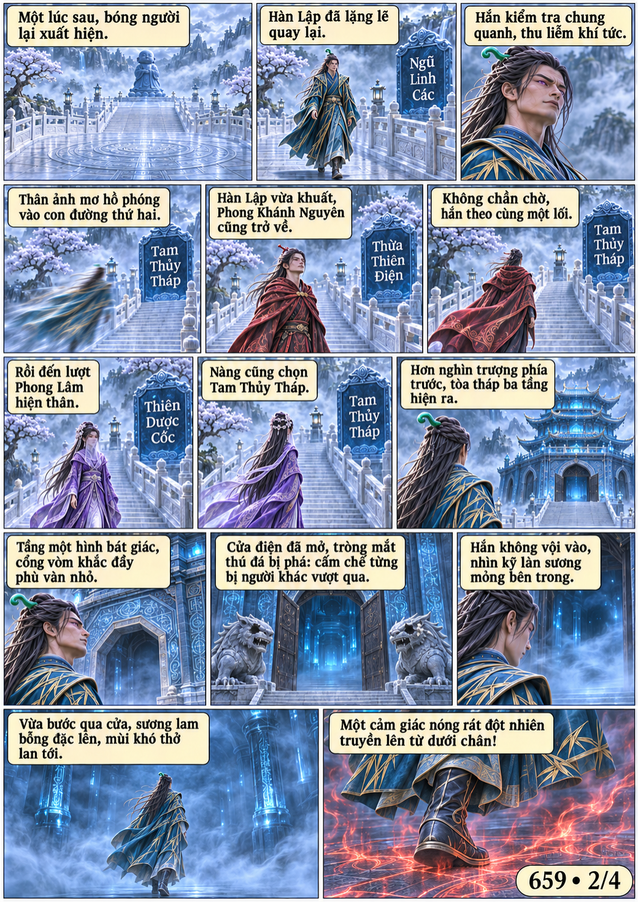
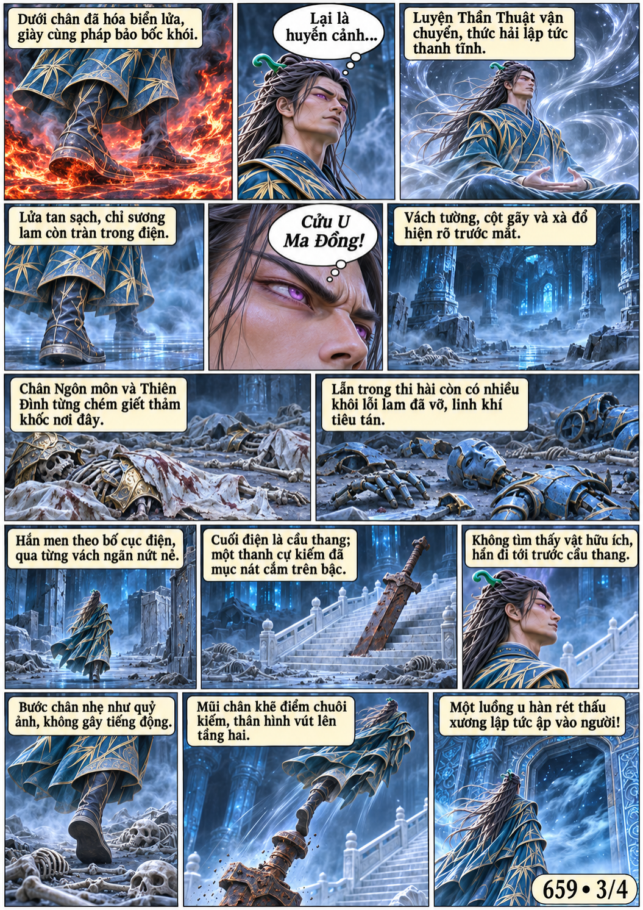
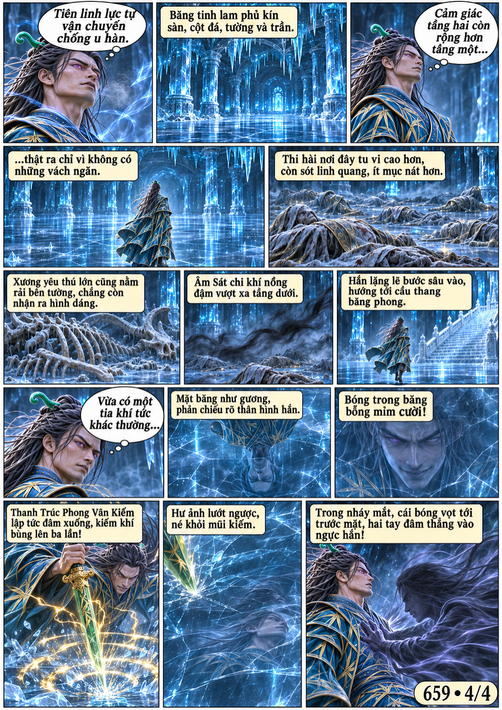

# Chương 659: Năm con đường

4 trang PNG riêng, tỉ lệ A4 dọc; chuyển thể từ văn bản người dùng đính kèm, có thoại, suy nghĩ và lời dẫn. Dùng model tham chiếu trong bộ nhớ dự án.

[PDF A4](chuong-659.pdf) · [Văn bản nguồn](SOURCE.txt)

Bốn người chọn năm lối rẽ nhưng lần lượt quay về Tam Thủy Tháp. Hàn Lập phá huyễn cảnh tầng một, lên tầng băng thứ hai và bị chính bóng phản chiếu tập kích.

