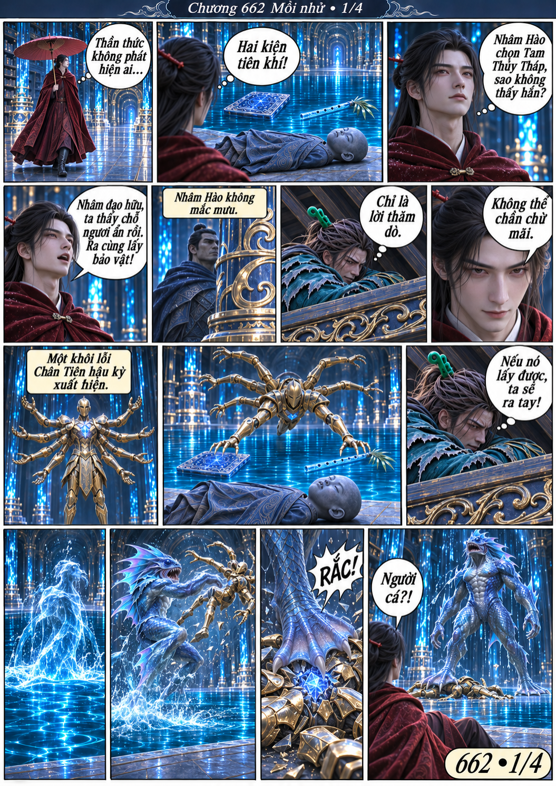
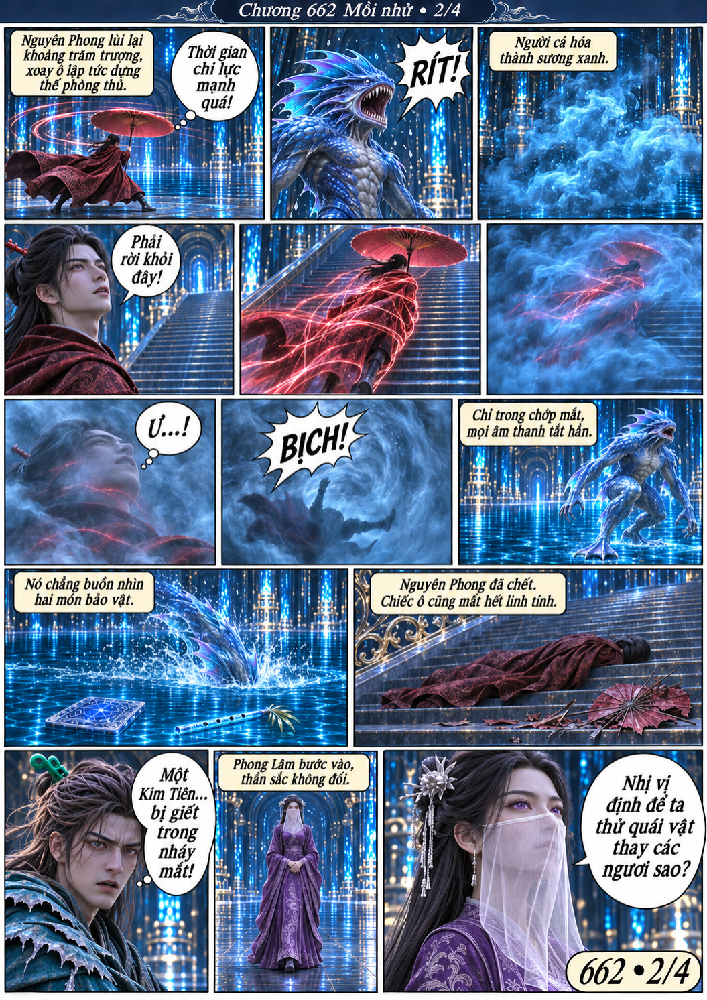
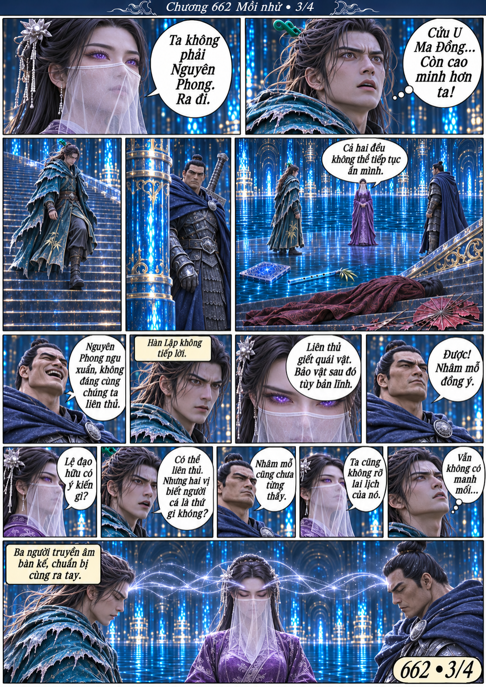
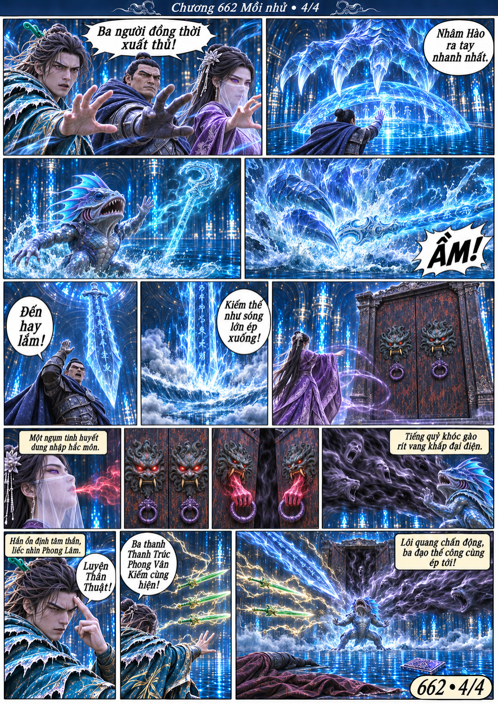

# Chương 662: Mồi nhử

4 trang PNG riêng, tỉ lệ A4 dọc; chuyển thể từ văn bản người dùng đính kèm, có thoại, suy nghĩ và lời dẫn. Dùng model tham chiếu trong bộ nhớ dự án.

[PDF A4](chuong-662.pdf) · [Văn bản nguồn](SOURCE.txt)

Nguyên Phong dùng khôi lỗi tám tay thử lấy bảo vật, bị người cá giết khi chạy trốn. Phong Lâm nhìn thấu chỗ ẩn của Hàn Lập và Nhâm Hào; ba người liên thủ xuất thủ.

