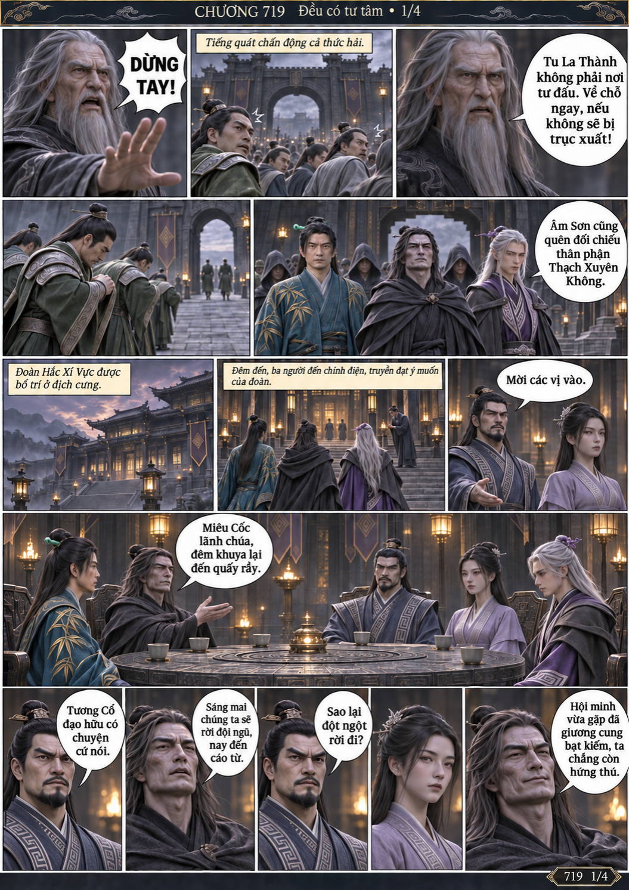
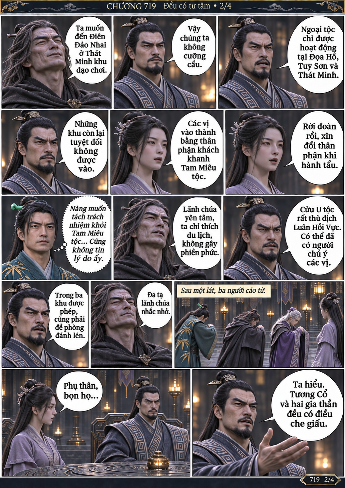
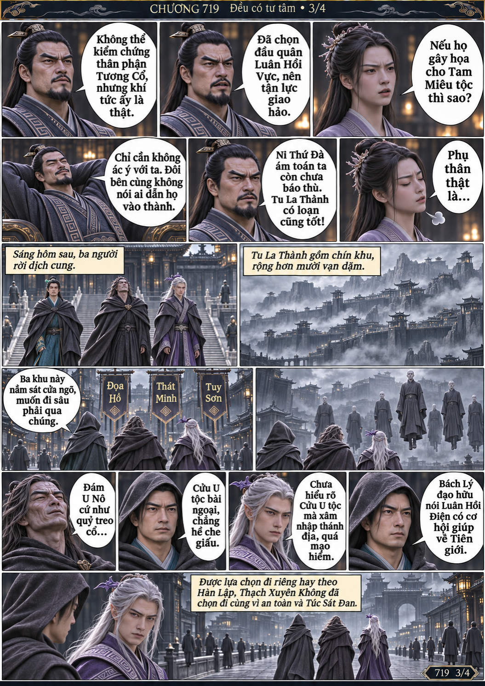
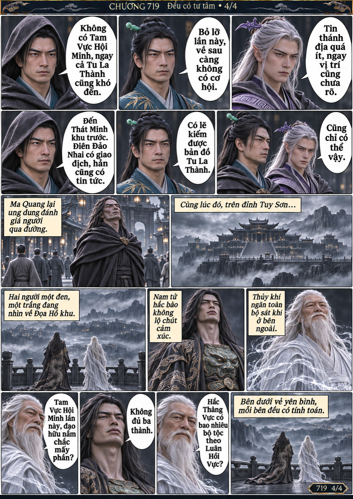

# Chương 719: Đều có tư tâm

4 trang PNG riêng, tỉ lệ A4 dọc; chuyển thể từ văn bản người dùng đính kèm, có thoại, suy nghĩ và lời dẫn. Dùng model tham chiếu trong bộ nhớ dự án.

[PDF A4](chuong-719.pdf) · [Văn bản nguồn](SOURCE.txt)

Trưởng lão Cửu U ngăn tư đấu. Ba người Hàn Lập cáo từ Tam Miêu tộc, biết giới hạn đi lại và tới Thát Minh khu tìm tin Tẩy Sát Trì. Hai nhân vật trên Tuy Sơn bàn thế hội minh.

