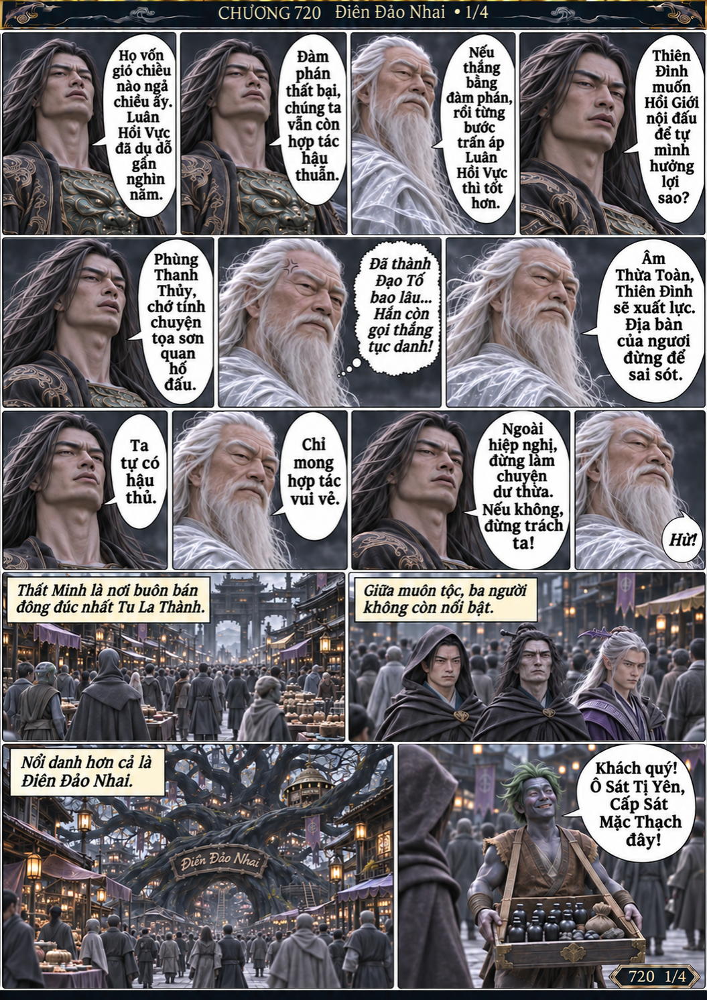
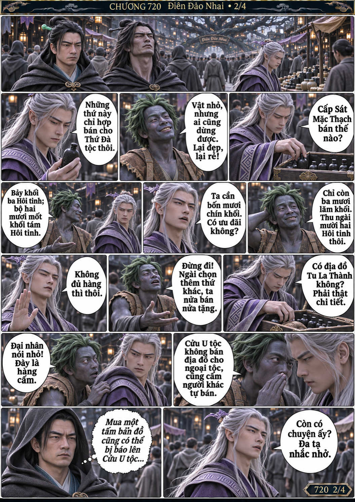
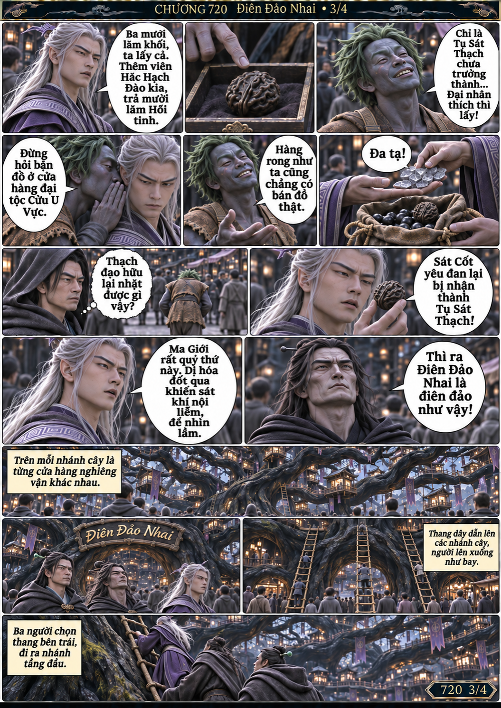
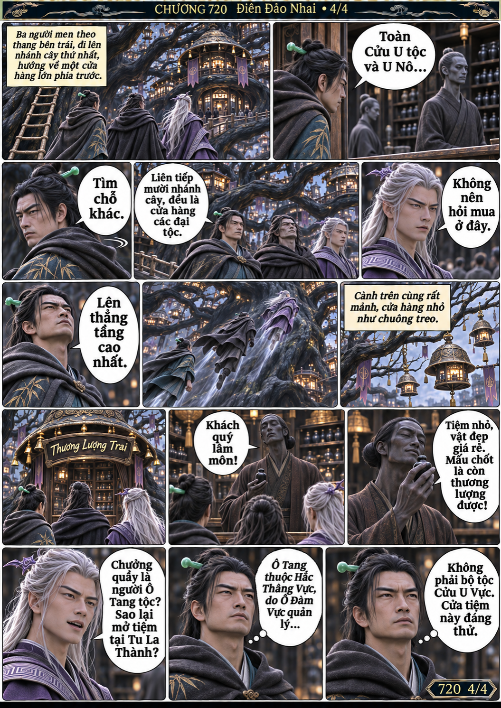

# Chương 720: Điên Đảo Nhai

4 trang PNG riêng, tỉ lệ A4 dọc; chuyển thể từ văn bản người dùng đính kèm, có thoại, suy nghĩ và lời dẫn. Dùng model tham chiếu trong bộ nhớ dự án.

[PDF A4](chuong-720.pdf) · [Văn bản nguồn](SOURCE.txt)

Âm Thừa Toàn và Phùng Thanh Thủy bàn hợp tác. Thạch Xuyên Không mua mặc thạch và nhặt được yêu đan Sát Cốt; ba người tìm tới Thương Lượng Trai trên cổ thụ Điên Đảo Nhai.

