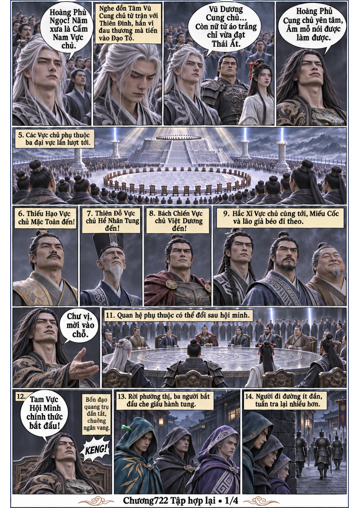
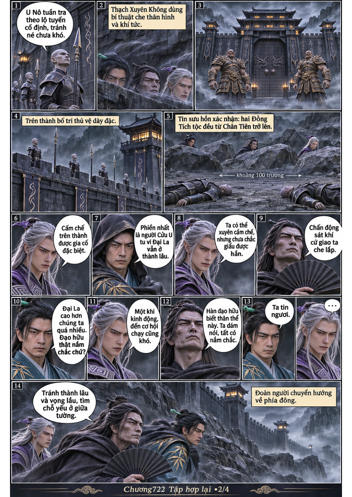
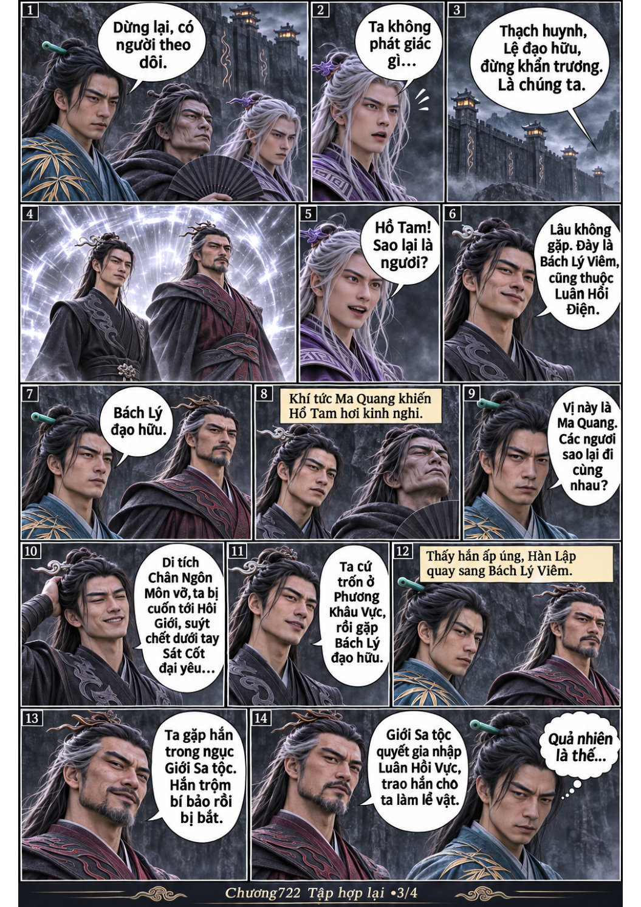
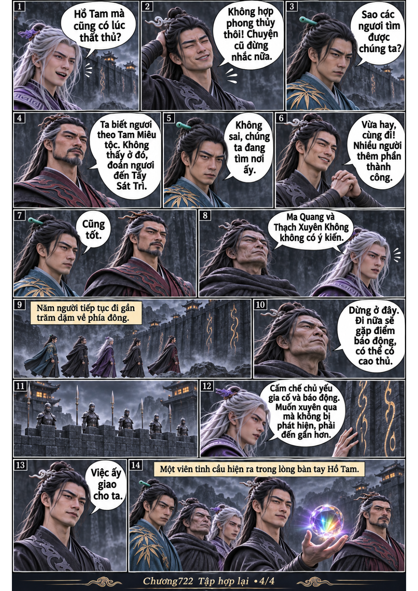

# Chương 722: Tập hợp lại

4 trang PNG riêng, tỉ lệ A4 dọc; chuyển thể từ văn bản người dùng đính kèm, có thoại, suy nghĩ và lời dẫn. Dùng model tham chiếu trong bộ nhớ dự án.

[PDF A4](chuong-722.pdf) · [Văn bản nguồn](SOURCE.txt)

Hội minh bắt đầu. Ba người thăm dò biên giới Bách Tàng, tái ngộ Hồ Tam và Bách Lý Viêm, thống nhất cùng tới Tẩy Sát Trì.

