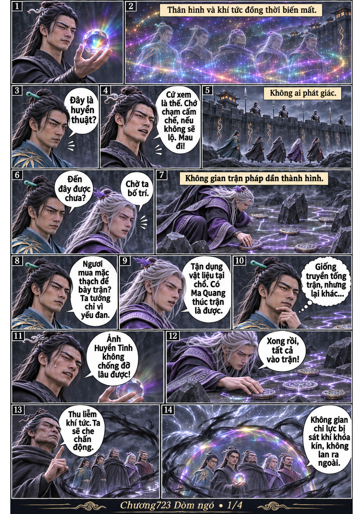
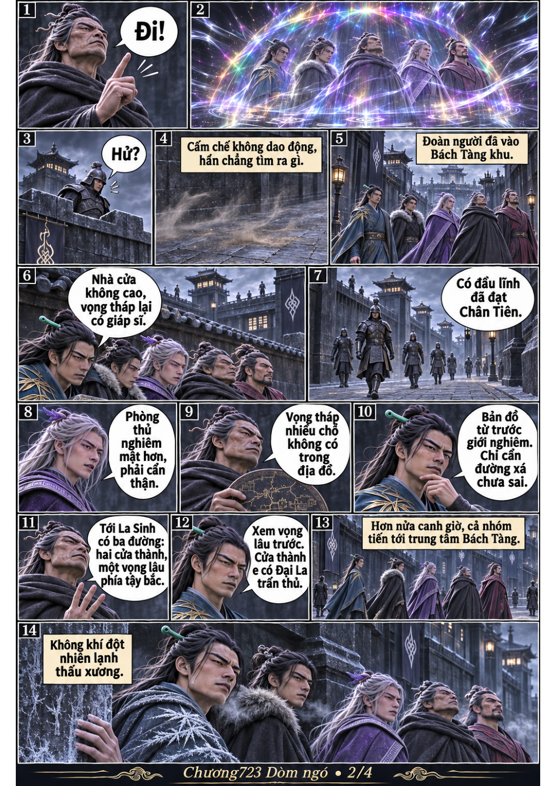
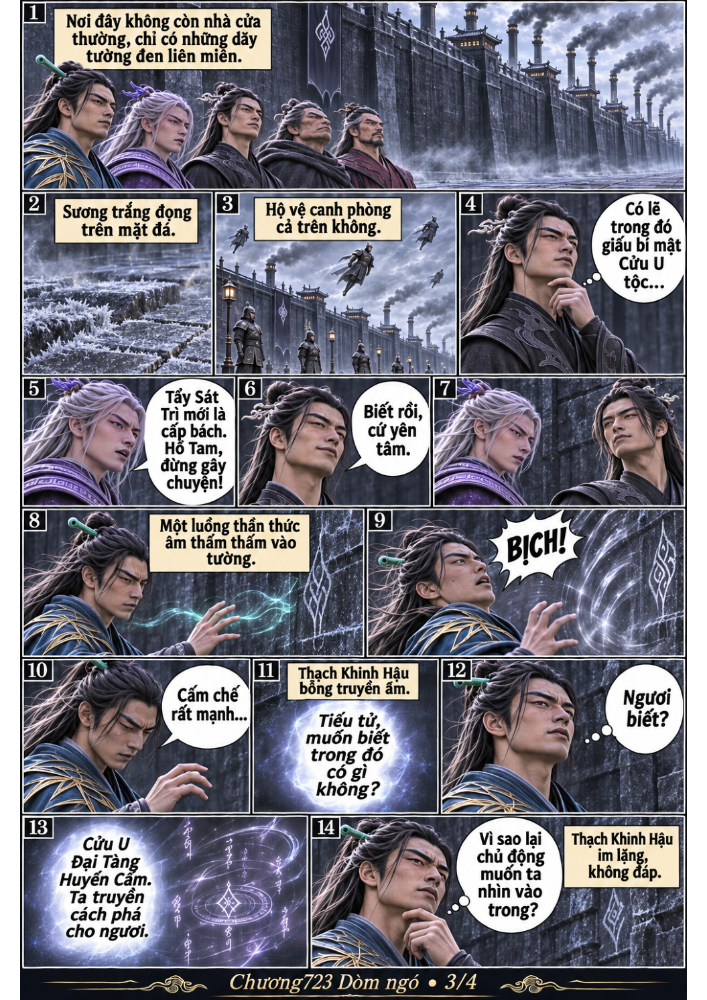
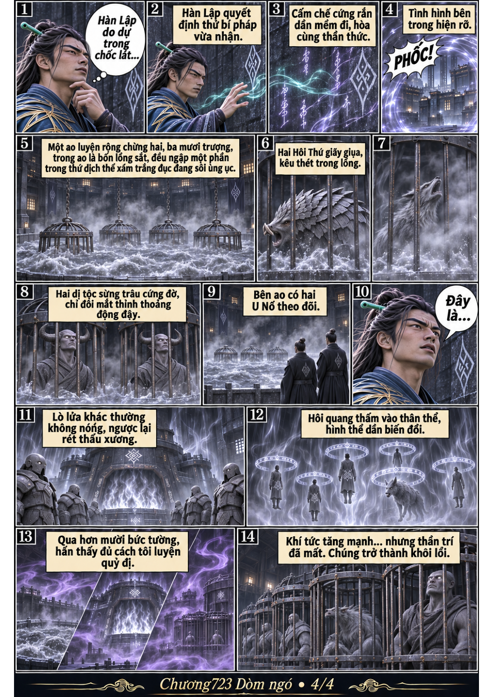

# Chương 723: Dòm ngó

4 trang PNG riêng, tỉ lệ A4 dọc; chuyển thể từ văn bản người dùng đính kèm, có thoại, suy nghĩ và lời dẫn. Dùng model tham chiếu trong bộ nhớ dự án.

[PDF A4](chuong-723.pdf) · [Văn bản nguồn](SOURCE.txt)

Năm người phối hợp vượt thành, tiến vào Bách Tàng. Thạch Khinh Hậu truyền bí pháp giúp thần thức Hàn Lập xuyên cấm chế, phát hiện nơi luyện khôi bí mật.

