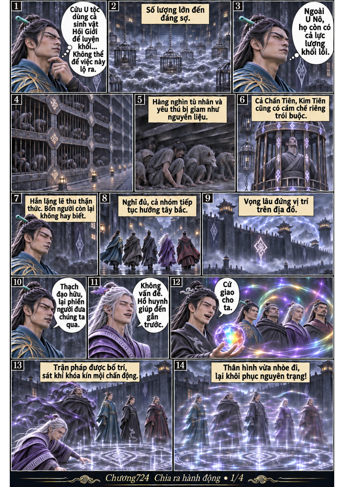
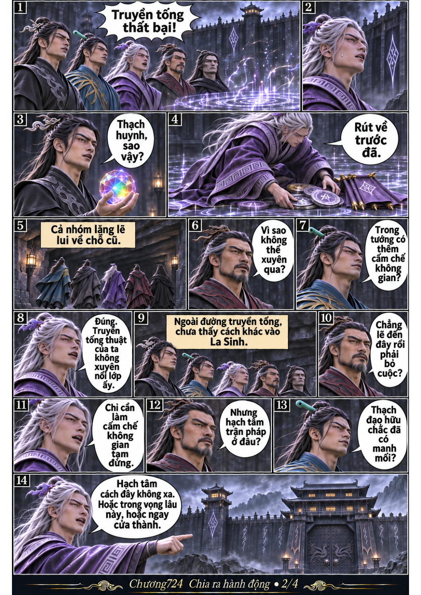
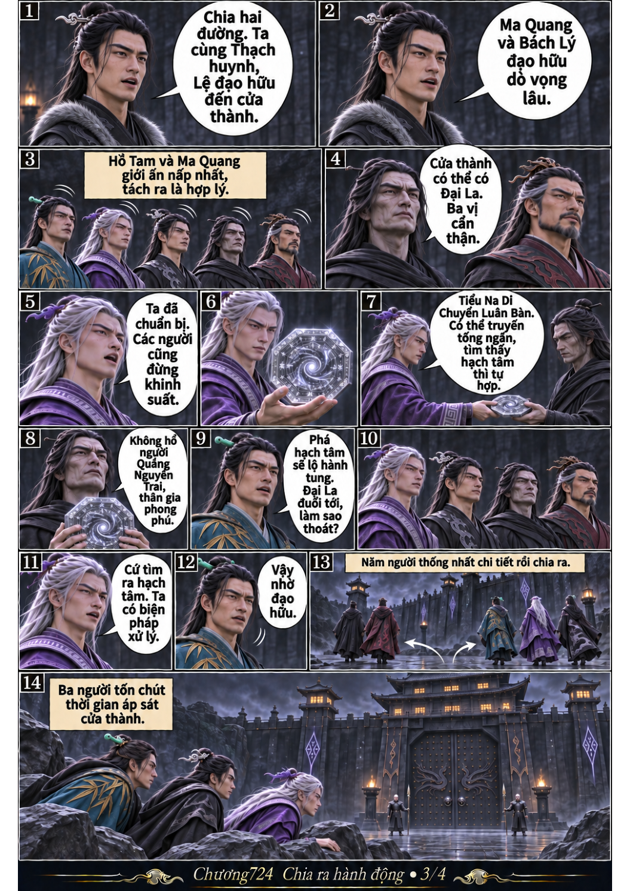
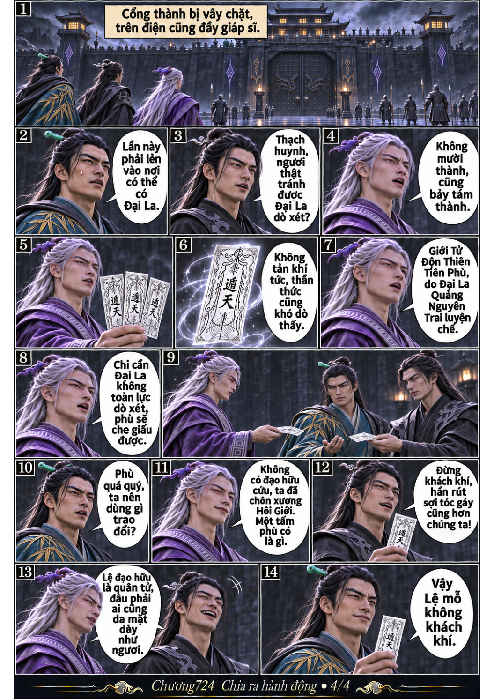

# Chương 724: Chia ra hành động

4 trang PNG riêng, tỉ lệ A4 dọc; chuyển thể từ văn bản người dùng đính kèm, có thoại, suy nghĩ và lời dẫn. Dùng model tham chiếu trong bộ nhớ dự án.

[PDF A4](chuong-724.pdf) · [Văn bản nguồn](SOURCE.txt)

Hàn Lập phát hiện nhà giam nguyên liệu. Cấm chế không gian khiến cả nhóm không thể truyền tống; họ chia hai đường tìm hạch tâm, Thạch Xuyên Không tặng Độn Thiên Tiên Phù cho Hàn Lập và Hồ Tam.

