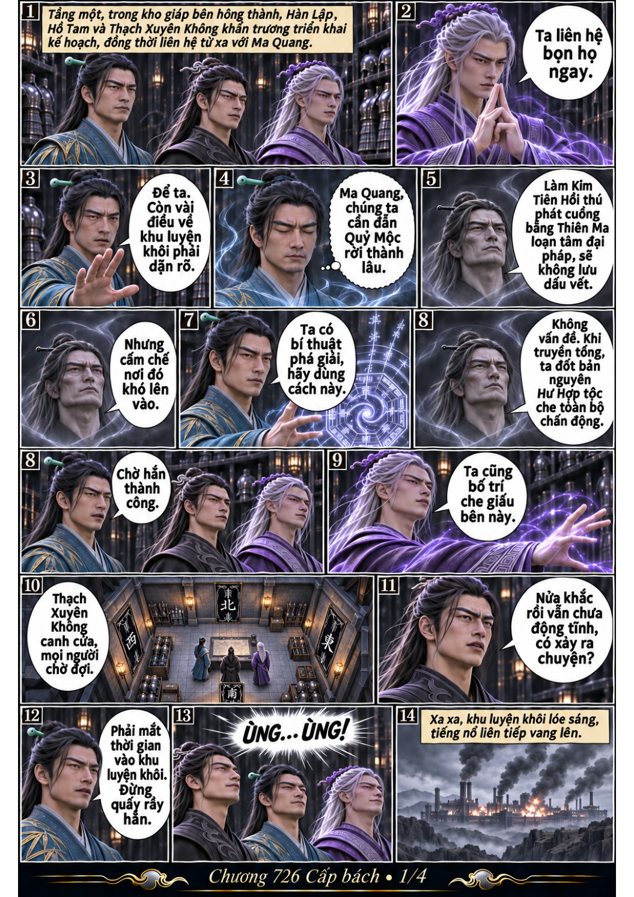
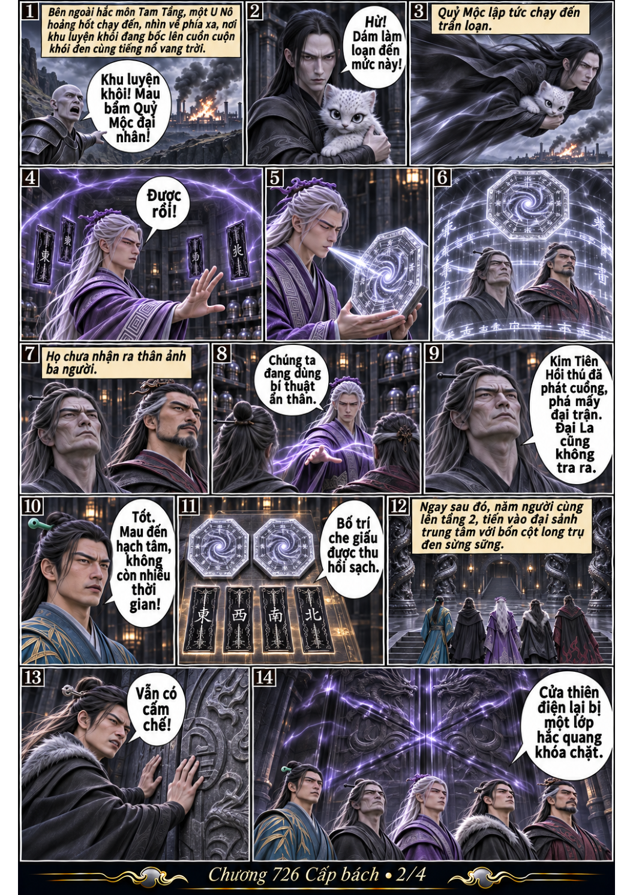
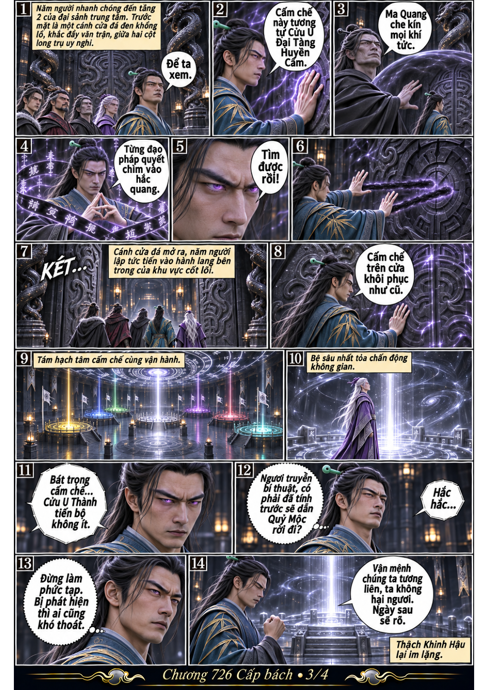
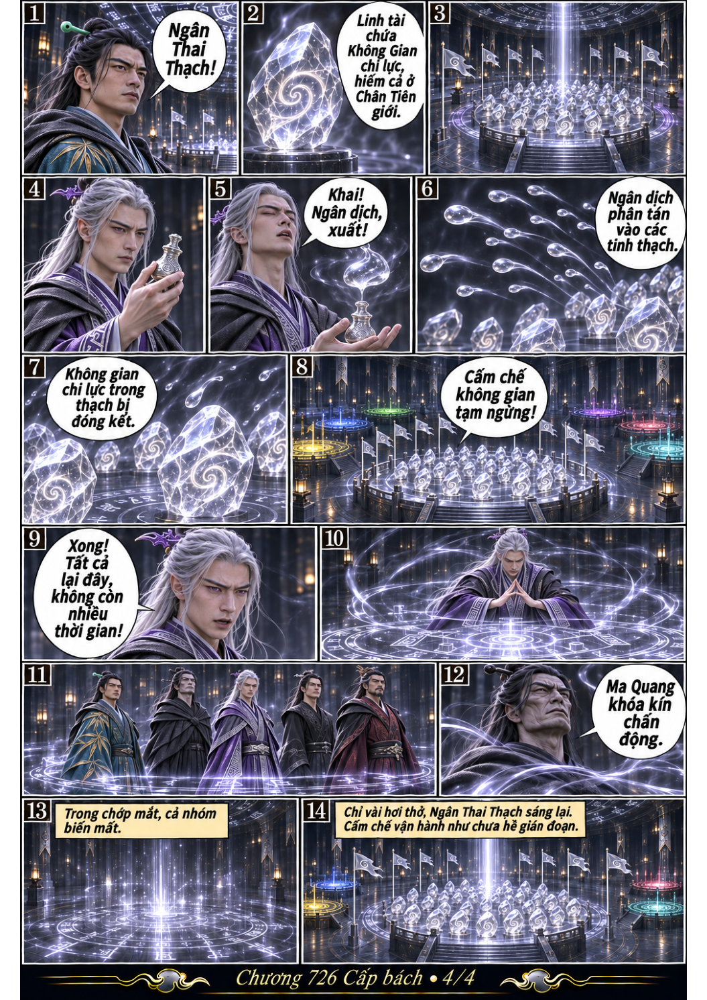

# Chương 726: Cấp bách

4 trang PNG riêng, tỉ lệ A4 dọc; chuyển thể từ văn bản người dùng đính kèm, có thoại, suy nghĩ và lời dẫn. Dùng model tham chiếu trong bộ nhớ dự án.

[PDF A4](chuong-726.pdf) · [Văn bản nguồn](SOURCE.txt)

Ma Quang gây biến loạn khu luyện khôi, dẫn Quỷ Mộc rời thành. Cả nhóm tụ hợp, Hàn Lập mở cấm chế cửa; Thạch Xuyên Không dùng ngân dịch tạm dừng hạch tâm không gian để năm người truyền tống đi.

