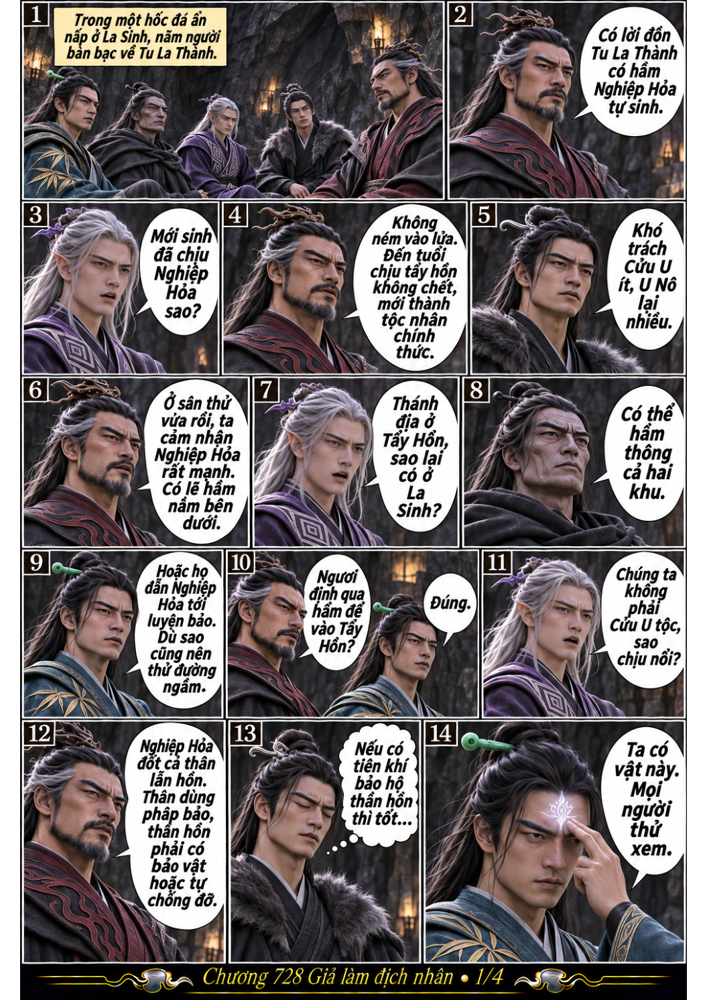
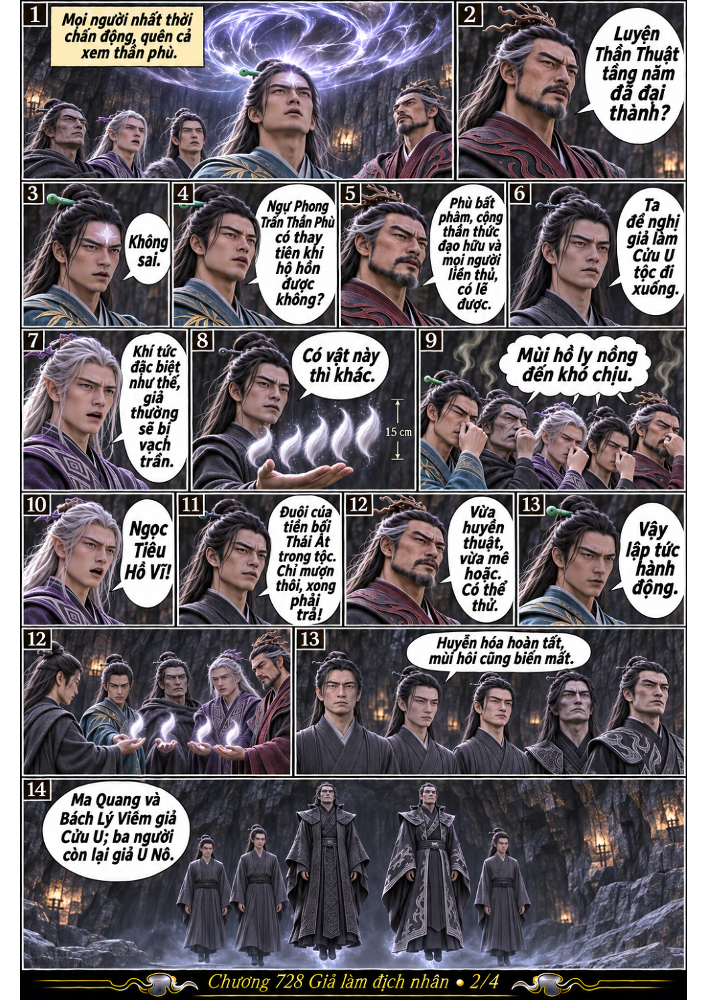
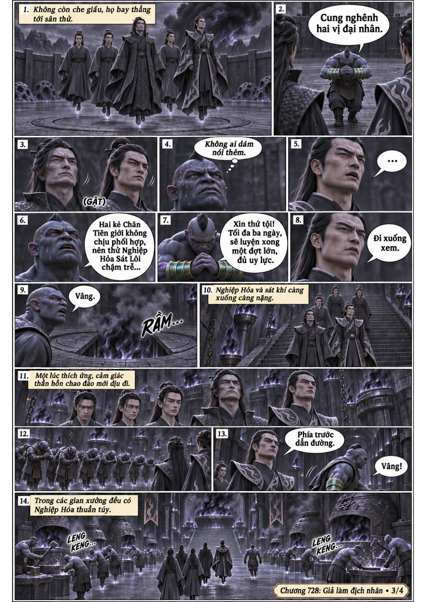
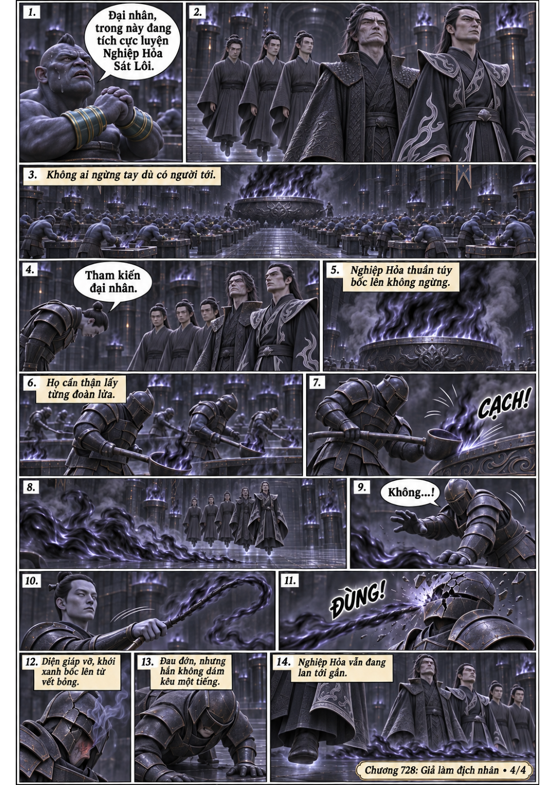

# Chương 728: Giả làm địch nhân

4 trang PNG riêng, tỉ lệ A4 dọc; chuyển thể từ văn bản người dùng đính kèm, có thoại, suy nghĩ và lời dẫn. Dùng model tham chiếu trong bộ nhớ dự án.

[PDF A4](chuong-728.pdf) · [Văn bản nguồn](SOURCE.txt)

Nhóm chọn đường hầm Nghiệp Hỏa, dựa vào Ngự Phong Trấn Thần Phù và Ngọc Tiêu Hồ Vĩ. Giả làm Cửu U cùng U Nô, họ được dẫn xuống xưởng Nghiệp Hỏa Sát Lôi và chứng kiến Uy Tinh tộc bị cưỡng bức làm việc.

