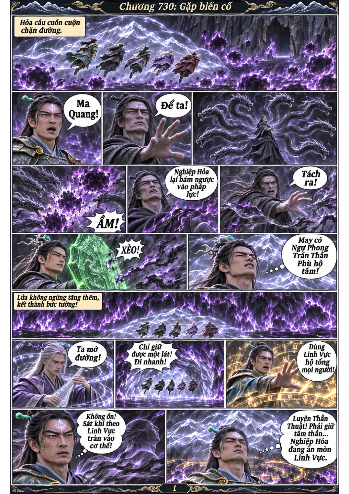
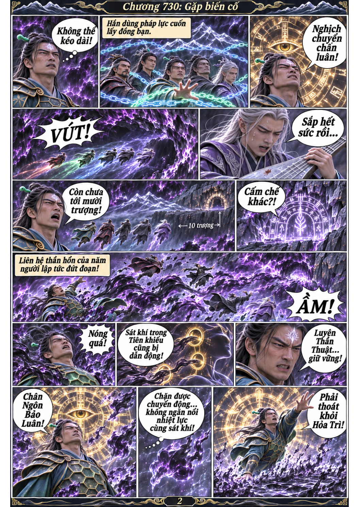
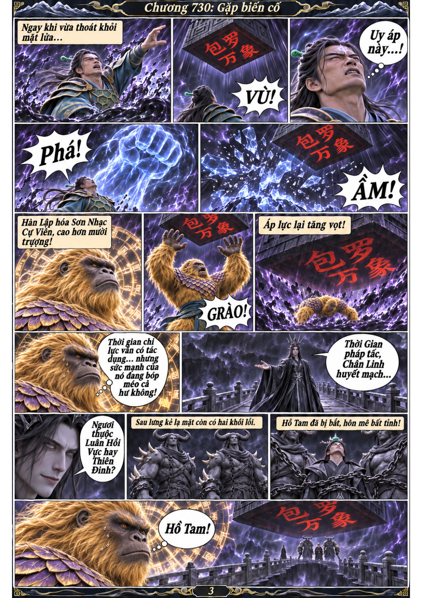
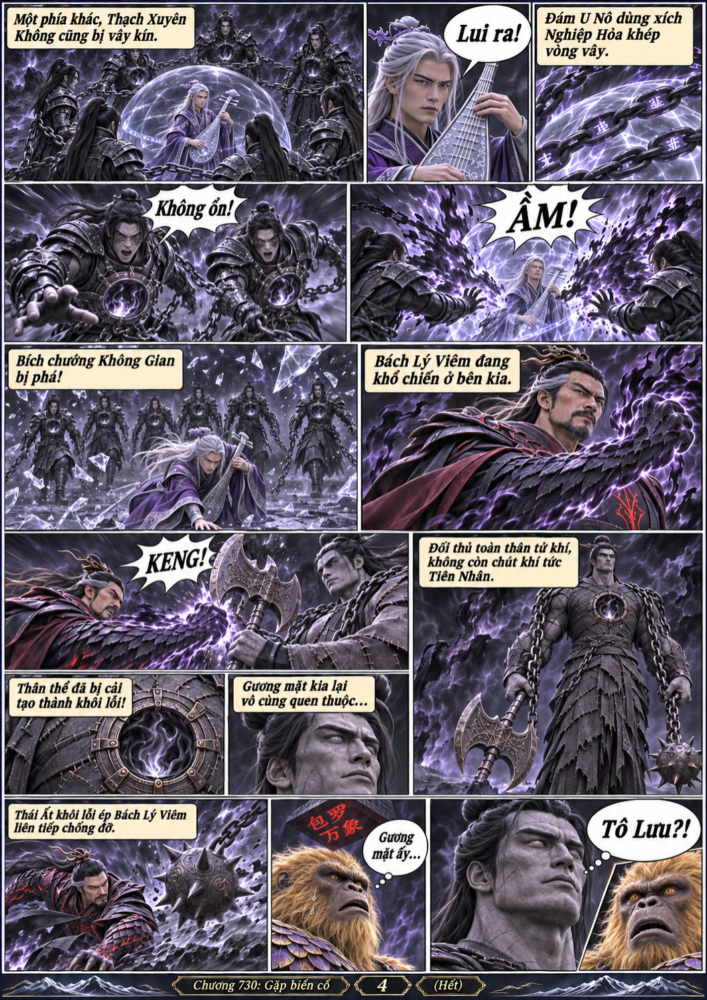

# Chương 730: Gặp biến cố

4 trang PNG riêng, tỉ lệ A4 dọc; chuyển thể từ văn bản người dùng đính kèm, có thoại, suy nghĩ và lời dẫn. Dùng model tham chiếu trong bộ nhớ dự án.

[PDF A4](chuong-730.pdf) · [Văn bản nguồn](SOURCE.txt)

Năm người vượt tường lửa nhưng trúng phục kích. Hàn Lập bị hắc ấn ép xuống Hỏa Trì, Hồ Tam bị bắt, Thạch Xuyên Không mất bích chướng, Bách Lý Viêm gặp khôi lỗi Tô Lưu.

