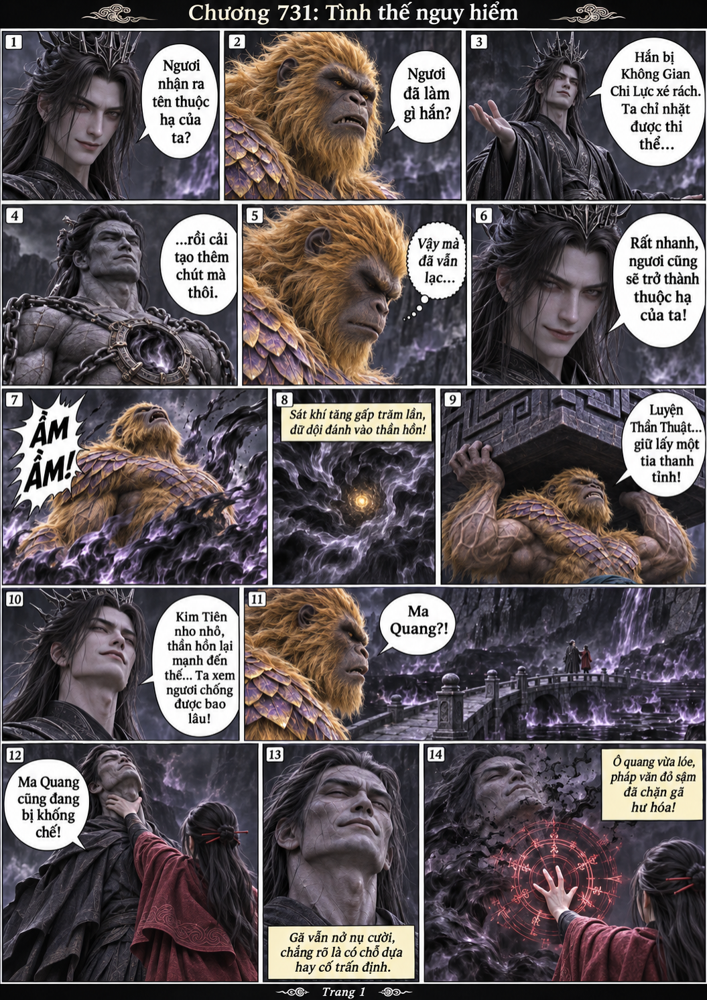
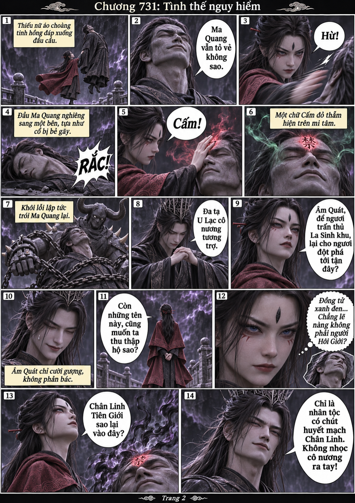
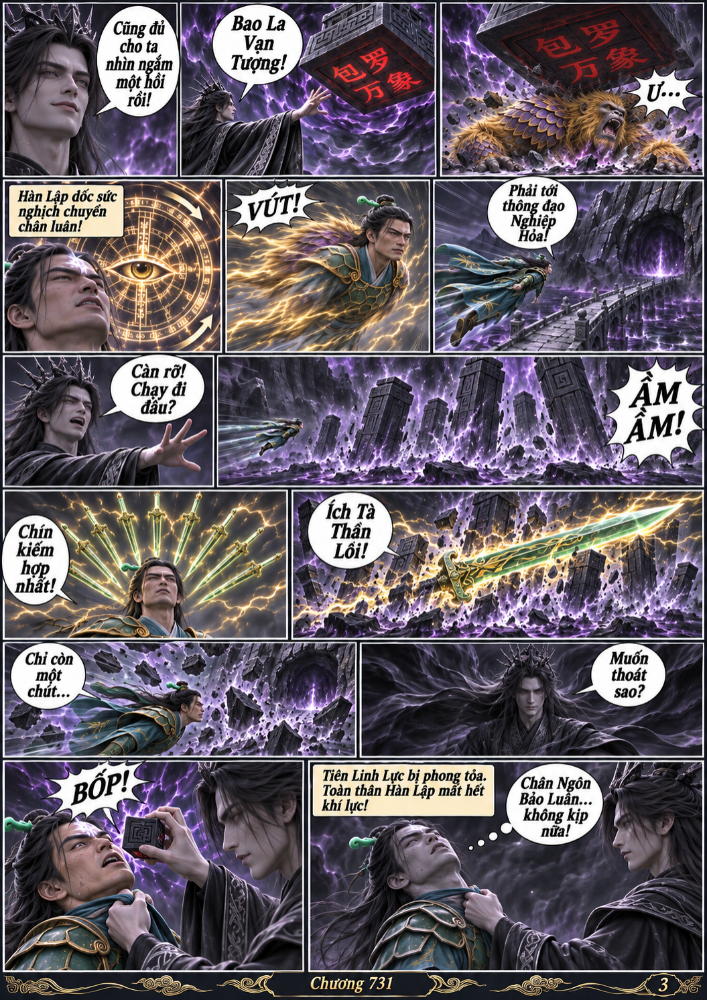
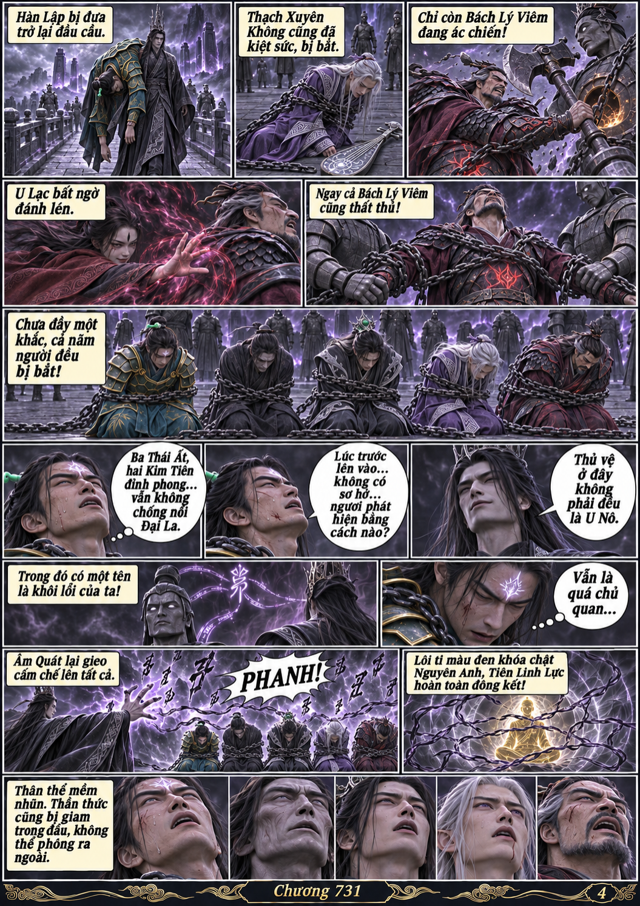

# Chương 731: Tình thế nguy hiểm

4 trang PNG riêng, tỉ lệ A4 dọc; chuyển thể từ văn bản người dùng đính kèm, có thoại, suy nghĩ và lời dẫn. Dùng model tham chiếu trong bộ nhớ dự án.

[PDF A4](chuong-731.pdf) · [Văn bản nguồn](SOURCE.txt)

U Lạc khống chế Ma Quang. Hàn Lập liều phá vây nhưng bị Âm Quát bắt; cả năm người chịu cấm chế Sát Lôi khóa Nguyên Anh, pháp lực và thần thức.

