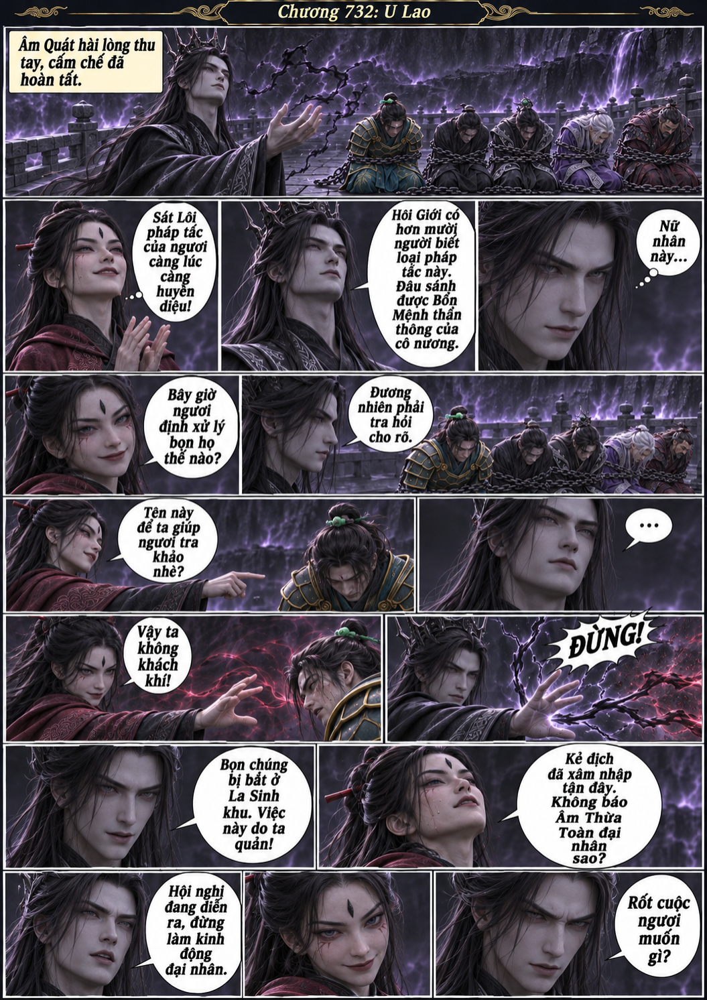
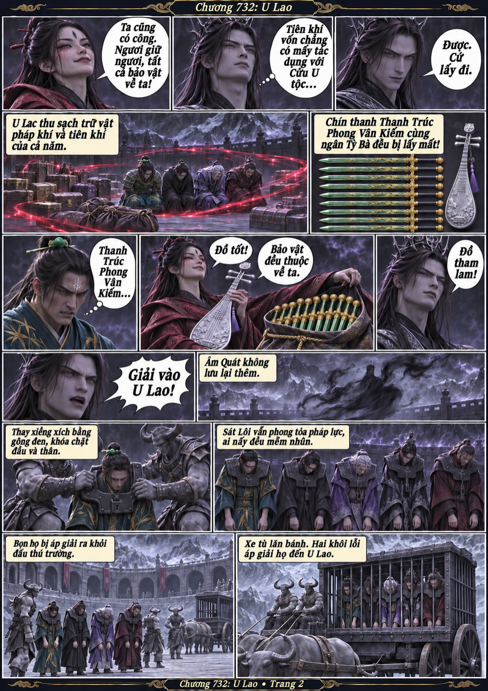
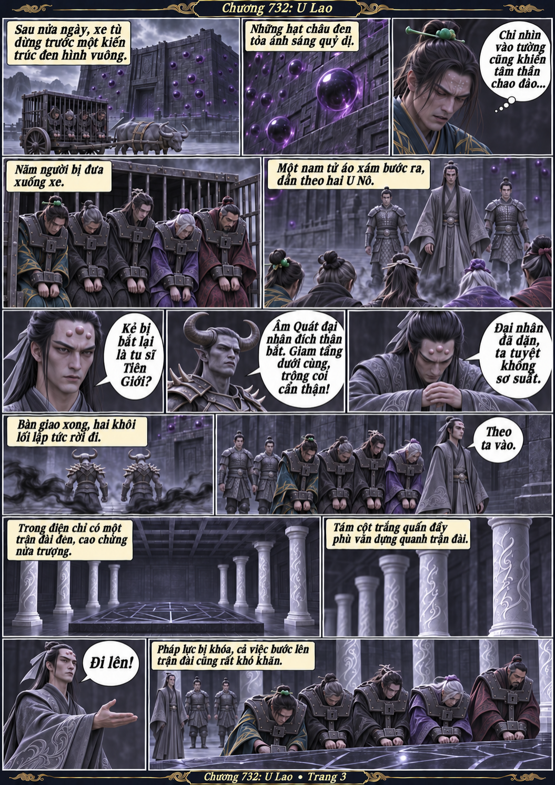
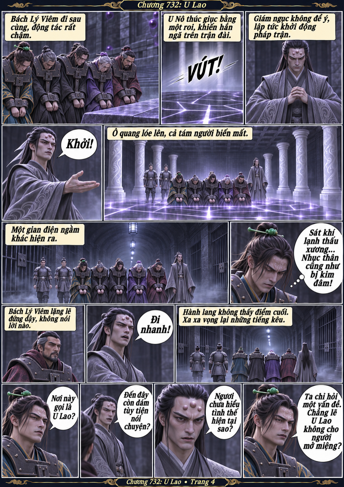

# Chương 732: U Lao

4 trang PNG riêng, tỉ lệ A4 dọc; chuyển thể từ văn bản người dùng đính kèm, có thoại, suy nghĩ và lời dẫn. Dùng model tham chiếu trong bộ nhớ dự án.

[PDF A4](chuong-732.pdf) · [Văn bản nguồn](SOURCE.txt)

U Lạc đổi công lao lấy toàn bộ bảo vật của năm người. Họ bị gông xiềng áp giải vào U Lao, dịch chuyển xuống ngục sâu; Hàn Lập vẫn bình tĩnh chất vấn giám ngục.

