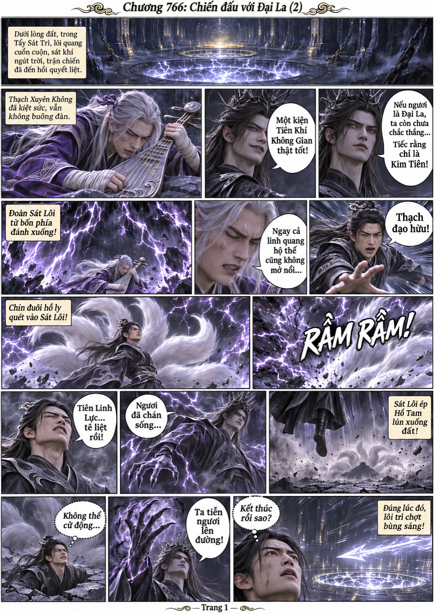
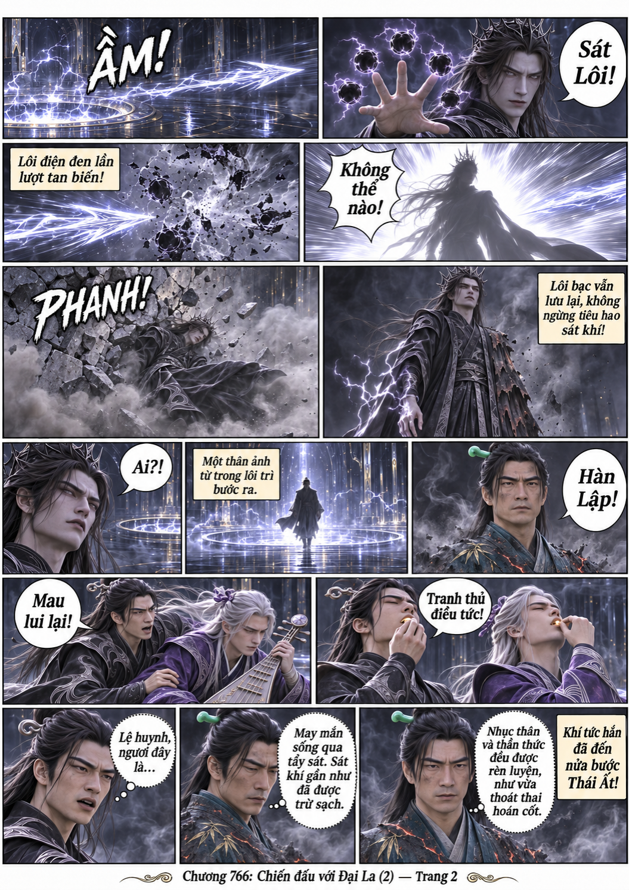
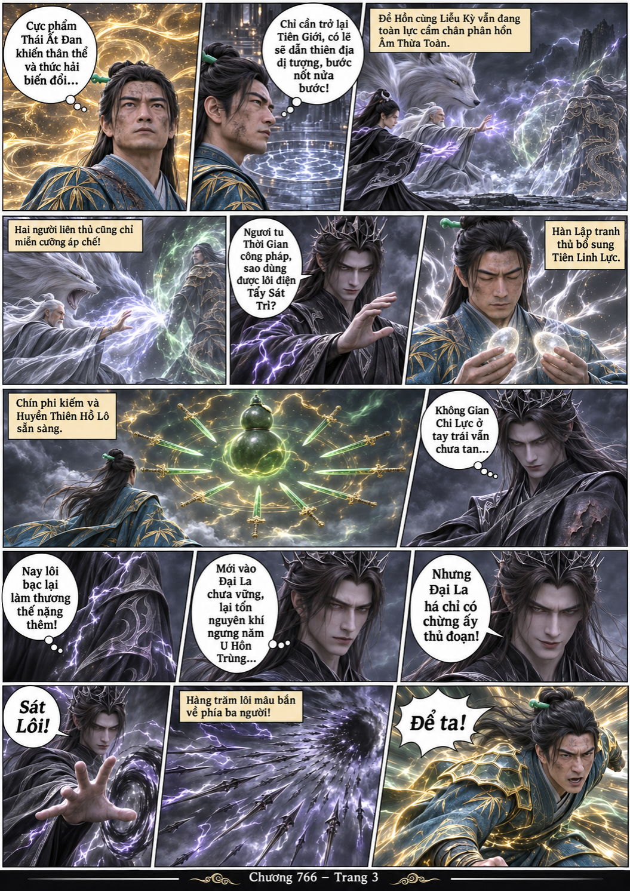
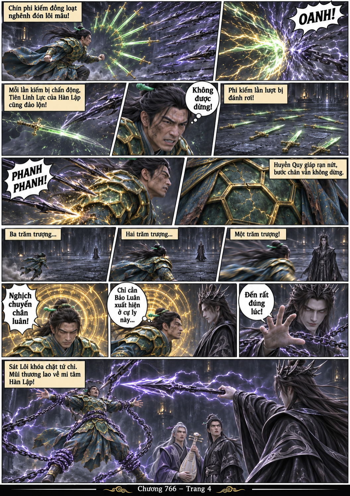

# Chương 766: Chiến đấu với Đại La (2)

4 trang PNG riêng, tỉ lệ A4 dọc; chuyển thể từ văn bản người dùng đính kèm, có thoại, suy nghĩ và lời dẫn. Dùng model tham chiếu trong bộ nhớ dự án.

[PDF A4](chuong-766.pdf) · [Văn bản nguồn](SOURCE.txt)

Hồ Tam cứu Thạch Xuyên Không, Hàn Lập rời lôi trì với thực lực nửa bước Thái Ất, liều áp sát Âm Quát nhưng trúng bẫy Sát Lôi.

