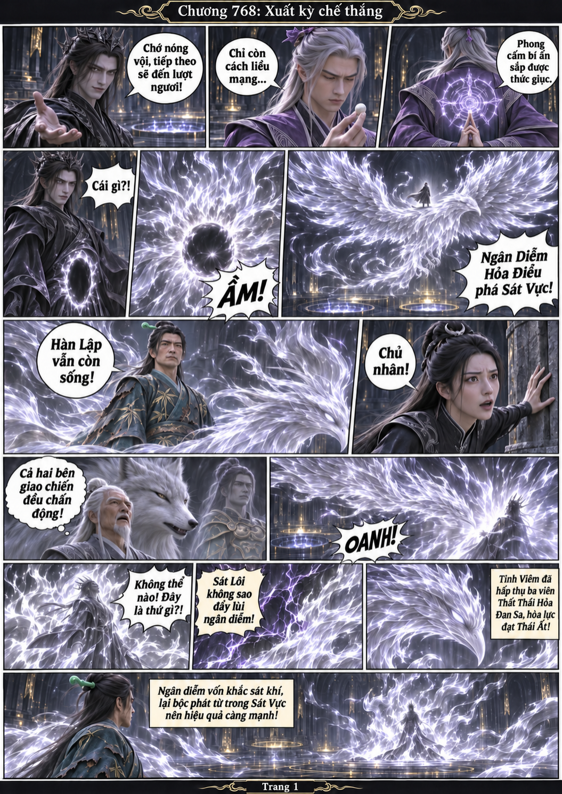
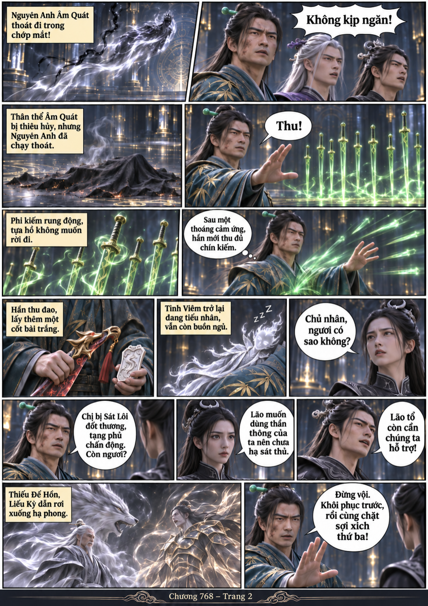
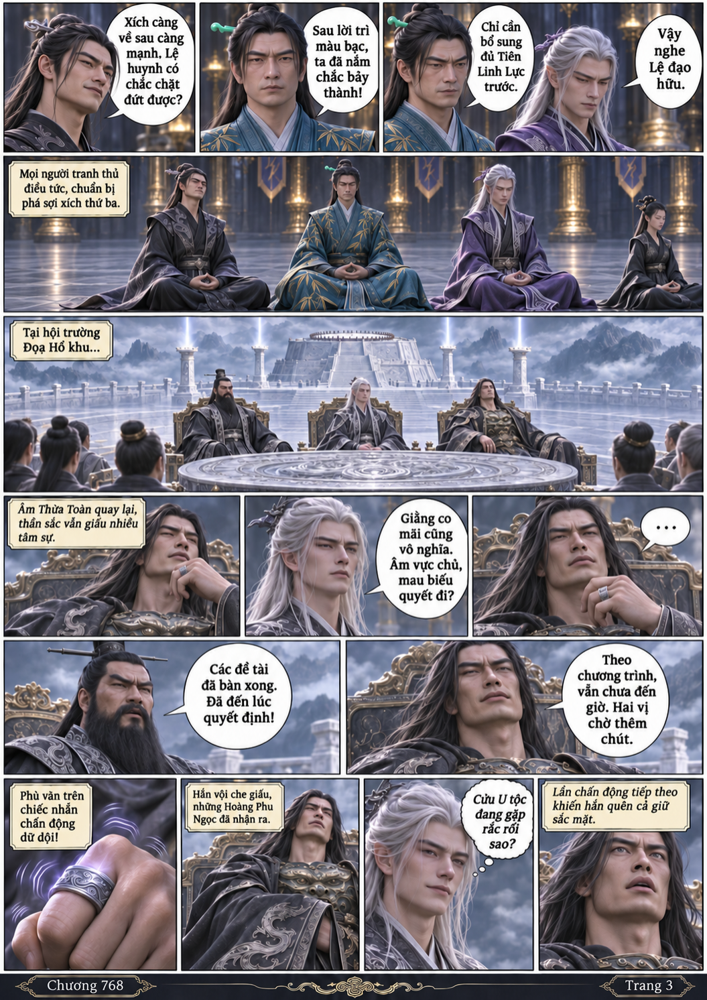
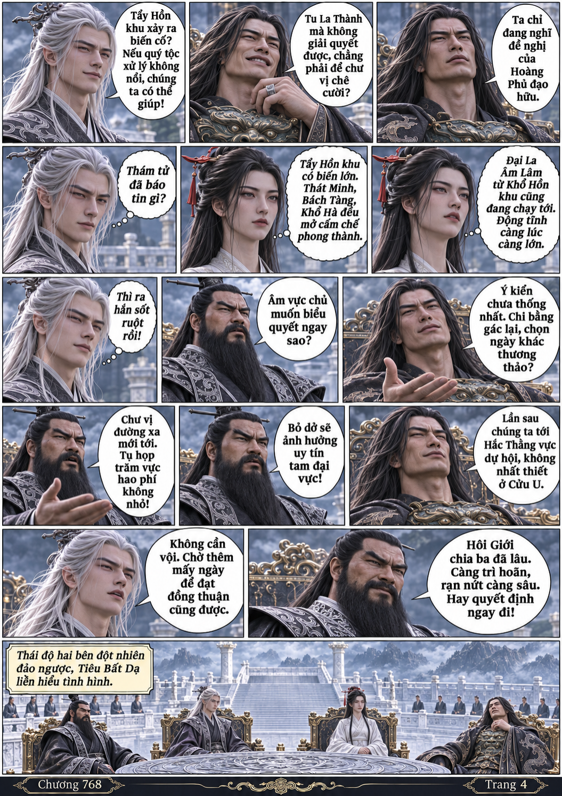

# Chương 768: Xuất kỳ chế thắng

4 trang PNG riêng, tỉ lệ A4 dọc; chuyển thể từ văn bản người dùng đính kèm, có thoại, suy nghĩ và lời dẫn. Dùng model tham chiếu trong bộ nhớ dự án.

[PDF A4](chuong-768.pdf) · [Văn bản nguồn](SOURCE.txt)

Tinh Viêm phá Sát Vực, hủy thân Âm Quát nhưng Nguyên Anh chạy thoát. Nhóm khôi phục để phá xích; tại hội nghị Âm Thừa Toàn nóng lòng muốn trì hoãn, Hoàng Phủ Ngọc nhận ra biến động.

