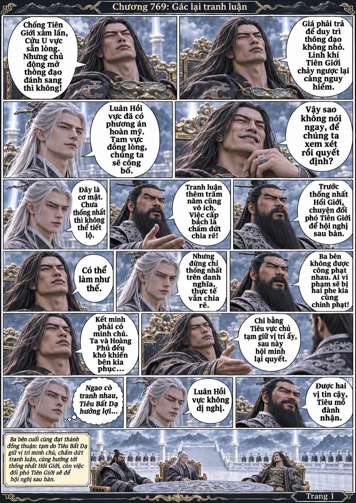
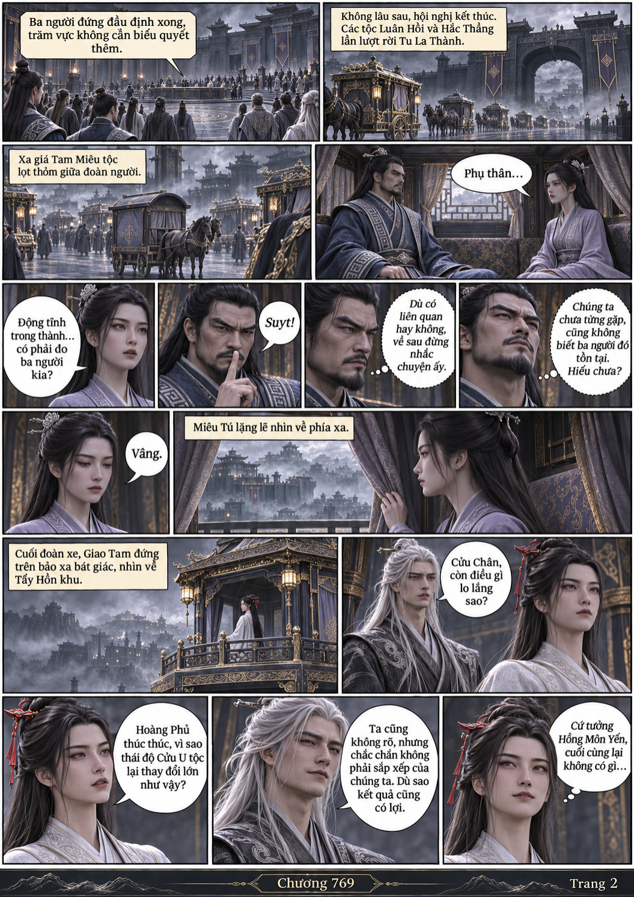
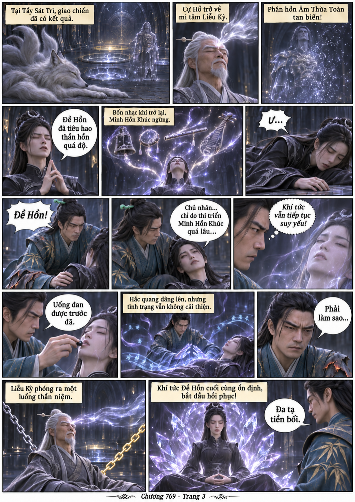
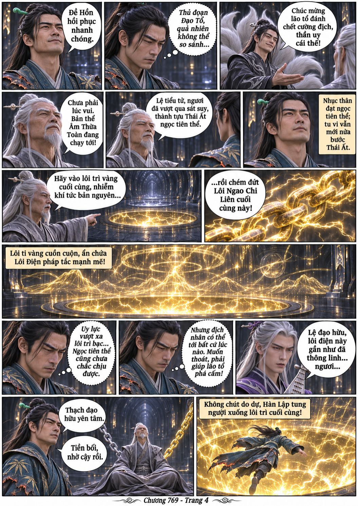

# Chương 769: Gác lại tranh luận

4 trang PNG riêng, tỉ lệ A4 dọc; chuyển thể từ văn bản người dùng đính kèm, có thoại, suy nghĩ và lời dẫn. Dùng model tham chiếu trong bộ nhớ dự án.

[PDF A4](chuong-769.pdf) · [Văn bản nguồn](SOURCE.txt)

Tam vực tạm kết minh, Tiêu Bất Dạ giữ ngôi minh chủ. Phân hồn Âm Thừa Toàn tan biến; Liễu Kỳ cứu Đề Hồn rồi thúc Hàn Lập xuống lôi trì vàng.

