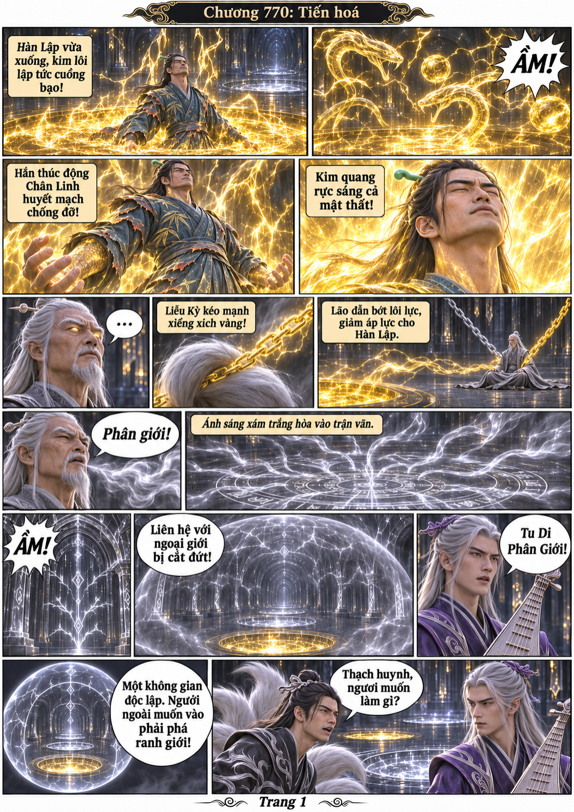
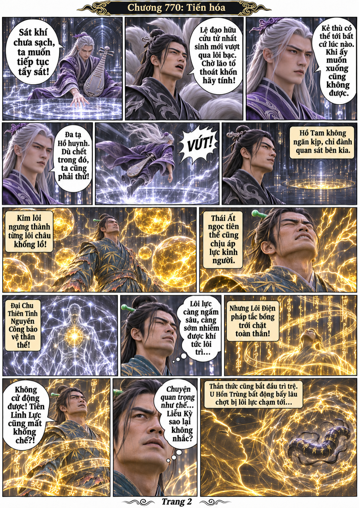
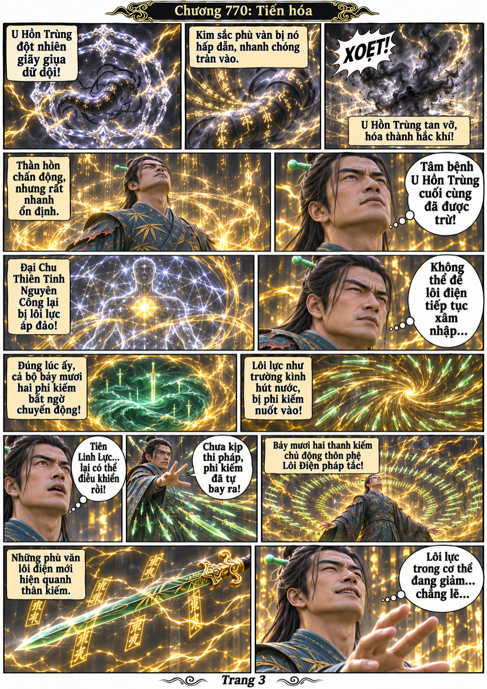
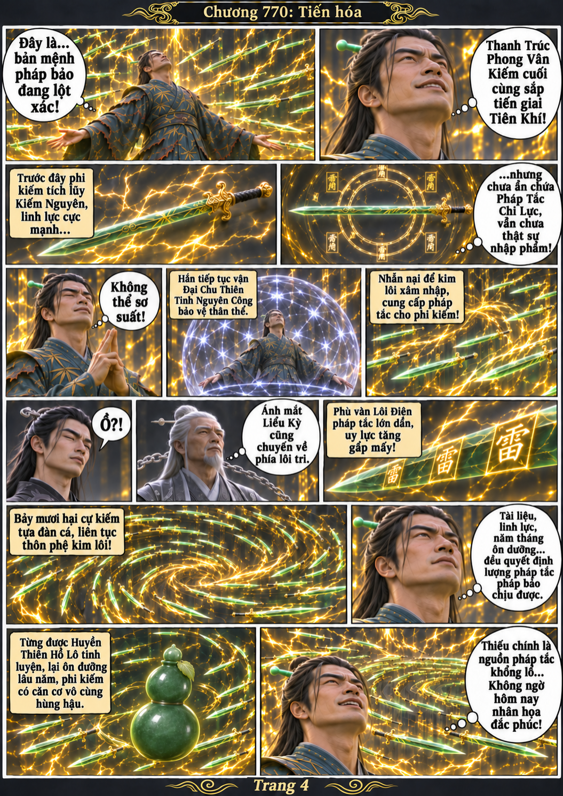

# Chương 770: Tiến hoá

4 trang PNG riêng, tỉ lệ A4 dọc; chuyển thể từ văn bản người dùng đính kèm, có thoại, suy nghĩ và lời dẫn. Dùng model tham chiếu trong bộ nhớ dự án.

[PDF A4](chuong-770.pdf) · [Văn bản nguồn](SOURCE.txt)

Liễu Kỳ cô lập đại điện, Thạch Xuyên Không quyết tẩy sát trong lôi bạc. Hàn Lập bị kim lôi phong tỏa nhưng trừ được U Hồn Trùng và gặp cơ duyên tiến hóa 72 phi kiếm.

