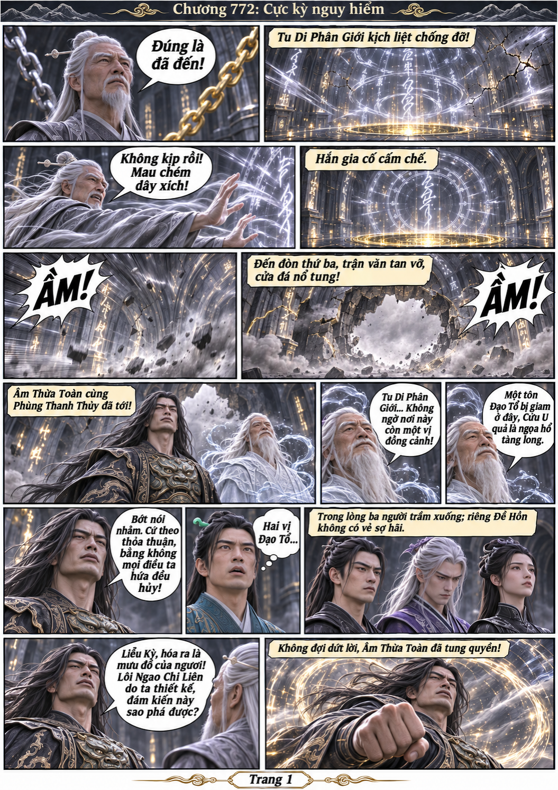
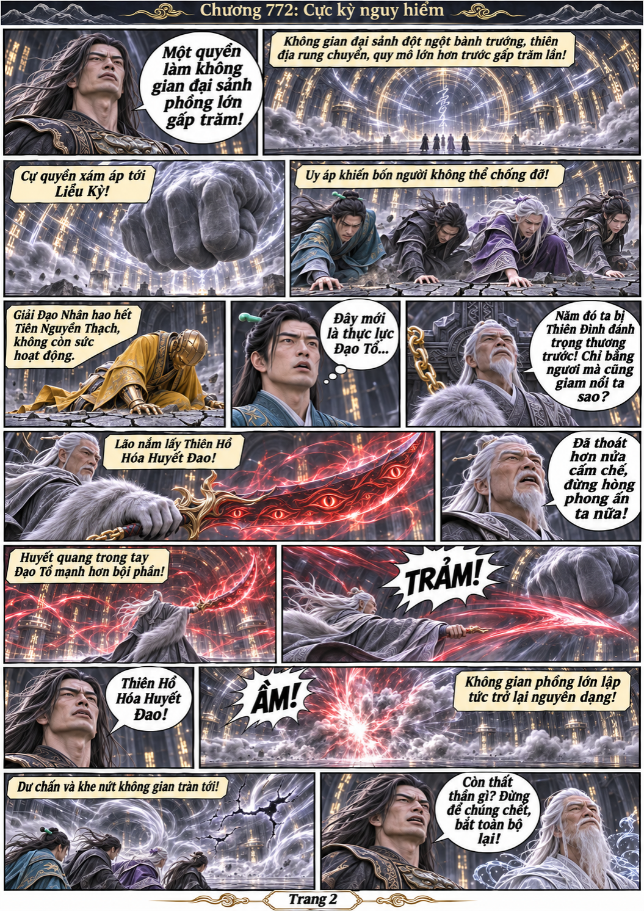
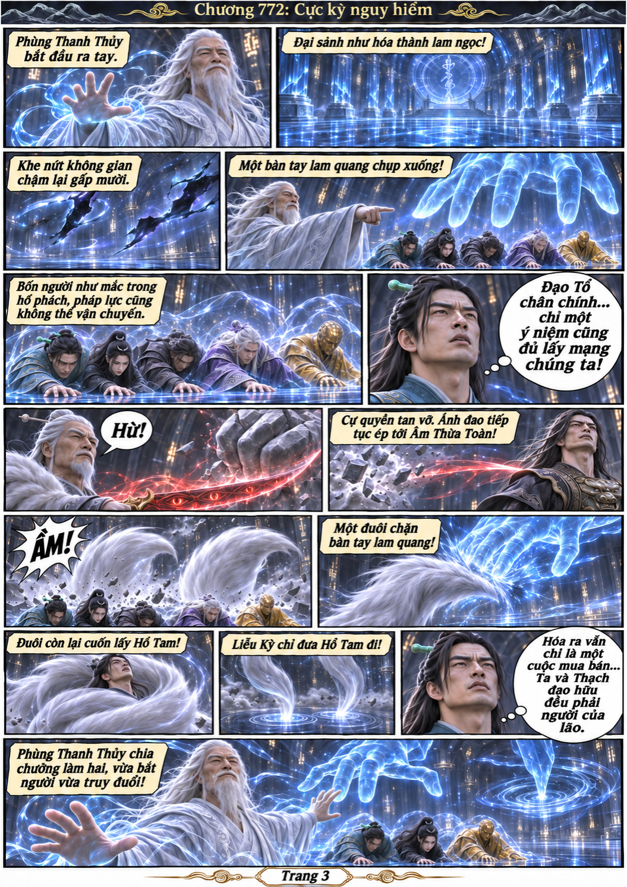
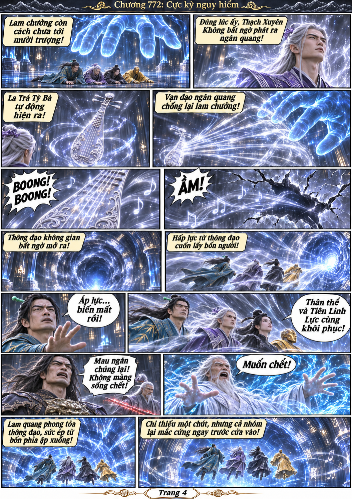

# Chương 772: Cực kỳ nguy hiểm

4 trang PNG riêng, tỉ lệ A4 dọc; chuyển thể từ văn bản người dùng đính kèm, có thoại, suy nghĩ và lời dẫn. Dùng model tham chiếu trong bộ nhớ dự án.

[PDF A4](chuong-772.pdf) · [Văn bản nguồn](SOURCE.txt)

Âm Thừa Toàn và Phùng Thanh Thủy phá vào đại điện. Liễu Kỳ chỉ cứu Hồ Tam; La Trá Tỳ Bà tự mở thông đạo nhưng nhóm Hàn Lập bị chặn ngay lối vào.

