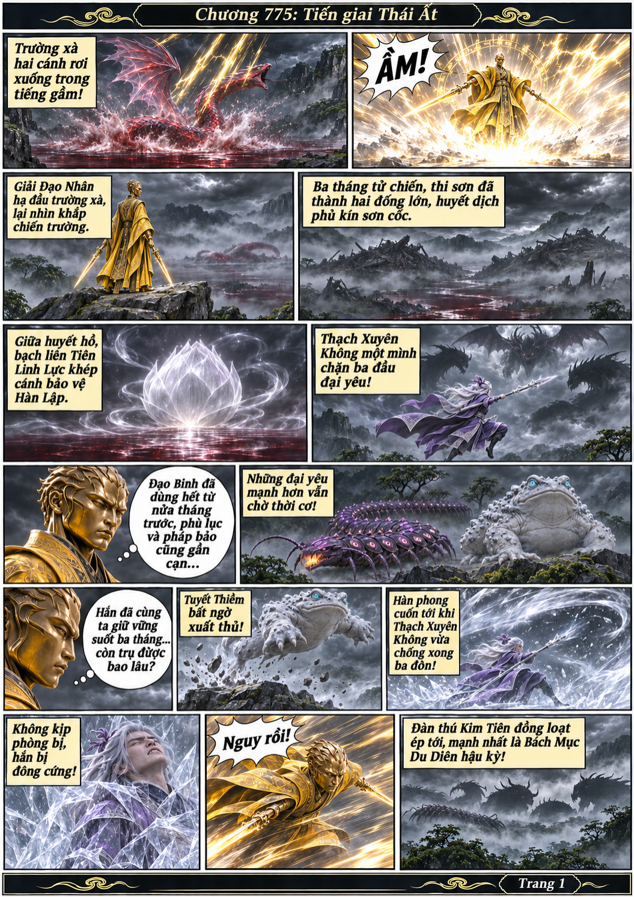
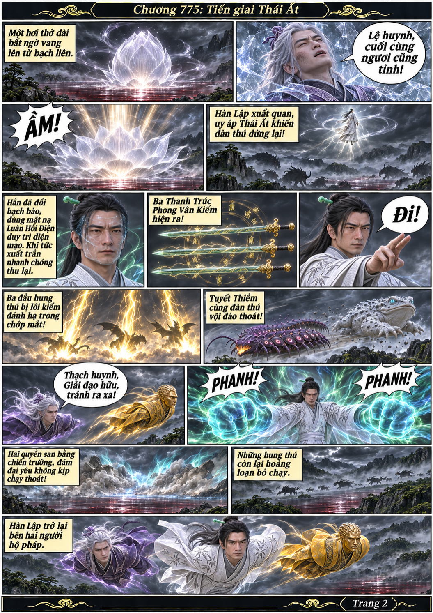
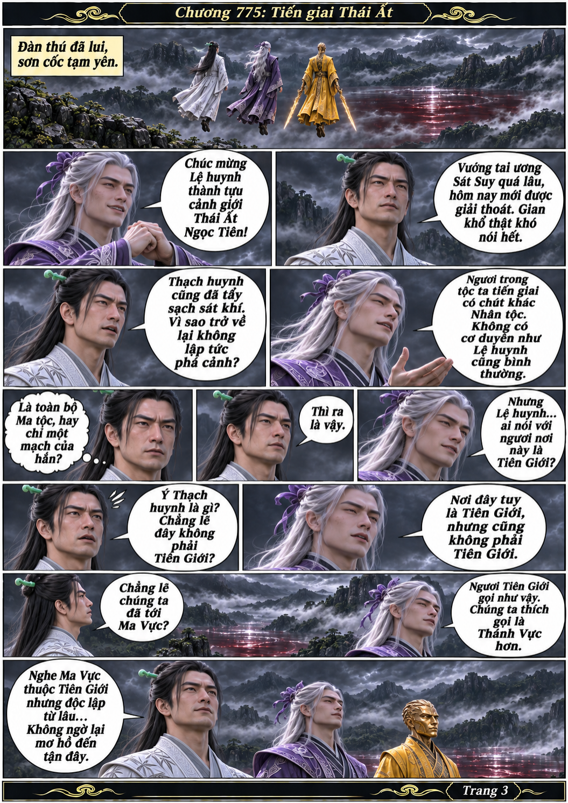
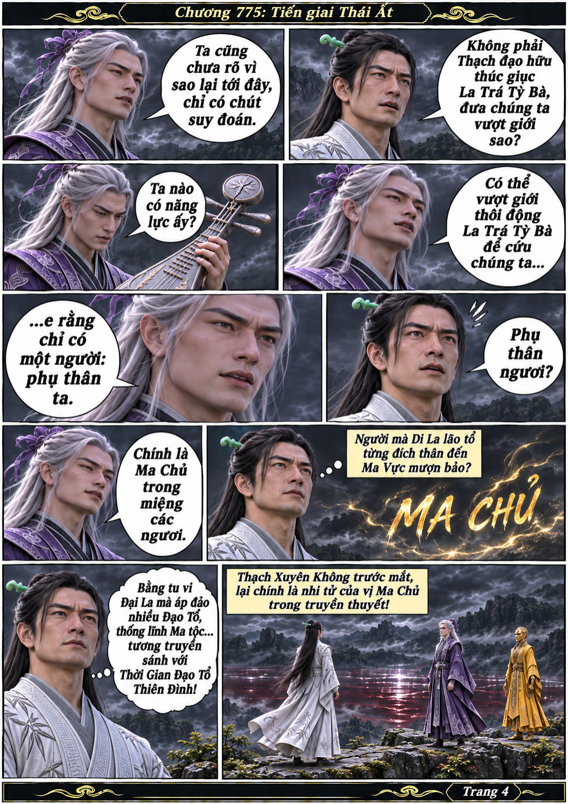

# Chương 775: Tiến giai Thái Ất

4 trang PNG riêng, tỉ lệ A4 dọc; chuyển thể từ văn bản người dùng đính kèm, có thoại, suy nghĩ và lời dẫn. Dùng model tham chiếu trong bộ nhớ dự án.

[PDF A4](chuong-775.pdf) · [Văn bản nguồn](SOURCE.txt)

Sau ba tháng hộ pháp, Hàn Lập xuất quan thành Thái Ất, giải vây cho hai đồng bạn. Họ đã tới Thánh Vực, và Thạch Xuyên Không tiết lộ mình là con Ma Chủ.

