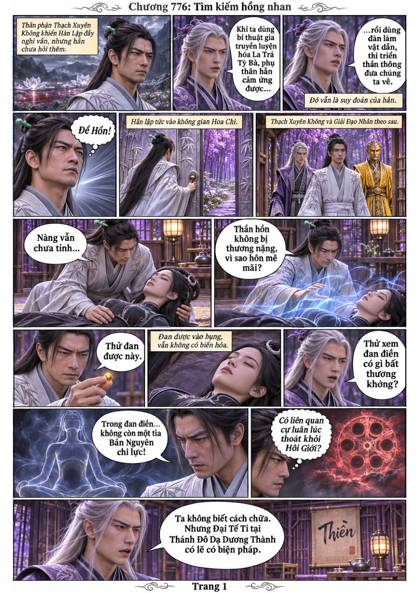
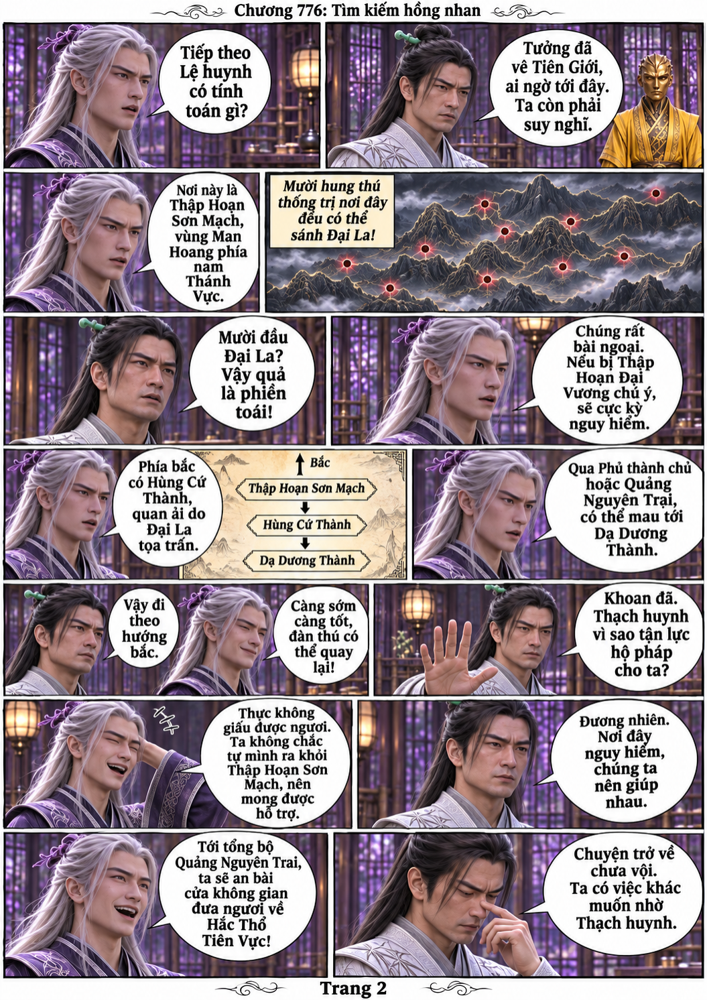
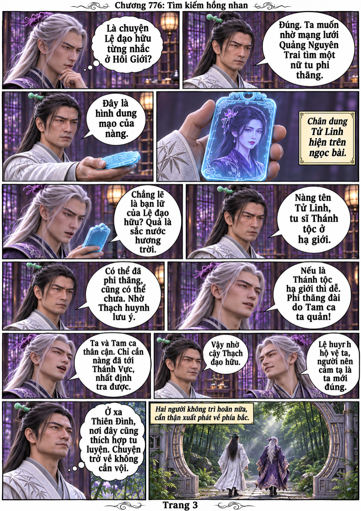
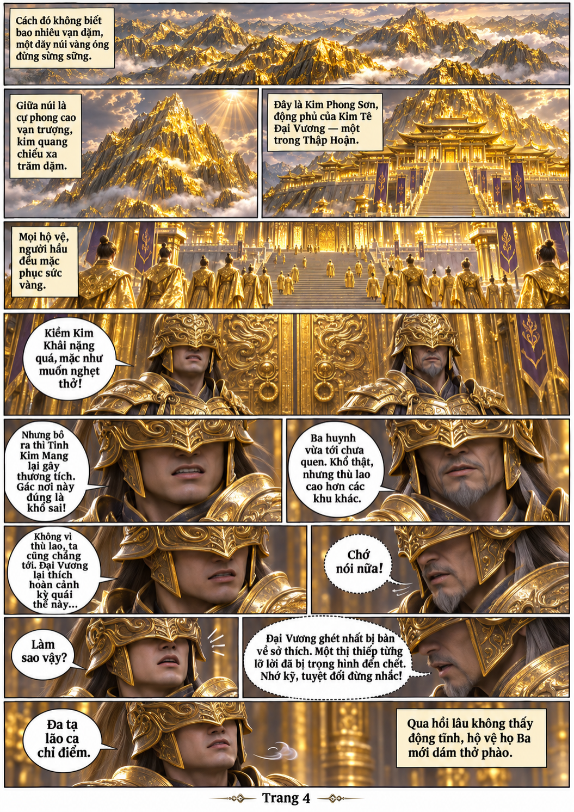

# Chương 776: Tìm kiếm hồng nhan

4 trang PNG riêng, tỉ lệ A4 dọc; chuyển thể từ văn bản người dùng đính kèm, có thoại, suy nghĩ và lời dẫn. Dùng model tham chiếu trong bộ nhớ dự án.

[PDF A4](chuong-776.pdf) · [Văn bản nguồn](SOURCE.txt)

Hàn Lập phát hiện Đề Hồn mất Bản Nguyên chi lực, đồng ý cùng Thạch Xuyên Không đi về phía bắc và nhờ Quảng Nguyên Trai tìm Tử Linh. Xa xa, Kim Phong Sơn hé lộ sự hà khắc của Kim Tê Đại Vương.

