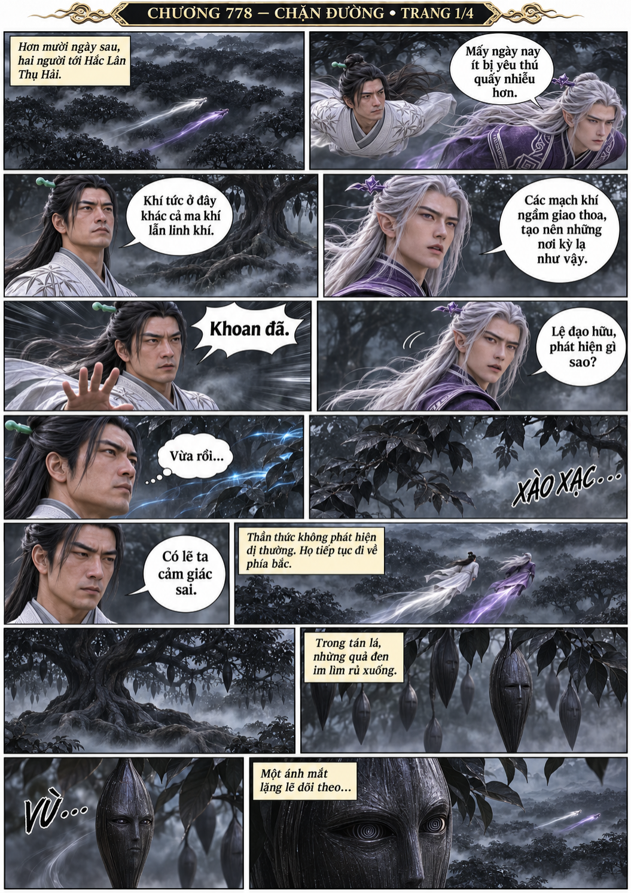
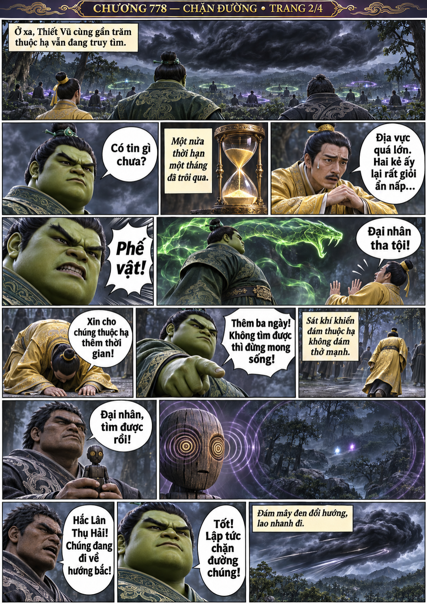
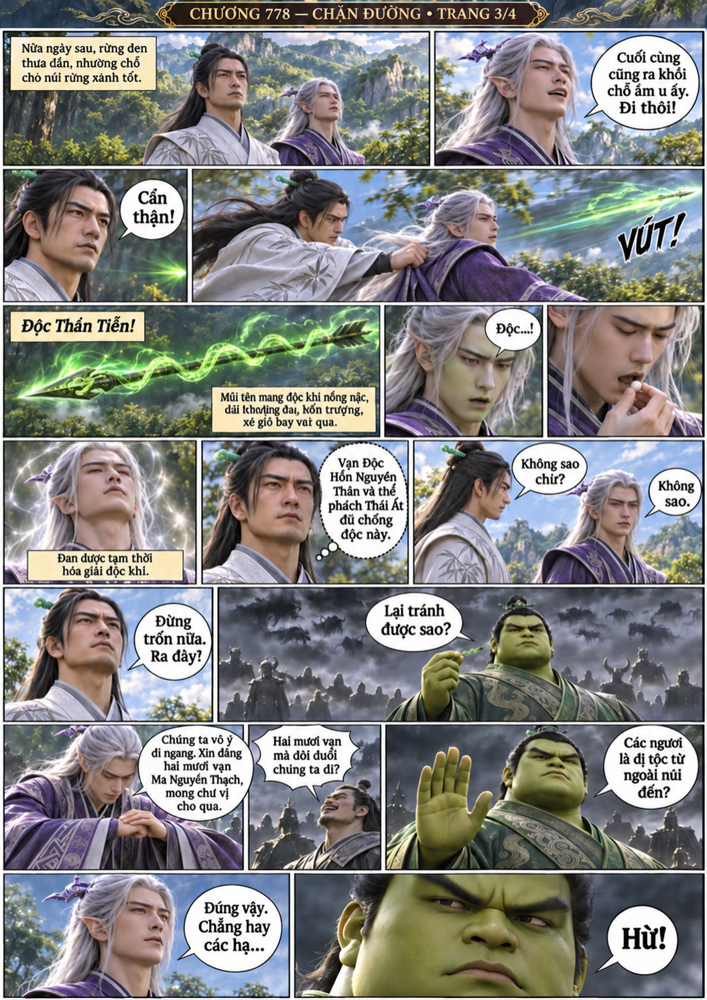
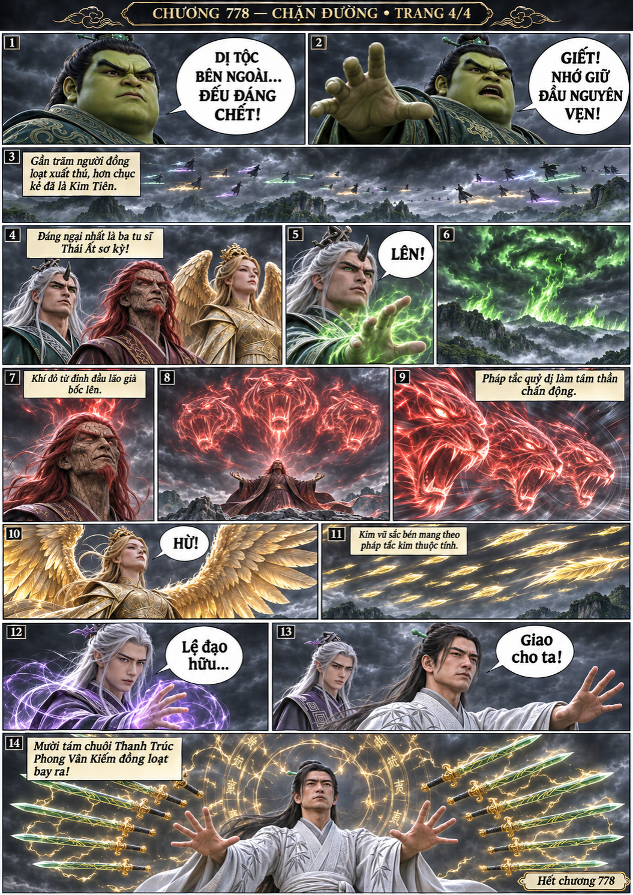

# Chương 778: Chặn đường

4 trang PNG riêng, tỉ lệ A4 dọc; chuyển thể từ văn bản người dùng đính kèm, có thoại, suy nghĩ và lời dẫn. Dùng model tham chiếu trong bộ nhớ dự án.

[PDF A4](chuong-778.pdf) · [Văn bản nguồn](SOURCE.txt)

Thiết Vũ dò tìm qua mộc ngẫu ở Hắc Lân Thụ Hải, phục kích bằng Độc Thần Tiễn. Ba tướng Thái Ất tấn công, Hàn Lập xuất 18 kiếm.

