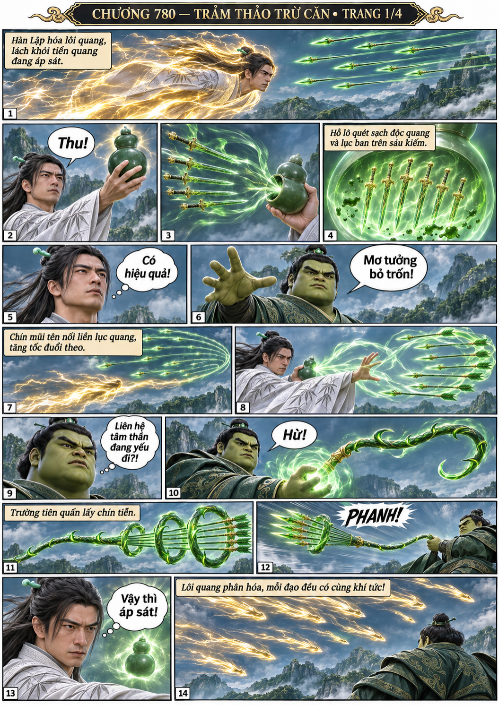
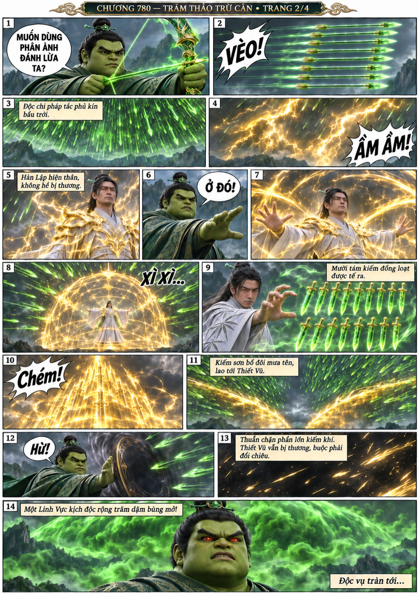
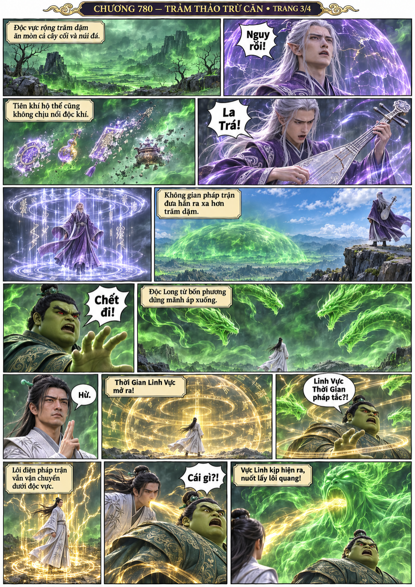
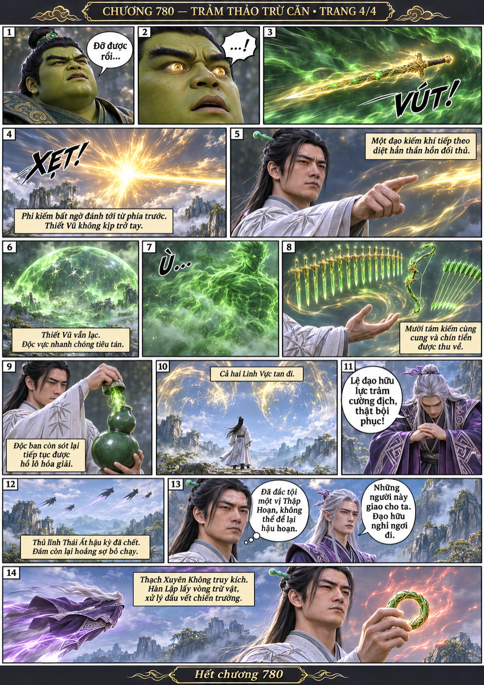

# Chương 780: Trảm thảo trừ căn

4 trang PNG riêng, tỉ lệ A4 dọc; chuyển thể từ văn bản người dùng đính kèm, có thoại, suy nghĩ và lời dẫn. Dùng model tham chiếu trong bộ nhớ dự án.

[PDF A4](chuong-780.pdf) · [Văn bản nguồn](SOURCE.txt)

Hồ lô hóa giải độc trên kiếm. Hàn Lập dùng Thời Gian Linh Vực và phi kiếm đánh bại Thiết Vũ; Thạch Xuyên Không truy kích nhóm còn lại.

