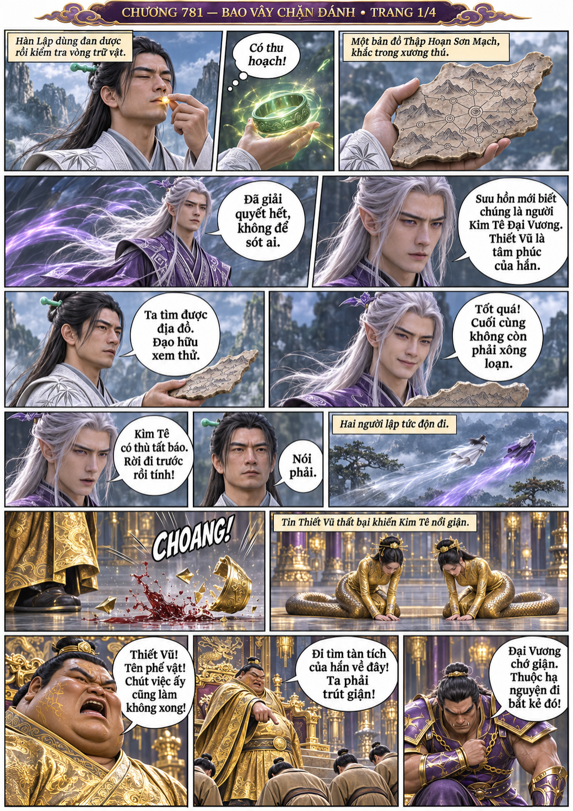
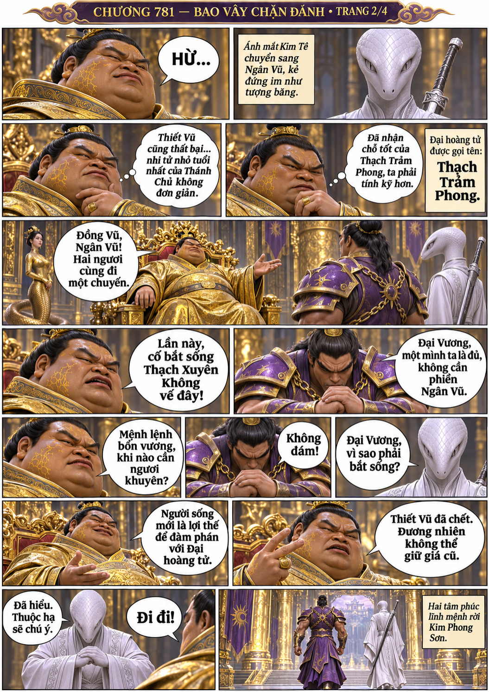
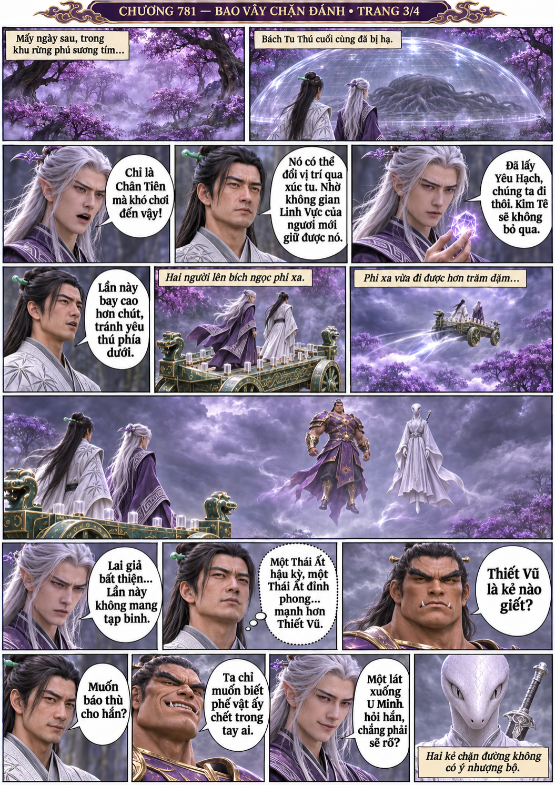
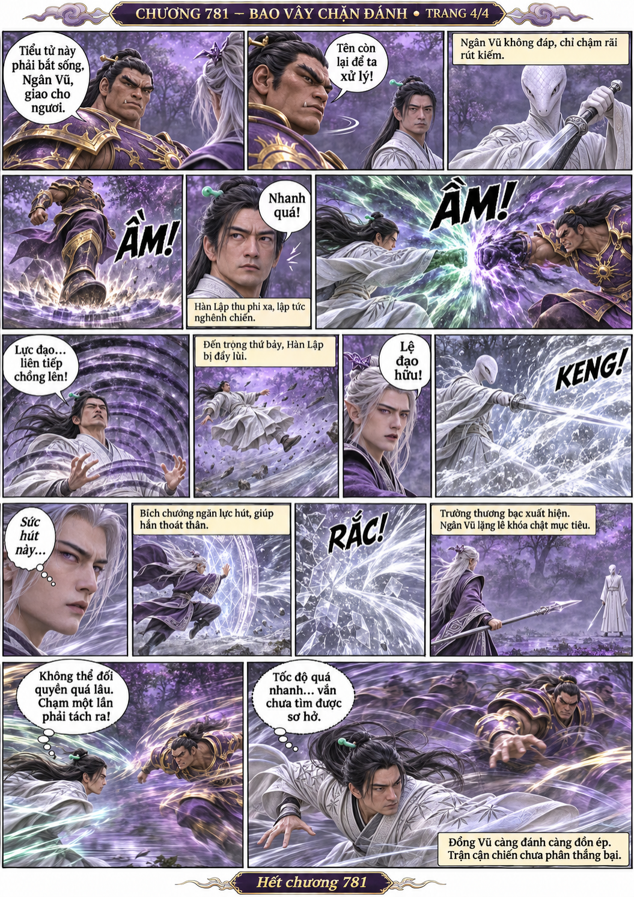

# Chương 781: Bao vây chặn đánh

4 trang PNG riêng, tỉ lệ A4 dọc; chuyển thể từ văn bản người dùng đính kèm, có thoại, suy nghĩ và lời dẫn. Dùng model tham chiếu trong bộ nhớ dự án.

[PDF A4](chuong-781.pdf) · [Văn bản nguồn](SOURCE.txt)

Lấy được địa đồ Thập Hoạn, hai người tiếp tục lên đường. Kim Tê phái Đồng Vũ và Ngân Vũ bắt sống Thạch Xuyên Không; hai cuộc giao chiến mới bắt đầu.

