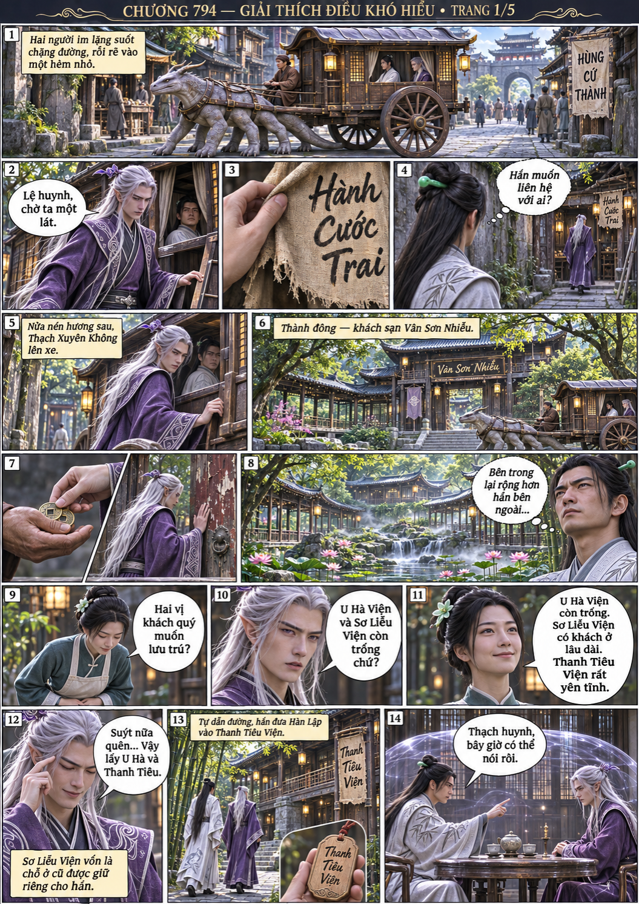
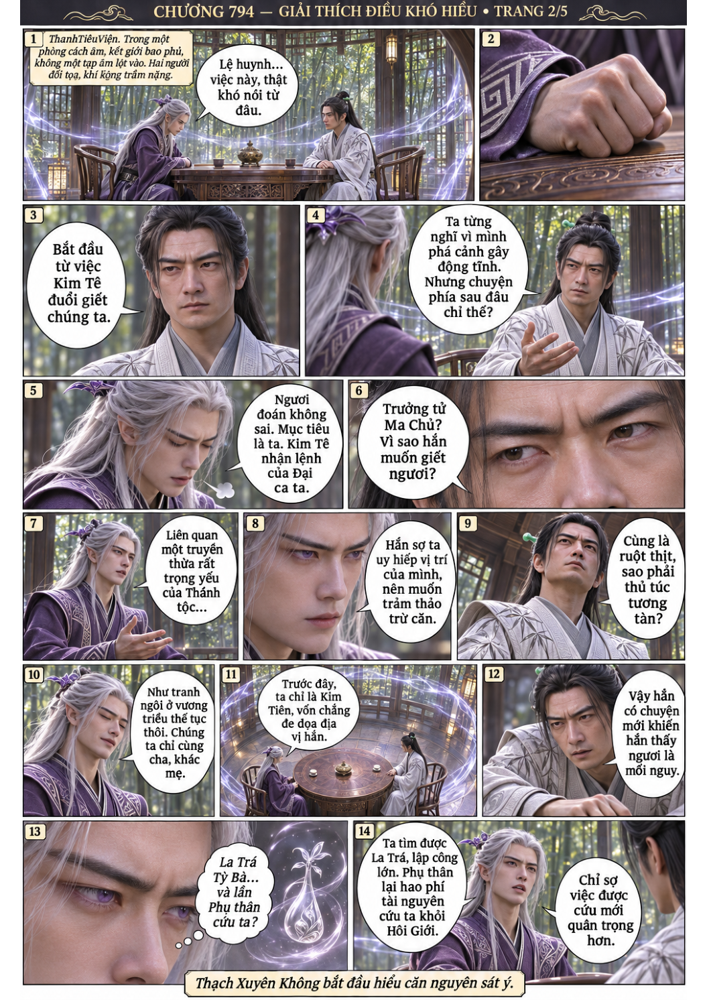
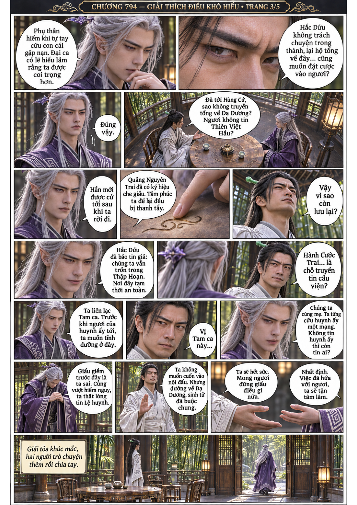
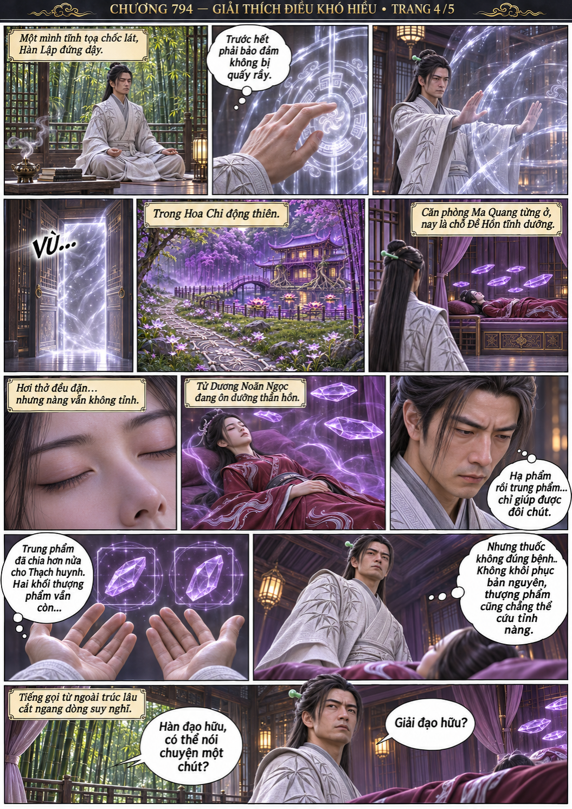
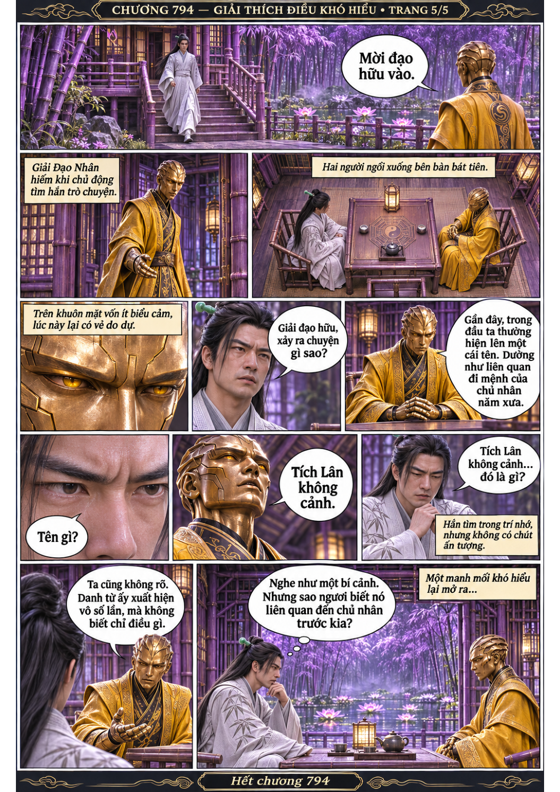

# Chương 794: Giải thích điều khó hiểu

5 trang PNG riêng, tỉ lệ A4 dọc; chuyển thể từ văn bản người dùng đính kèm, có thoại, suy nghĩ và lời dẫn. Dùng model tham chiếu trong bộ nhớ dự án.

[PDF A4](chuong-794.pdf) · [Văn bản nguồn](SOURCE.txt)

Hàn Lập và Thạch Xuyên Không giải tỏa khúc mắc về truy sát và cuộc tranh quyền; Đề Hồn vẫn hôn mê, Giải Đạo Nhân nhắc Tích Lân không cảnh.

