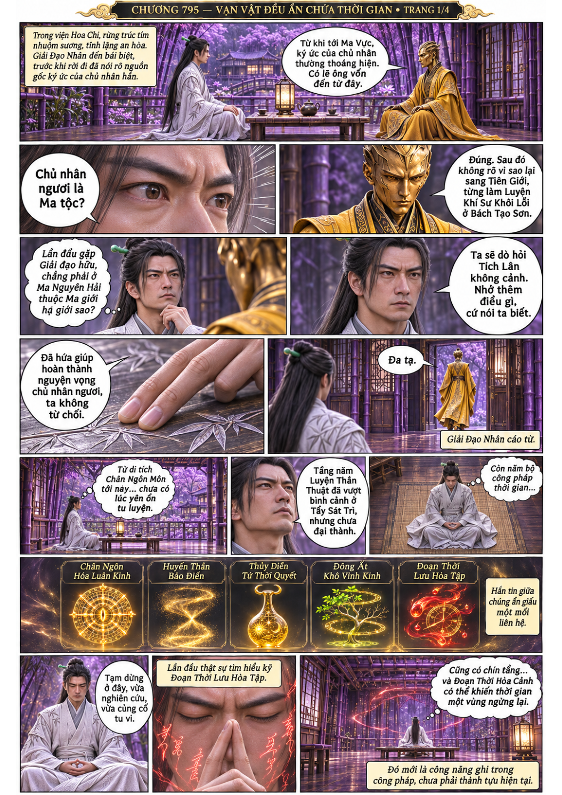
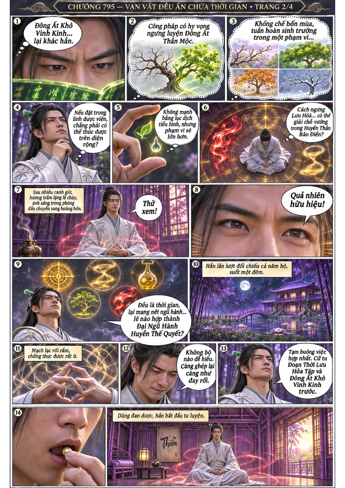
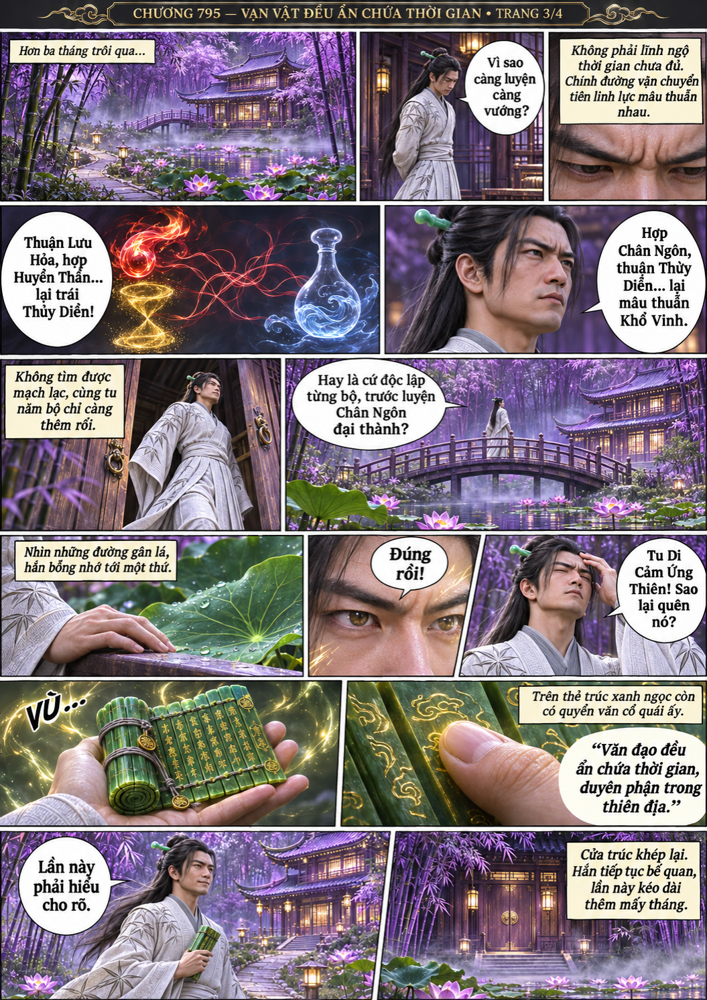
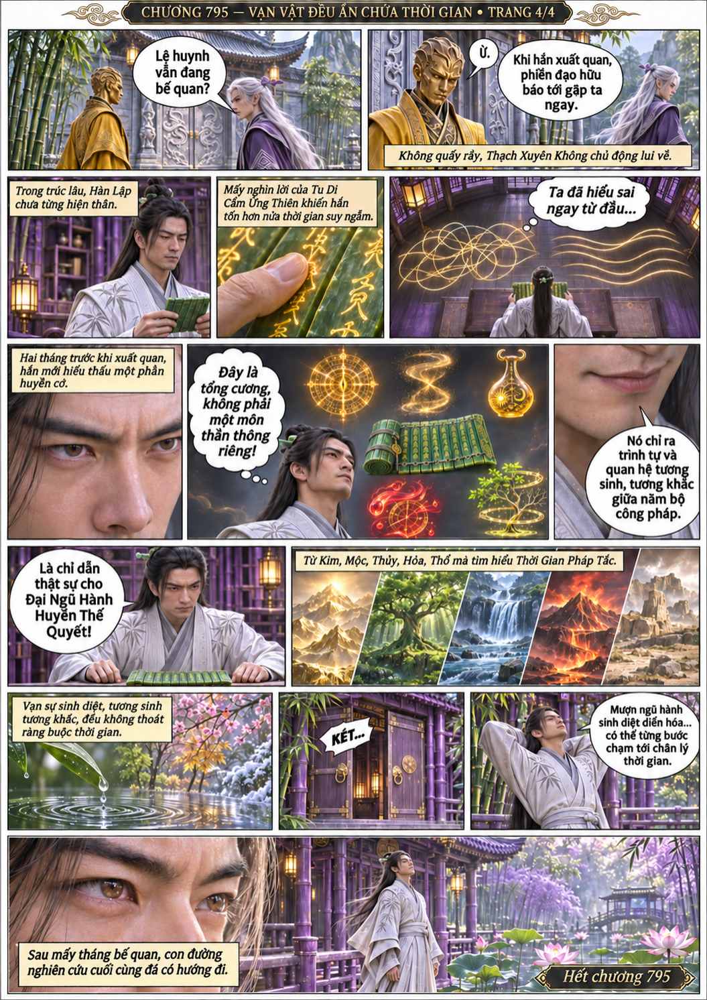

# Chương 795: Vạn vật đều ẩn chứa thời gian

4 trang PNG riêng, tỉ lệ A4 dọc; chuyển thể từ văn bản người dùng đính kèm, có thoại, suy nghĩ và lời dẫn. Dùng model tham chiếu trong bộ nhớ dự án.

[PDF A4](chuong-795.pdf) · [Văn bản nguồn](SOURCE.txt)

Giải Đạo Nhân kể ký ức về chủ nhân. Sau nhiều tháng nghiên cứu năm bộ công pháp, Hàn Lập hiểu Tu Di Cảm Ứng Thiên là tổng cương liên kết chúng.

