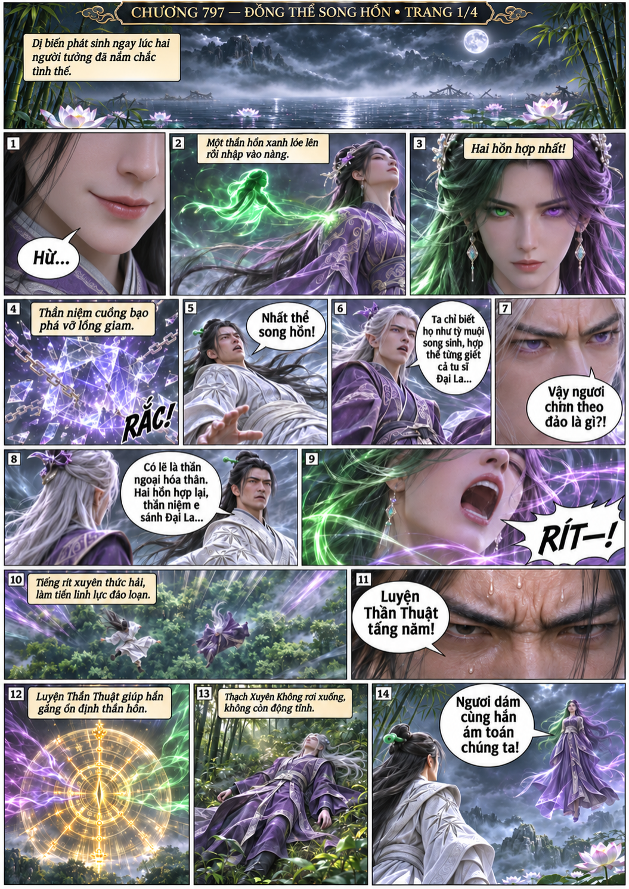
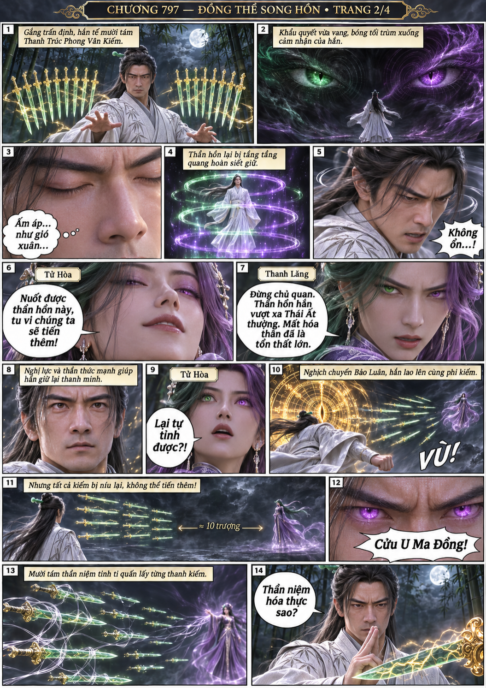
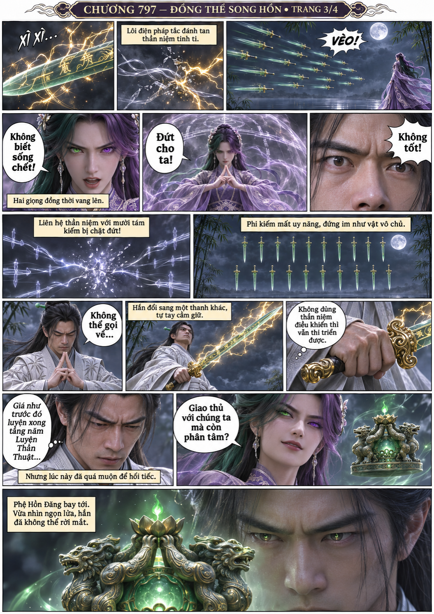
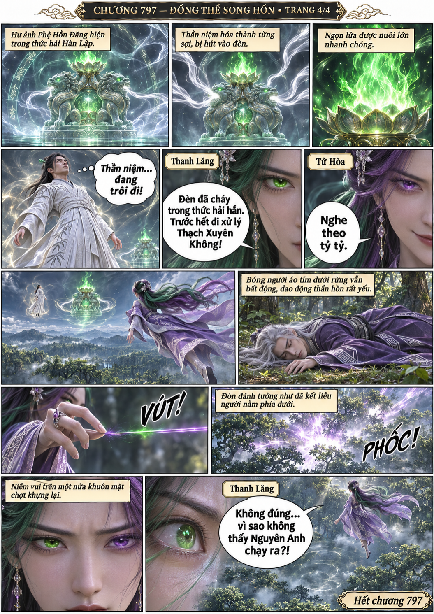

# Chương 797: Đồng thể song hồn

4 trang PNG riêng, tỉ lệ A4 dọc; chuyển thể từ văn bản người dùng đính kèm, có thoại, suy nghĩ và lời dẫn. Dùng model tham chiếu trong bộ nhớ dự án.

[PDF A4](chuong-797.pdf) · [Văn bản nguồn](SOURCE.txt)

Hai hồn dung hợp phá lồng giam, phong tỏa thần thức và dùng Phệ Hồn Đăng. Hàn Lập bị hút thần niệm; đòn đánh vào người nằm dưới rừng dẫn tới nghi vấn.

