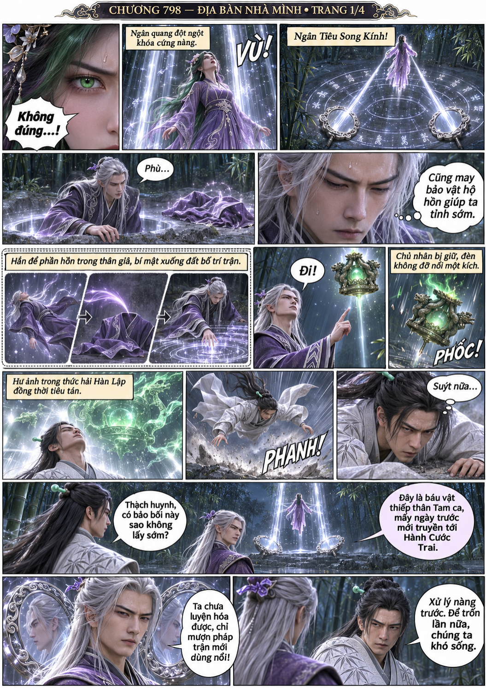
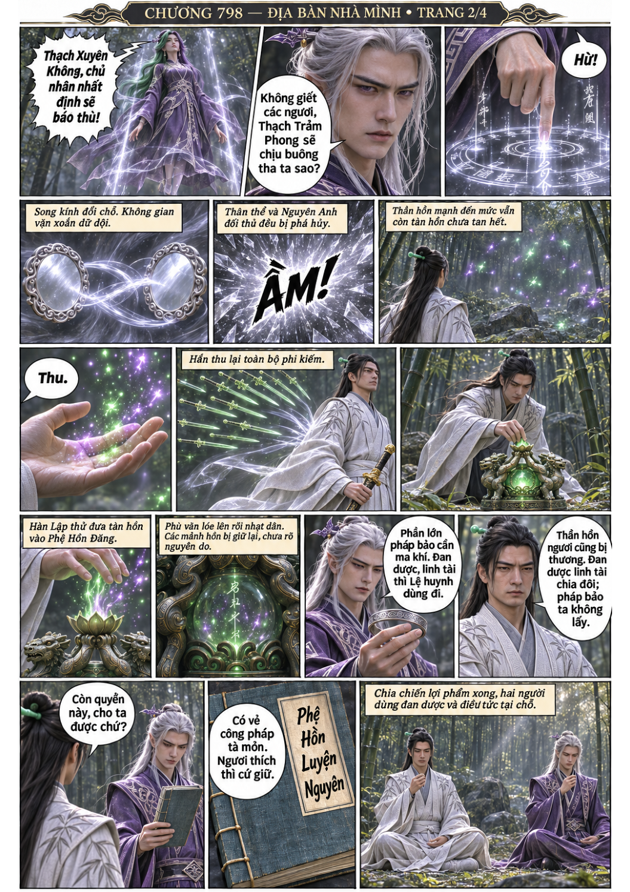
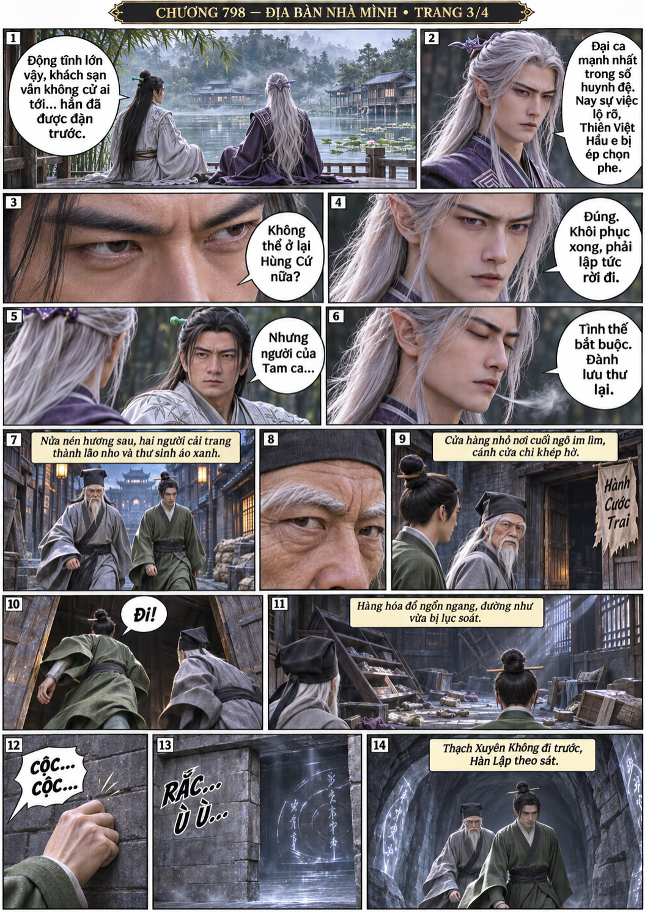
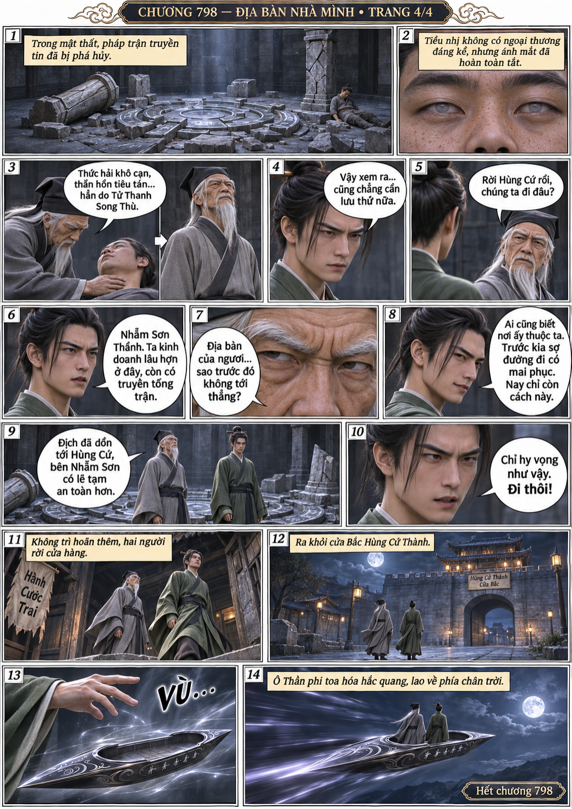

# Chương 798: Địa bàn nhà mình

4 trang PNG riêng, tỉ lệ A4 dọc; chuyển thể từ văn bản người dùng đính kèm, có thoại, suy nghĩ và lời dẫn. Dùng model tham chiếu trong bộ nhớ dự án.

[PDF A4](chuong-798.pdf) · [Văn bản nguồn](SOURCE.txt)

Thạch Xuyên Không dùng Song Kính giải vây, hai người xử lý đối thủ và thu chiến lợi phẩm. Phát hiện đường liên lạc bị phá, họ cải trang rời Hùng Cứ đi Nhẫm Sơn.

