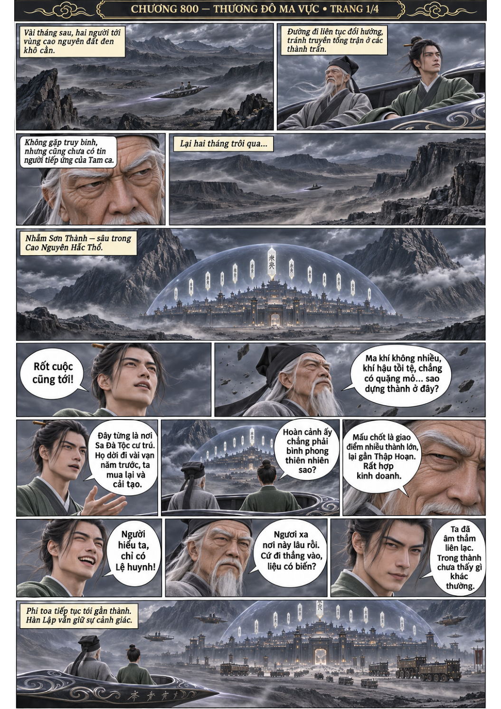
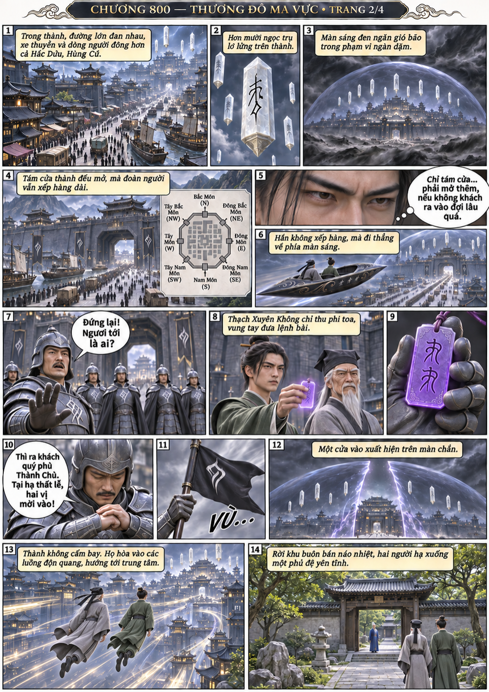
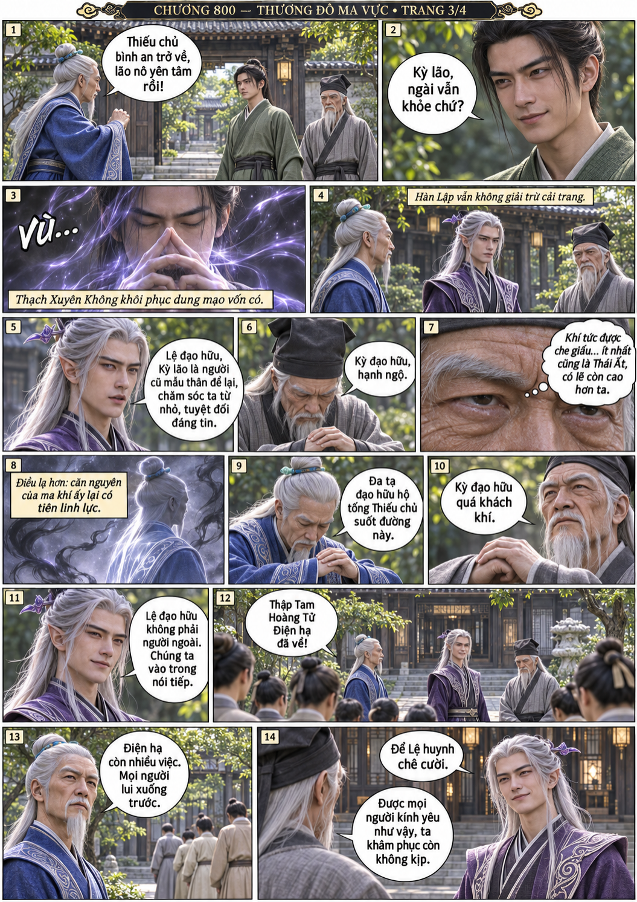
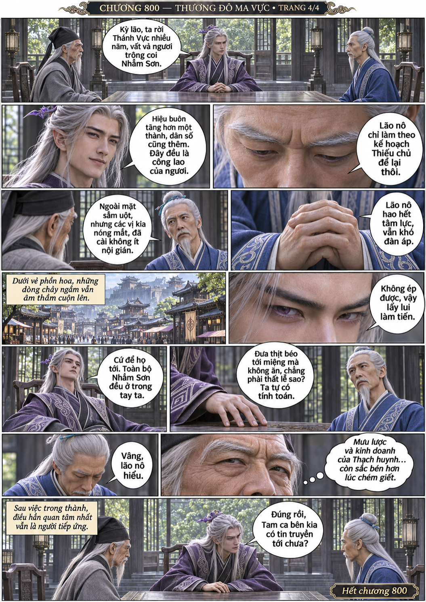

# Chương 800: Thương đô Ma Vực

4 trang PNG riêng, tỉ lệ A4 dọc; chuyển thể từ văn bản người dùng đính kèm, có thoại, suy nghĩ và lời dẫn. Dùng model tham chiếu trong bộ nhớ dự án.

[PDF A4](chuong-800.pdf) · [Văn bản nguồn](SOURCE.txt)

Qua cao nguyên Hắc Thổ, hai người tới Nhẫm Sơn Thành và gặp Kỳ lão. Sau vẻ phồn hoa là nội gián và dòng chảy ngầm; Thạch Xuyên Không tự có kế hoạch ứng phó.

