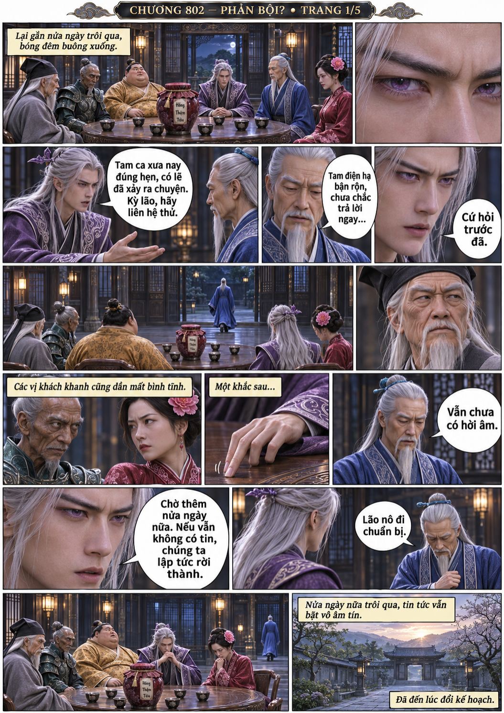
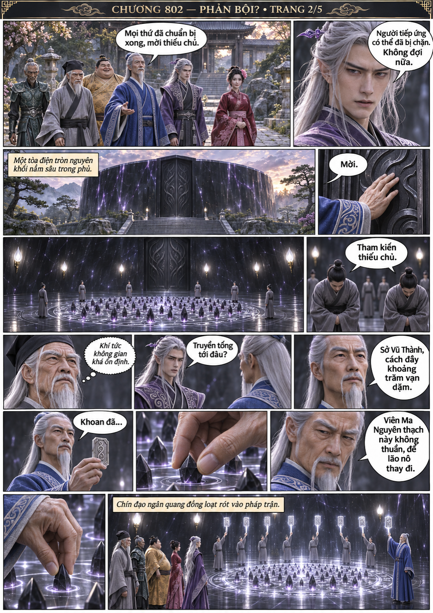
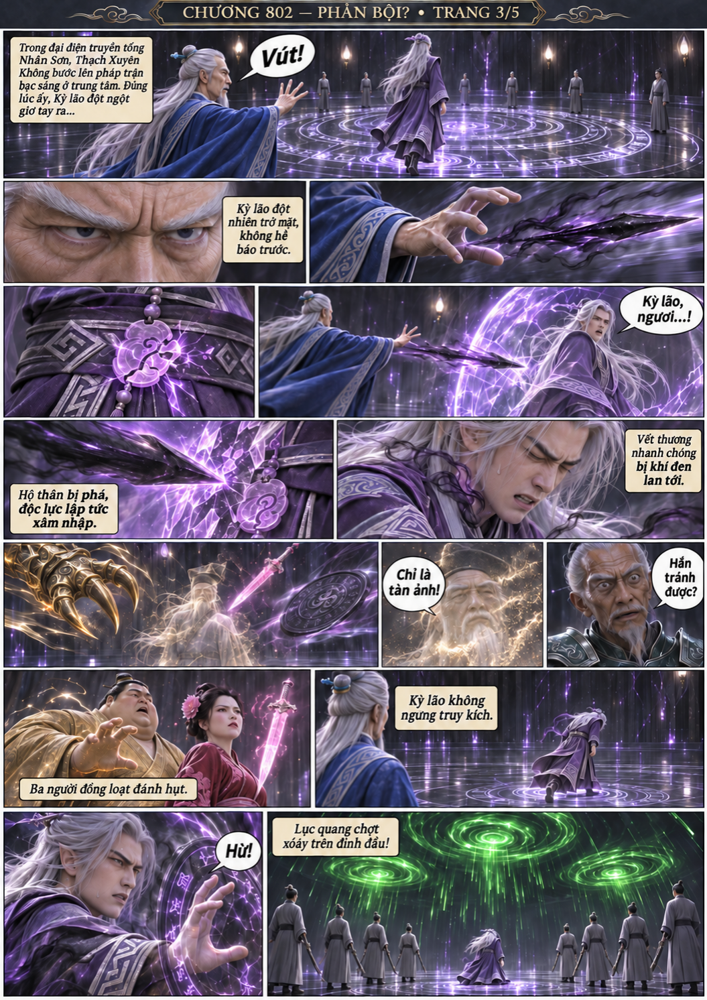
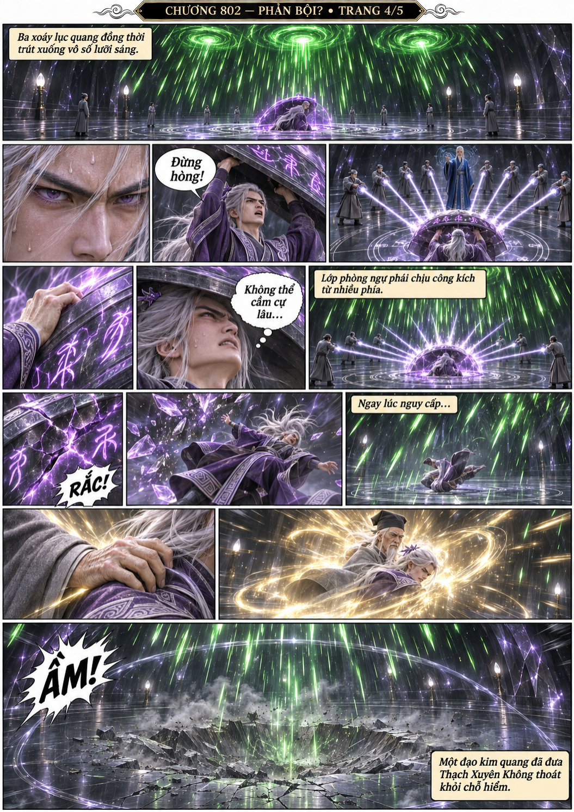
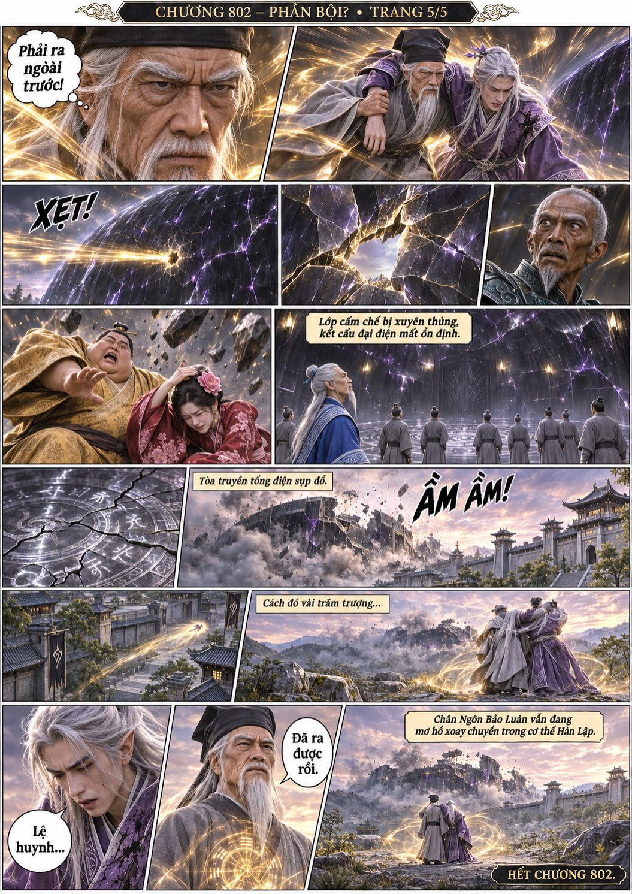

# Chương 802: Phản bội?

5 trang PNG riêng, tỉ lệ A4 dọc; chuyển thể từ văn bản người dùng đính kèm, có thoại, suy nghĩ và lời dẫn. Dùng model tham chiếu trong bộ nhớ dự án.

[PDF A4](chuong-802.pdf) · [Văn bản nguồn](SOURCE.txt)

Không nhận được tin tiếp ứng, Thạch Xuyên Không quyết định truyền tống rời thành. Kỳ lão và các khách khanh bất ngờ ra tay; Hàn Lập cứu Thạch khỏi đại điện đang sụp đổ.

