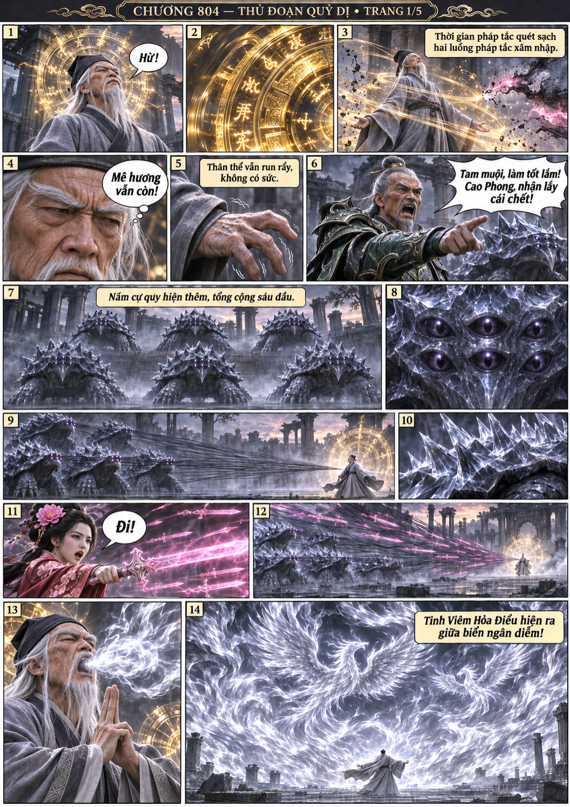
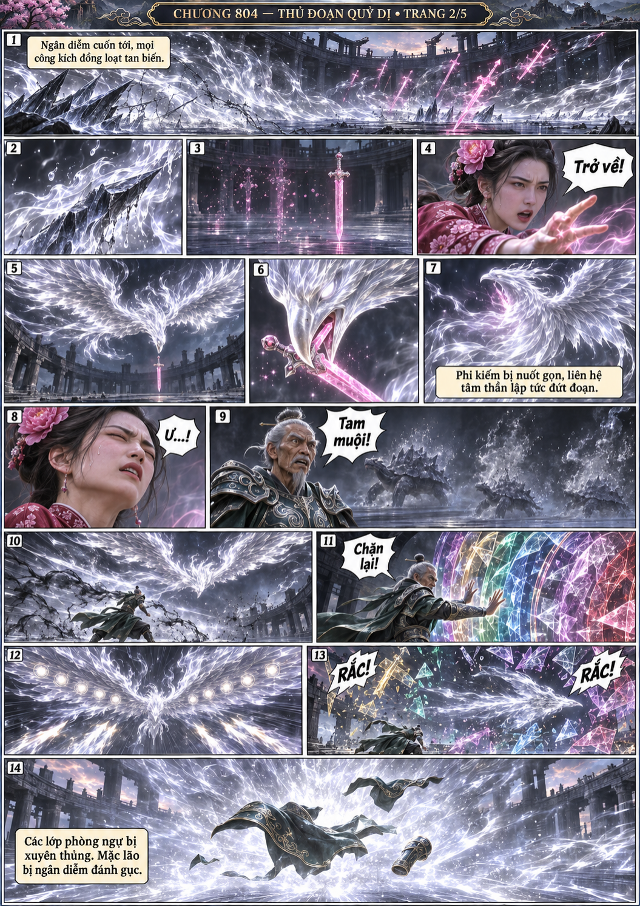
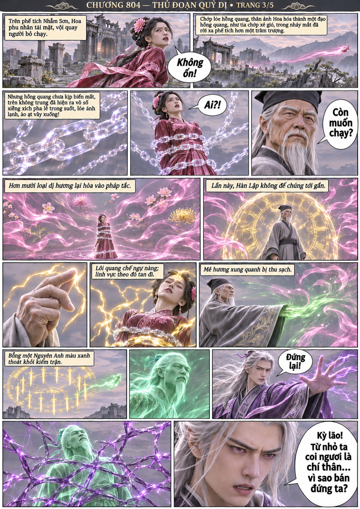
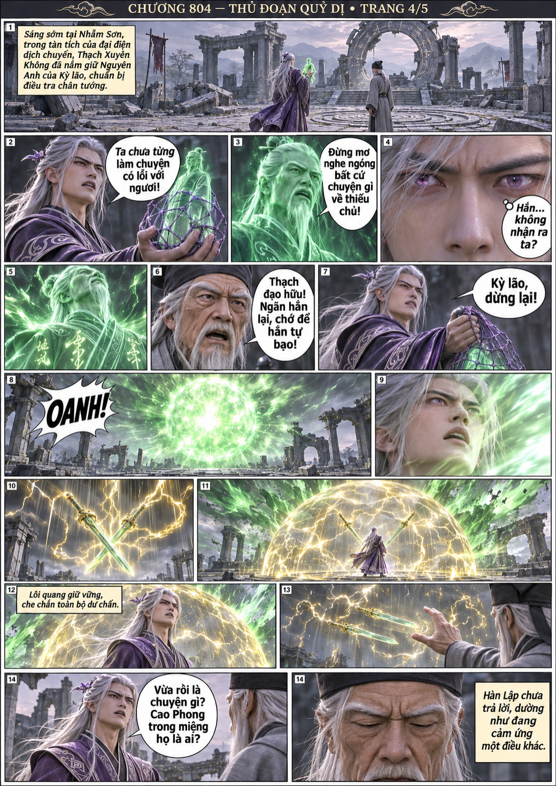
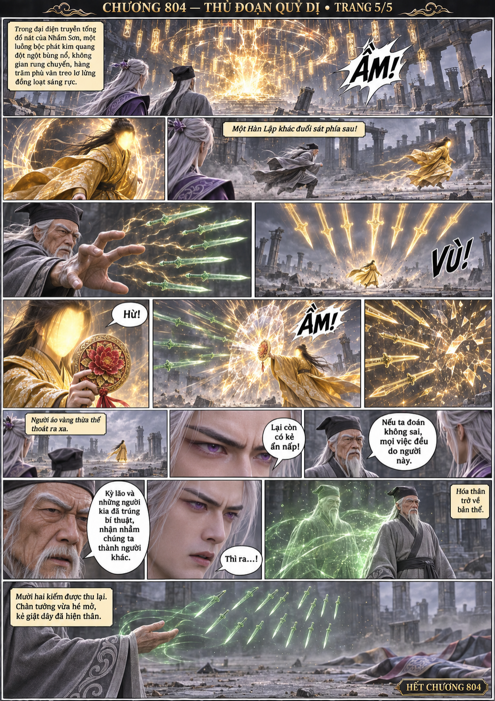

# Chương 804: Thủ đoạn quỷ dị

5 trang PNG riêng, tỉ lệ A4 dọc; chuyển thể từ văn bản người dùng đính kèm, có thoại, suy nghĩ và lời dẫn. Dùng model tham chiếu trong bộ nhớ dự án.

[PDF A4](chuong-804.pdf) · [Văn bản nguồn](SOURCE.txt)

Tinh Viêm Hỏa Điểu phá thế công của hai khách khanh. Nguyên Anh Kỳ lão tự bạo trong hiểu lầm; Hàn Lập bảo vệ Thạch Xuyên Không rồi phát hiện người điều khiển đứng sau.

