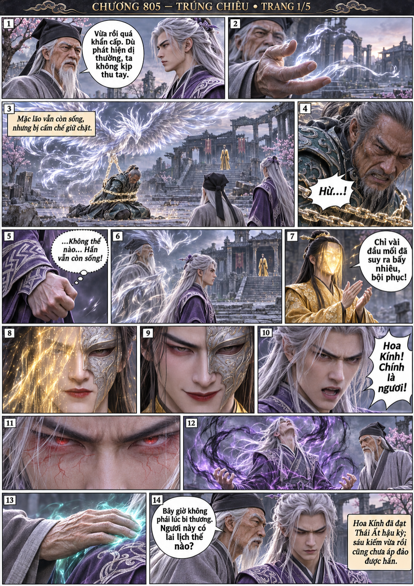
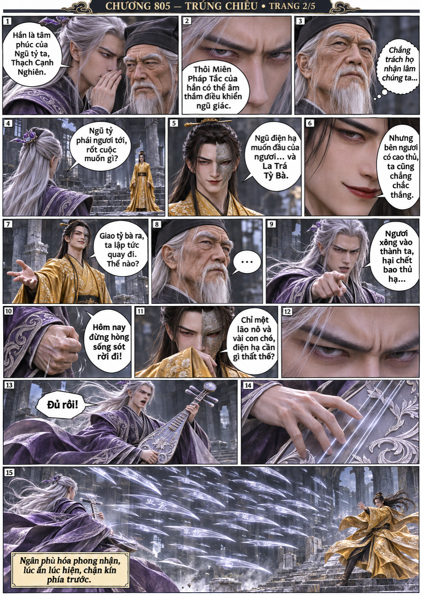
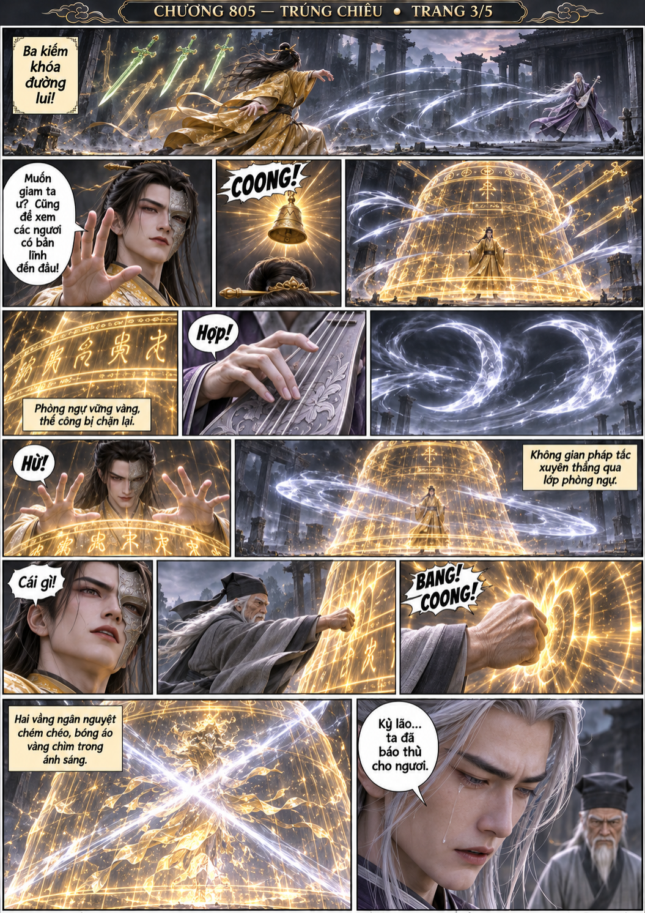
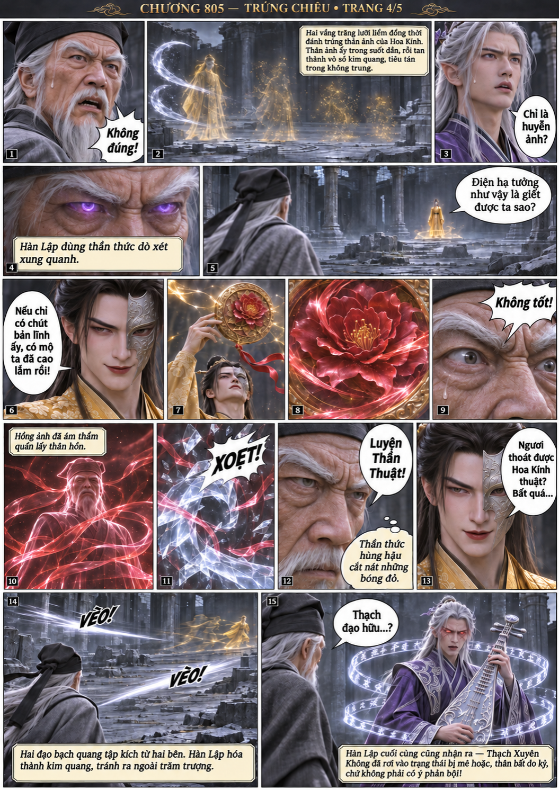
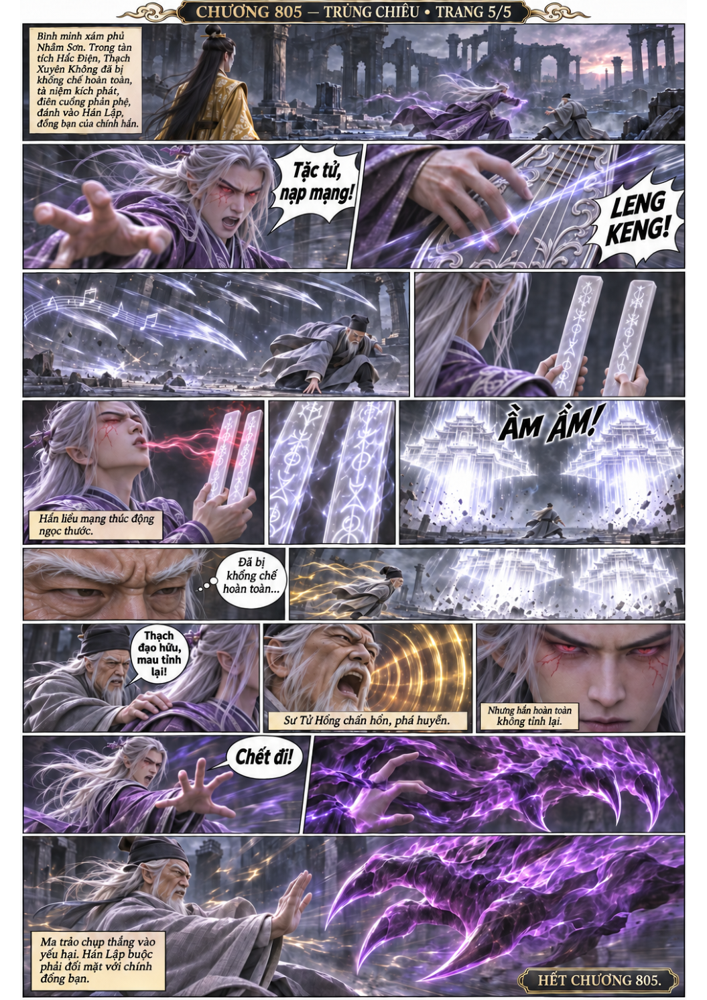

# Chương 805: Trúng chiêu

5 trang PNG riêng, tỉ lệ A4 dọc; chuyển thể từ văn bản người dùng đính kèm, có thoại, suy nghĩ và lời dẫn. Dùng model tham chiếu trong bộ nhớ dự án.

[PDF A4](chuong-805.pdf) · [Văn bản nguồn](SOURCE.txt)

Hoa Kính lộ danh tính và mục đích lấy La Trá Tỳ Bà. Đòn phối hợp của hai người chỉ đánh trúng huyễn ảnh; Hàn thoát khỏi thôi miên, nhưng Thạch Xuyên Không đã bị điều khiển.

