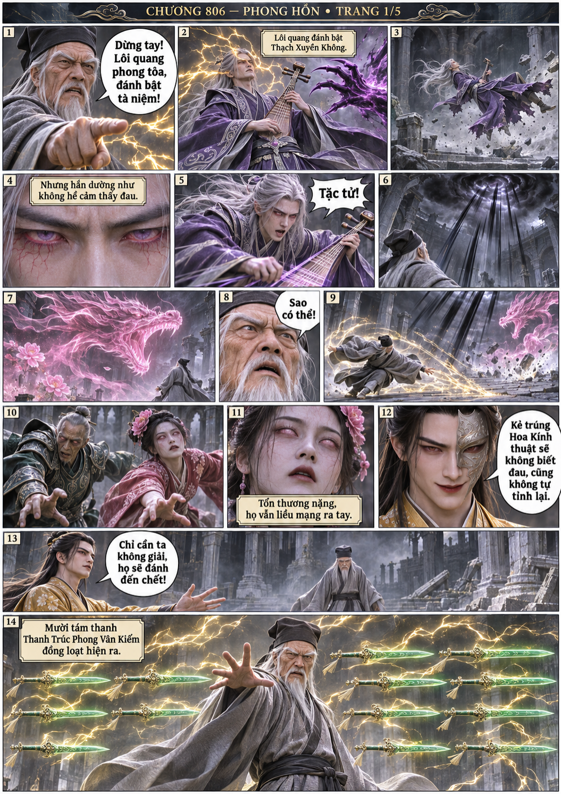
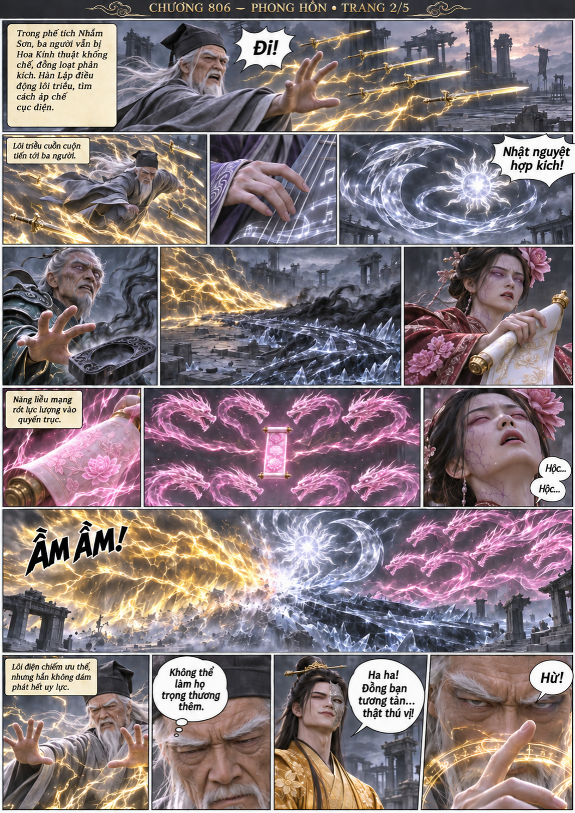
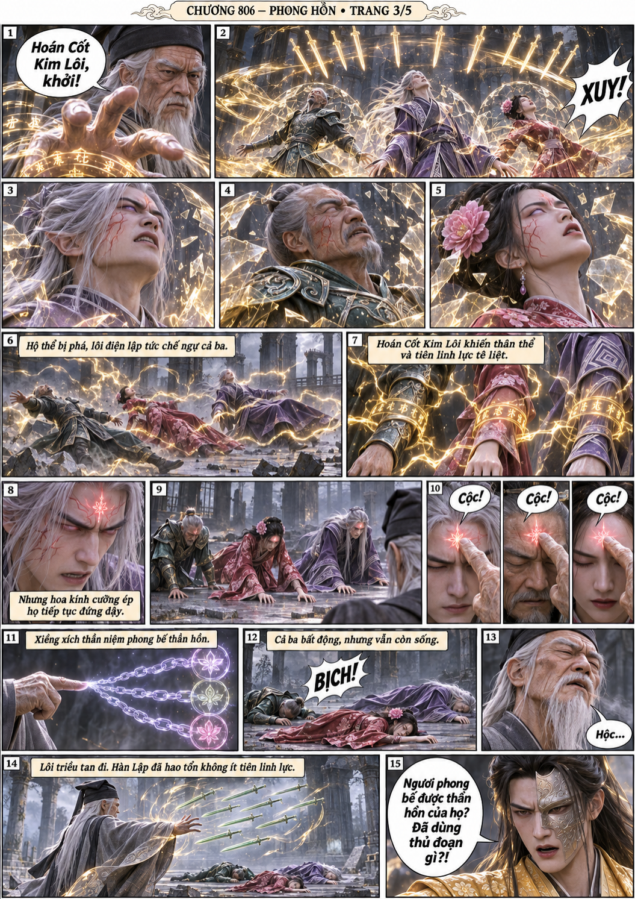
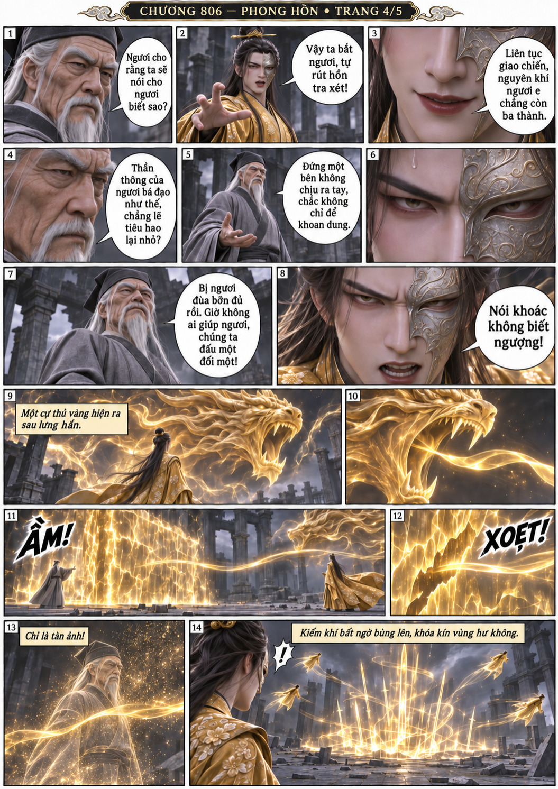
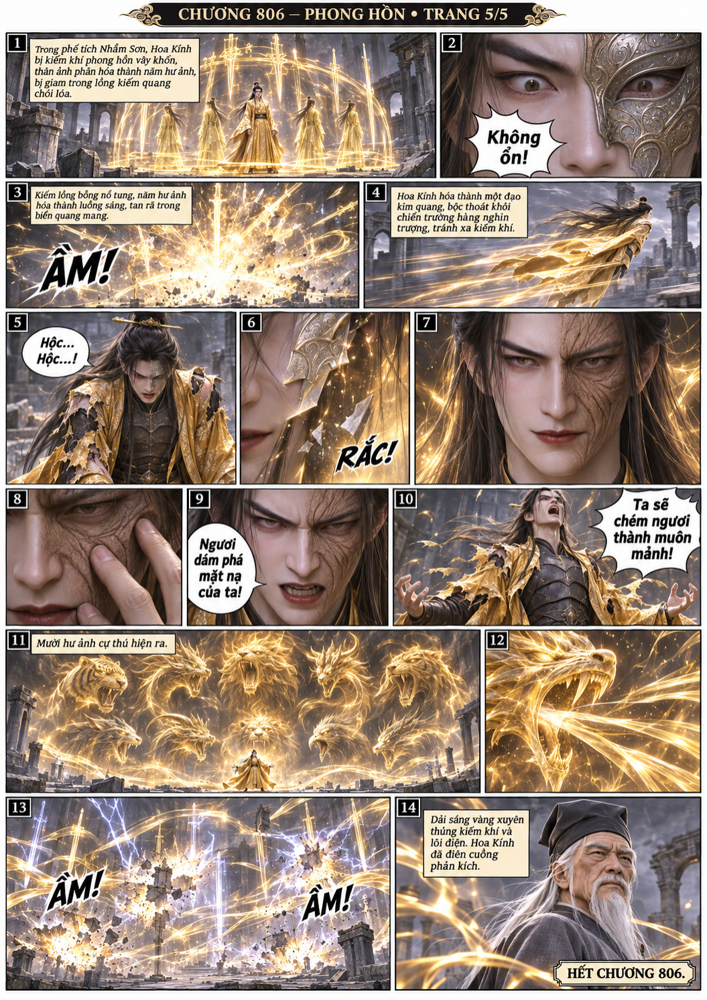

# Chương 806: Phong hồn

5 trang PNG riêng, tỉ lệ A4 dọc; chuyển thể từ văn bản người dùng đính kèm, có thoại, suy nghĩ và lời dẫn. Dùng model tham chiếu trong bộ nhớ dự án.

[PDF A4](chuong-806.pdf) · [Văn bản nguồn](SOURCE.txt)

Hàn Lập dùng lôi triều và xiềng xích thần niệm chế ngự ba người bị thôi miên. Cuộc đấu riêng với Hoa Kính làm vỡ nửa mặt nạ bạc, khiến đối thủ điên cuồng phản kích.

