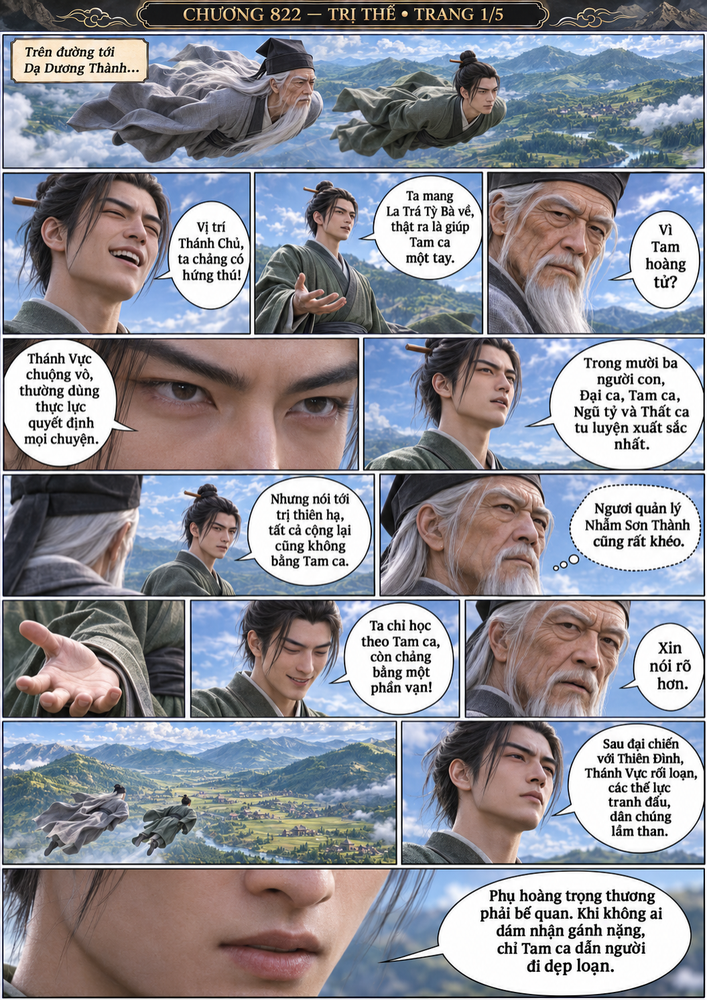
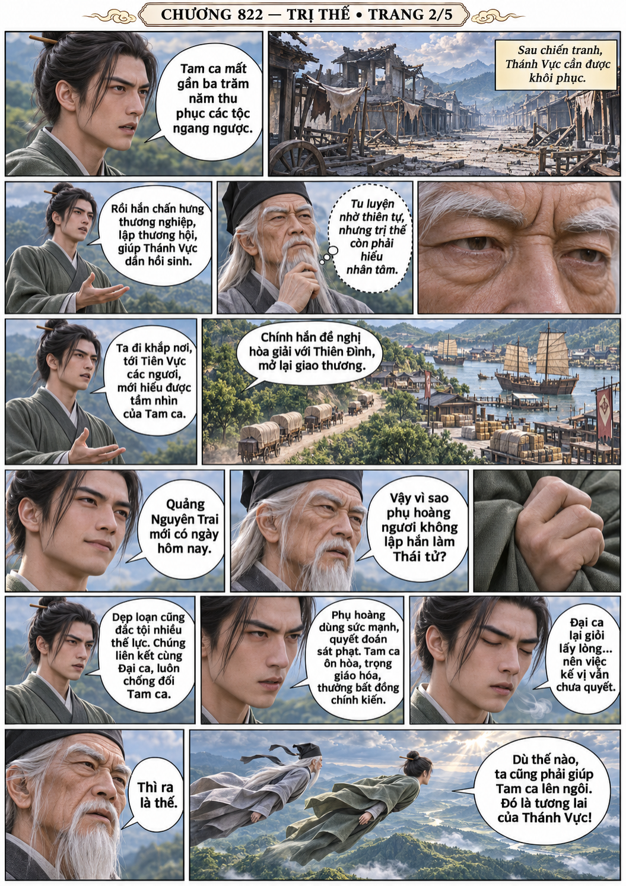
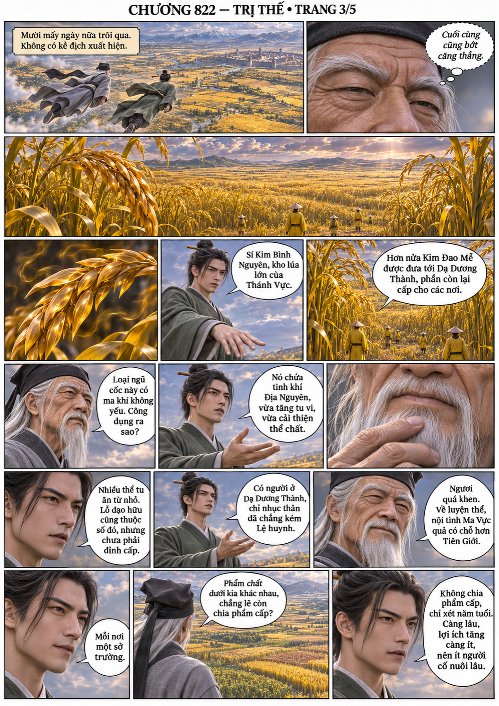
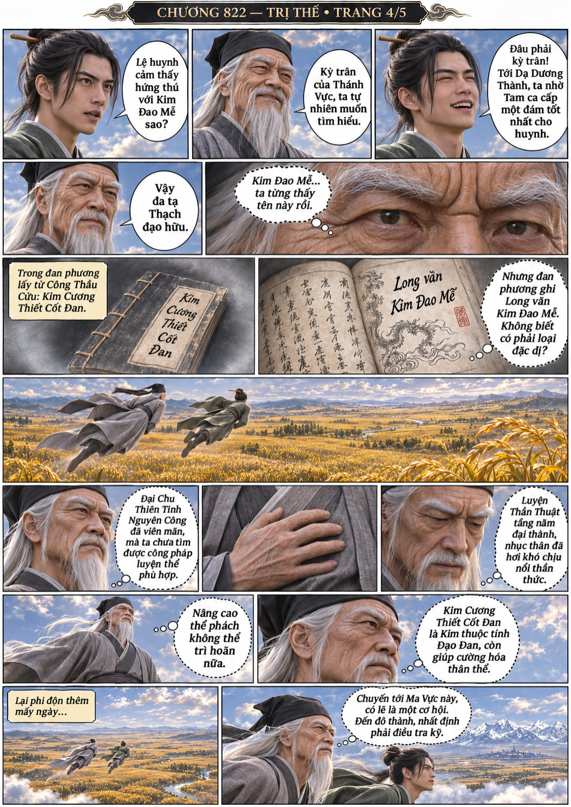
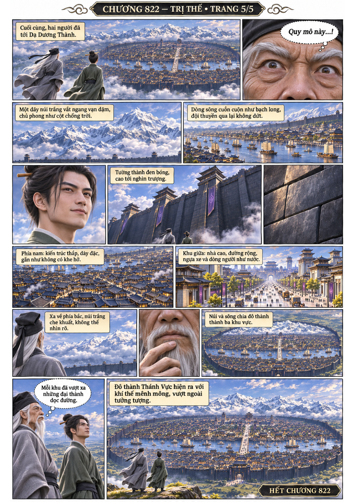

# Chương 822: Trị thế

5 trang PNG riêng, tỉ lệ A4 dọc; chuyển thể từ văn bản người dùng đính kèm, có thoại, suy nghĩ và lời dẫn. Dùng model tham chiếu trong bộ nhớ dự án.

[PDF A4](chuong-822.pdf) · [Văn bản nguồn](SOURCE.txt)

Trên đường đến Dạ Dương Thành, Thạch Xuyên Không giải thích lý do ủng hộ Tam ca. Kim Đao Mễ gợi cho Hàn Lập một hướng luyện thể; đô thành Thánh Vực dần hiện ra.

